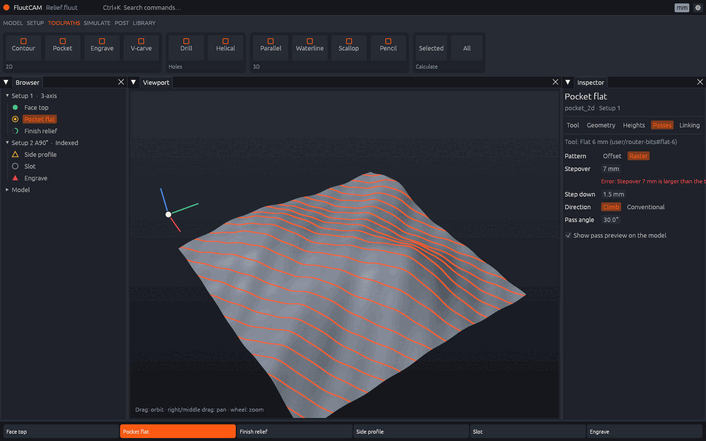
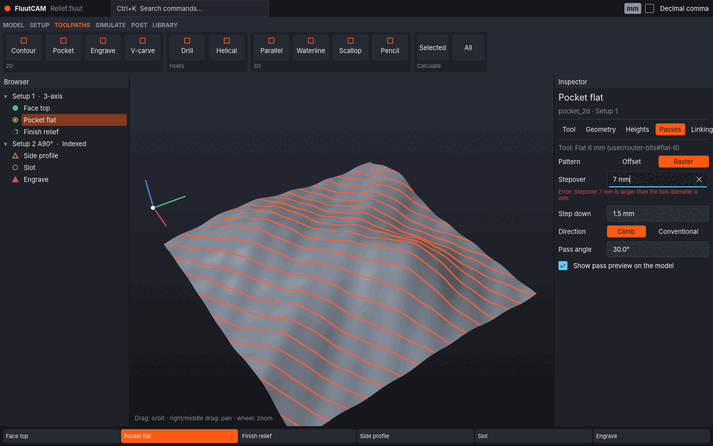

# S4 — UI Toolkit Spike Report

Date: 2026-11-01. Plan: [`../2026-11-01-s4-ui-toolkit.md`](../2026-11-01-s4-ui-toolkit.md).
Code (outside the workspace, each with its own `[workspace]`):
- `spikes/s4-common`: what both prototypes share. Generated mesh, orbit camera, `wgpu` viewport renderer, mock data shaped like D15, brand colours, measurement harness;
- `spikes/s4-egui`: `eframe`/`egui` 0.36 with `egui_dock` 0.21;
- `spikes/s4-slint`: `slint` 1.18 with its `wgpu` 30 renderer (FemtoVG by default, Skia with `--features skia`).

Measurement tools:
- `spikes/s4-common/measure.sh` (frame time, startup, idle CPU, size, lines of code; `build` for clean build times);
- `cargo run --release --example viewport_bench` in `spikes/s4-common` (the renderer alone, no toolkit).
- `spikes/s4-common/a11y/run.sh` (dumps a prototype's AT-SPI accessibility tree).

**The decision (OQ-09) belongs to the product owner.** This report gives the evidence and a recommendation (§8).

## 1. What was built

Both prototypes show the same window (S 08 §8.2), with the same mock data and the same renderer:

| Part | Both prototypes |
|---|---|
| Title bar | logo dot, project name, command search field, units badge (click: mm ↔ in), decimal-comma setting |
| Ribbon | six stage tabs; groups per stage; on Toolpaths, galleries of toolpath types (S 08 §8.3) |
| Browser | two Setups with toolpaths; a status icon per state (S 08 §8.6), each a different shape so colour is not the only signal |
| Viewport | `wgpu` texture: shaded relief of 999 698 triangles, 4× MSAA, gradient background; orbit (left drag), pan (right or middle drag), zoom (wheel); overlay work-zero triad with a hover handle |
| Inspector | `pocket_2d` `passes` fields from D15 §4.1: `pattern`, `stepover`, `step_down`, `direction`, `offset_order` / `pass_angle_deg` (shown by `pattern`). Numeric fields scrub by dragging and accept expressions with units (`tool.diameter*0.4`, `1/4"`, `2,5`). D15 §4.2 messages appear under their field |
| Pass preview (CH-23) | raster lines at `stepover` and `pass_angle_deg`, draped on the mesh in the fragment shader; they follow scrubbing live |
| Timeline | one clip per toolpath |

Differences:
- **Docking.** egui's panels are `egui_dock` tabs. Moving the Inspector tab into the Viewport's tab group was tested. Slint has no docking, so its panels are a fixed layout.
- **Rendering path.** In egui the texture is registered with `egui_wgpu` (`register_native_texture`). In slint it is imported with `slint::Image::try_from(wgpu::Texture)` each time it is redrawn.

Screenshots: both after typing `tool.diameter+1` into Stepover (7 mm > 6 mm tool, so D15 error `param.passes.stepover.max` shows):

| egui | slint |
|---|---|
|  |  |

## 2. Measurements

**Machine:** cloud VM, 4 vCPU Intel Xeon at 2.1 GHz, Linux 6.18, no GPU. Xvfb display with Mesa 25.2.8 lavapipe (Vulkan on the CPU, LLVM 20). Window 1440 × 900 at scale 1.
**Build:** release, `lto = "thin"`, `codegen-units = 1`.
**Method:** `measure.sh`, run with nothing else on the machine.
- *Frame time*: `S4_BENCH` orbits the camera every frame and redraws continuously. It records the interval between frame starts for 100 frames after 20 warm-up frames. Both toolkits use `wgpu`'s `AutoVsync` present mode; Xvfb does not throttle it.
- *Startup*: from the first line of `main` to the start of the second frame (the first has been presented). Median of 5 runs. Includes generating the mesh: 50 ms for 1 M triangles.

| Measure | egui | slint (FemtoVG, default) | slint (Skia) |
|---|---|---|---|
| Frame time, orbiting 1 M triangles, median / p95 | **215 / 253 ms** | 406 / 479 ms | 222 / 262 ms |
| Frame time, 4 802 triangles (UI cost), median / p95 | 28 / 46 ms | 214 / 273 ms | **21 / 39 ms** |
| Same, with a 200-toolpath tree (10 × 20) | 33 / 41 ms | 372 / 432 ms | **26 / 32 ms** |
| Idle CPU over 10 s | 0 ticks (< 0.1 %) | 0 ticks (< 0.1 %) | 0 ticks (< 0.1 %) |
| Memory when idle (RSS, 1 M mesh) | 384 MB | 392 MB | 335 MB |
| Startup, 1 M triangles | **205 ms** | 775 ms | 600 ms |
| Startup, 4 802 triangles | **133 ms** | 506 ms | 269 ms |
| Release binary / stripped | **21.2 / 17.6 MB** | 27.8 / 23.3 MB | 34.8 / 28.8 MB |
| Crates in the build (normal dependencies) | **449** | 634 | 634 + Skia (C++) |
| Clean release build, 4 cores | **168 s** | 240 s | 261 s (includes downloading the Skia binaries) |

**The renderer alone** (`viewport_bench`, headless, 1280 × 800, waiting for each frame): about 1 M triangles take 180–220 ms per frame on lavapipe across runs. The draped preview has no measurable cost (§7). So at 1 M triangles both toolkits' frames are almost all software rasterisation of the mesh. The D13 §5.4 target (16 ms with 2 M segments and a 50 k-face model) cannot be judged here.

**Lines of code** (non-blank, non-comment). These count only the toolkit-specific code. Both share `s4-common` (1 175 lines of Rust, 63 of WGSL).

| | Rust | `.slint` | Total |
|---|---|---|---|
| egui | 548 | — | **548** |
| slint | 361 | 493 | 854 |

Slint's UI file is declarative and easy to read. The Rust side is mostly property synchronisation: Rust pushes view-model values into properties and receives callbacks. egui needs no sync layer, because the UI is rebuilt from state each frame.

**Why slint with FemtoVG is slower here.** Slint itself is ready quickly: the window and backend are up 76 ms after `main` starts. The time goes into the first frames. FemtoVG draws every shape with stencil-and-cover passes, which a GPU does cheaply and a software rasteriser does not. With Skia on the same `wgpu` device, slint matches or beats egui. On a real GPU the FemtoVG gap is probably much smaller, but this machine cannot show it.

### What this machine cannot measure

- **Frame times on a real GPU.** All numbers above are on a CPU rasteriser, so they rank CPU-side and fill costs, not what a user with a GPU sees. A GPU run on Windows, macOS and Linux is needed before M5 (D13 §5.4).
- **Smooth animation at the display rate** (S 08 §8.11 item 4). Xvfb has no vsync, so frame pacing cannot be observed.
- **Per-monitor DPI changes** (§5). Xvfb has one screen.
- **Windows and macOS.** Binary sizes, startup, and the platform accessibility and IME paths (UIA, NSAccessibility, TSF, macOS IME) differ there.
- **A real screen reader and a real input method.** The accessibility tree was read through AT-SPI (§4), but Orca was not run. No ibus or fcitx was available.
- **Cold-cache startup.** All startup runs had the binary in the page cache.

## 3. Licences (S 06 §6.1, D14 §5)

FluutCAM is MIT OR Apache-2.0. S 06 §6.1 allows permissive dependencies and MPL-2.0 in shipped binaries, but no GPL, LGPL or AGPL. `cargo deny` enforces this.

Each prototype was checked with the root `deny.toml` (`cargo deny check licenses`).

**egui.** `egui`, `eframe`, `egui-wgpu`, `egui-winit`, `epaint`: MIT OR Apache-2.0. `egui_dock`: MIT. `accesskit`, `wgpu`: MIT OR Apache-2.0.
Three licences are not in today's allow list:
- `BSL-1.0` (Boost): `clipboard-win` and `error-code`, Windows only, through `arboard` (slint uses them too). Permissive and OSI-approved.
- `OFL-1.1` and `Ubuntu-font-1.0`: `epaint_default_fonts`, which bundles Ubuntu Light, Hack and Noto Emoji. Both are permissive font licences that allow bundling. Turning off `default_fonts` and shipping a chosen OFL UI font avoids `Ubuntu-font-1.0`. S 08 §8.9 asks for one UI font family anyway.

So egui fits S 06 §6.1 with these allow-list additions, all permissive, and no change to the spec.

**slint.** `slint` and its 10 `i-slint-*` crates are `GPL-3.0-only OR LicenseRef-Slint-Royalty-free-2.0 OR LicenseRef-Slint-Software-3.0`. None of the three is in the allow list. Facts, from the texts shipped in the `slint` 1.18.1 crate ([`LICENSES/`](https://github.com/slint-ui/slint/tree/master/LICENSES)) and the [Slint FAQ](https://github.com/slint-ui/slint/blob/master/FAQ.md):

- **GPL-3.0-only** ([text](https://github.com/slint-ui/slint/blob/master/LICENSES/GPL-3.0-only.txt)). Our source files could stay MIT/Apache, but the FAQ says "the work as a whole must be licensed under the GPL". S 06 §6.1 rules this out for shipped binaries.
- **Royalty-free Desktop, Mobile, and Web Applications License 2.0** ([text](https://github.com/slint-ui/slint/blob/master/LICENSES/LicenseRef-Slint-Royalty-free-2.0.md)). Free, but not an open-source licence. Its terms:
  - **Attribution** (§2): show the `AboutSlint` widget in an About dialog reachable from the top-level menu (or the splash screen), *or* show the "Made with Slint" badge on a public web page, preferably the download page.
  - **No embedded systems** (§3): "a computer system designed to perform a specific task within a larger mechanical or electrical system". The FAQ says applications on a user's general-purpose computer are not embedded.
  - **No exposing Slint's APIs** (§3): "The License does not permit the distribution of Application that exposes the APIs, in part or in total, of the Software."
  - Slint may not be distributed alone, outside an application. Licence notices in its source must stay.
  - Governing terms come from SixtyFPS GmbH. The FAQ commits to keeping a royalty-free licence available.
- **Slint Software License 3.0** ([text](https://github.com/slint-ui/slint/blob/master/LICENSES/LicenseRef-Slint-Software-3.0.md)). Paid, per developer seat. It covers embedded systems; royalties are waived for open-source projects. It includes audit rights and German law.
- **Forks and redistributors.** The FAQ says the royalty-free licence "does not restrict users on how they license their application": a fork can stay MIT, and the forker picks one of the three Slint licences for its own binaries.

**What slint would mean for FluutCAM:**
1. Our source stays MIT OR Apache-2.0, but **a shipped binary would be under three sets of terms**: ours, the permissive dependencies', and Slint's royalty-free licence. "MIT OR Apache-2.0" would no longer describe what users download.
2. S 06 §6.1 would need an explicit exception for a non-open-source licence. `deny.toml` would need `LicenseRef-Slint-Royalty-free-2.0` in its allow list plus a `[[licenses.clarify]]` for the slint crates.
3. Two of the conditions touch FluutCAM's design:
   - **"No exposing Slint's APIs."** The scripting API (D12) must never give scripts slint types or let scripts build slint UI.
   - **Embedded systems.** A machine builder who ships FluutCAM on a computer built into a CNC machine could fall under "embedded" and would need the paid licence or GPL. That is the redistributor's problem, not ours, but S 06 §6.1 wants the dual licence to stay usable downstream.
4. **Attribution** is easy: an `AboutSlint` widget in the About dialog (D13 §6.1).
5. **Skia** (slint's faster renderer here) is C++. It needs an OQ-08 FFI exception (S 01 §1.8.3). Its Rust bindings `skia-safe` and `skia-bindings` are MIT; Skia itself is BSD-3-Clause. By default the build downloads prebuilt Skia binaries from GitHub, which conflicts with reproducible builds (S 06 §6.2) unless Skia is built from source. FemtoVG is pure Rust (MIT OR Apache-2.0).

This is a factual reading, not legal advice. If slint is chosen, the product owner may want SixtyFPS to confirm in writing how points 3 and 5 apply to an open-source CAM application and its redistributors.

## 4. Accessibility (S 08 §8.9, §8.11 item 5)

Both toolkits use AccessKit 0.24 through `accesskit_winit` (AT-SPI on Linux, UIA on Windows, NSAccessibility on macOS).

**Method.** The AT-SPI tree of each running prototype was read with `pyatspi` on a private D-Bus session, with the a11y bus enabled (`spikes/s4-common/a11y/run.sh`).

| | egui | slint |
|---|---|---|
| Tree exposed | yes | yes |
| Nodes in the tree | 71 | 110 |
| Window title on the frame node | empty | "FluutCAM — slint prototype" |
| Built-in widgets | named automatically (buttons, toggle buttons, check box, text entry) | named automatically (std widgets) |
| Custom-drawn parts | 11 painted parts (status icons, the logo dot, icon overlays) are `unknown` nodes with no name; the viewport got a name only through `widget_info` | every custom component needed `accessible-role`/`accessible-label` written by hand. With them, tree items read "Pocket flat, stale" and ribbon tabs are `page tab` |
| Numeric fields | 3 unnamed spin buttons (the grid label is not linked to the field) | entries named "Stepover", "Step down", "Pass angle" |

Both meet the requirement. Neither does it for free on custom widgets, and FluutCAM's ribbon, browser, timeline and dials are custom widgets.
- In egui, each custom widget sets `WidgetInfo`, and labels are linked with `labelled_by`.
- In slint, the properties are declared next to the element, which is easy to review.

The D13 §10 test "every control has a role and label" is possible in both, and the AT-SPI dump above is a start. Keyboard focus and full keyboard operation were not checked.

## 5. High DPI (S 08 §8.9, §8.11 item 6)

Both take the scale factor from `winit`.

**Test:** with `WINIT_X11_SCALE_FACTOR=2`, both drew the whole UI at twice the size with sharp text, and the viewport texture at physical resolution.
- egui adds a user zoom (`Ctrl` `+`/`−`, `zoom_factor`), which gives the "UI scale setting" of S 08 §8.9 with no work.
- Slint has `SLINT_SCALE_FACTOR` for testing; a user scale setting would be a property multiplied into sizes, or the window scale factor.

Per-monitor changes come through `winit`'s `ScaleFactorChanged` in both, but were not tested (one virtual screen).

## 6. IME and localisation (S 08 §8.10a)

| | egui 0.36 | slint 1.18 |
|---|---|---|
| IME | `egui-winit` handles `Ime::Preedit`/`Commit`; `TextEdit` shows preedit text | the winit backend handles preedit/commit; `TextInput` shows preedit |
| Text shaping | `harfrust` (HarfBuzz port) since 0.36 | `parley` with `harfrust` and `swash` |
| Bidirectional text (RTL) | not supported: the source says "once RTL/bidi support is added" | `unicode-bidi`; ICU segmentation and line breaking |
| Fonts | only the fonts the app loads; no system font fallback (so CJK needs a bundled CJK font) | system fonts through `fontique`, with fallback |
| Translation | none built in; strings are Rust values, so `fluent-rs` (D13 §9) plugs in directly | `@tr()` with gettext catalogues built in. Fluent would need strings passed in as properties or a global, which loses `@tr()`'s extraction |
| Number entry | our own parser (`s4_common::mock::parse_length`) in both; accepts `.` and `,` |  |

Neither was tested with a real input method (none on this machine).

For FluutCAM, v1 is English and translations come later from the community (S 08 §8.10a). Slint is ahead on text: bidi, system fonts and line breaking. egui could not offer Arabic or Hebrew until upstream adds bidi. CJK works in egui with a bundled font.

## 7. Other S 08 §8.11 requirements

| Requirement | egui | slint |
|---|---|---|
| 1. Custom widgets and theming | Full restyle through `egui::Style`/`Visuals` (brand colours on every built-in widget). Custom widgets are painter calls; status icons and gallery tiles took about 40 lines | Design tokens in a `global`; custom components are concise. **The std widgets' accent colour cannot be changed** (Fluent `Palette` properties are `out`), so the check box stays blue; brand-coloured controls must be custom components |
| 2. Docking, floating, multi-window | `egui_dock`: dock, split, tab, float inside the window; native extra windows through egui viewports (not prototyped). `egui_dock` 0.21 needs egui 0.36 while egui is already at 0.37, so upgrades wait for it | Nothing built in; docking would be our own component (splitters, drop zones, tab drag). Extra windows are possible |
| 3. `wgpu` viewport with overlays | yes: native texture or paint callback; overlays with the painter | yes: texture import or under/overlay in the rendering notifier; overlays as `Path`s. Requires `SLINT_WGPU_CPU=1` to run without a GPU adapter |
| 4. Smooth animation | not measurable here (§2) | not measurable here; built-in property animations |
| 5. Accessibility | §4 | §4 |
| 6. HiDPI | §5 | §5 |

**Code effort, observed:**
- egui: the immediate-mode model made the inspector short. Field visibility, validation under fields and expression entry (`DragValue::custom_parser`) took a few lines each. egui's fonts lack ●, △ and ▲, so the icons were painted.
- slint: the layout language is pleasant and the result looks polished out of the box. Two things cost time:
  - typing into a `LineEdit` replaces its `text` binding, so the field needed a `changed value-text` handler to show later value changes;
  - layouts stretched the ribbon until stretch factors were set.

**CH-23 (draped pass preview).** The raster preview is a shader uniform (stepover, angle), so editing does no buffer work.
- **Cost:** none measurable. On 1 M triangles the renderer's median frame was 202–203 ms with the preview and 206–218 ms without, in two runs each (`viewport_bench`, `S4_PREVIEW=0`), which is within run-to-run noise.
- **Live:** scrubbing Stepover or Pass angle moves the lines in the next frame in both prototypes.
- **Look:** it reads as the pass layout on the part, though line width varies a little with slope.
- **Not covered:** offset patterns (rings) cannot be drawn this way. They need 2-D offsets from `fluut-cam` draped as lines.

## 8. Recommendation — for the product owner to decide

**Recommendation: egui** (with `egui_dock`), with these follow-ups:
- `BSL-1.0`, `OFL-1.1` and `Ubuntu-font-1.0` added to `deny.toml`, or a chosen UI font instead of the default fonts;
- a GPU frame-time check on the three platforms before M5;
- bidi text tracked as a known gap for later translations.

Reasons:
1. **Licence.** egui keeps "MIT OR Apache-2.0 with permissive dependencies" true for the shipped binary, as S 06 §6.1 and D14 §5 assume. Slint is usable only under its royalty-free licence. That licence is not open source, and its conditions (no exposed APIs, no embedded systems, attribution) pass to every redistributor. That is a spec change, not a dependency choice.
2. **Docking.** S 08 §8.2 and §8.11 item 2 require docking and floating panels. egui has them today; in slint we would build and maintain them.
3. **Measured effort and cost.** For the same features, egui needed 548 lines against 854. It builds faster (168 s against 240 s), ships smaller (17.6 MB against 23.3 MB stripped) and starts faster here (133–205 ms against 506–775 ms). Frame times are equal to slint+Skia and much better than slint's pure-Rust renderer on this software-only machine.

**What speaks for slint:**
- better text: bidi, system font fallback;
- a cleaner declarative UI description that a designer could edit;
- richer built-in accessibility roles;
- property animations;
- a polished default look.

If the product owner weighs RTL languages or design-tool workflow above the licence and docking points, slint is workable. In that case: use FemtoVG (pure Rust) or record an OQ-08 exception for Skia; build docking; get the licence questions in §3 confirmed by SixtyFPS.

**After the decision:**
- record it in S 01 §1.8 and S 08 §8.11;
- replace D13 §6's comparison table with the chosen toolkit's notes;
- update `deny.toml`.

## 9. Challenges

- **CH-23:** partly resolved for raster and parallel patterns (§7); offset patterns still open.
- **CH-02:** not exercised. The prototypes have no document model; a 200-toolpath browser costs 5 ms per frame in egui and Skia-slint here. Undo memory is M4 work.
