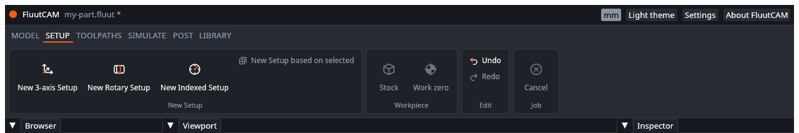
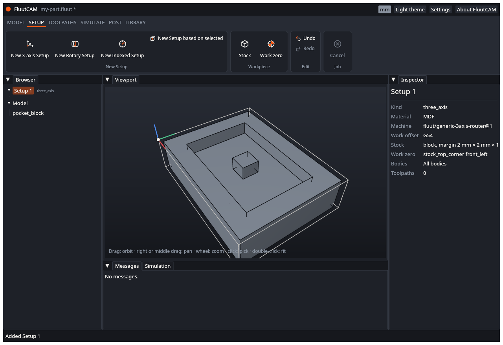

# Add a Setup

A **Setup** is one way of holding the part on the machine. It says which bodies are machined, how the part is oriented, what the stock is, where the work zero is, and which machine and material to use. The toolpaths belong to a Setup. A part cut in one clamping needs one Setup; a part you flip, or turn on a rotary axis, needs one for each way it is held.

This page shows how to add the three kinds of Setup. [Setups, stock and work zero](Setups-Stock-and-Zero) explains the details.

## The three kinds

| Kind | Use it for | Machine needs |
|---|---|---|
| **3-axis** (`three_axis`) | Ordinary milling: the tool moves in X, Y and Z, and the part does not turn | A normal 3-axis machine |
| **Rotary** (`rotary`) | Cutting while a rotary axis turns the part, for example a shaft or a relief wrapped round a cylinder | A machine with a rotary axis (A) |
| **Indexed** (`indexed`) | Cutting one side at a time: the rotary axis turns the part to an angle, locks, and the cut is 3-axis | A machine with a rotary axis (A) |

## Add one

1. Import a model first. A project with no model cannot have a rotary or indexed Setup, because their stock is sized from the model. (A 3-axis Setup can be added without a model.)
2. Open the **Setup** stage of the ribbon and click **New 3-axis Setup**, **New Rotary Setup** or **New Indexed Setup**.

The new Setup is named "Setup 1", "Setup 2" and so on, added at the end of the list, and selected. It is one undo step. The viewport shows its stock outline and work zero, and the inspector shows what FluutCAM chose.

## What each kind starts with

All three start with the material **MDF**, because the built-in starter tools have cutting data for MDF. The work offset is G54.

**3-axis.** The machine is `fluut/generic-3axis-router@1`. The stock is a block: the model plus 2 mm on each side in X and Y, and 1 mm on top. The work zero is the top front-left corner of the stock.

**Rotary and indexed.** The machine is `fluut/generic-4axis-router@1`, a router with a rotary axis along X. The stock is a cylinder around the X axis through the model's origin, 1 mm bigger in radius than the model and 2 mm longer. The work zero is on the axis at the left end of the stock. The clearance is a cylinder 10 mm outside the stock.

FluutCAM assumes your part lies along the X axis through the model origin. If it does not, the Setup's orientation must name the axis, and the window cannot set that yet; edit the project file (see [Setups, stock and work zero](Setups-Stock-and-Zero)).

## Based on another Setup

A Setup can be **based on** an earlier one. It inherits that Setup's machine, material, orientation, bodies and work zero, and it starts from the material the earlier Setup left behind. Use it to flip or turn a part and carry on, and to machine the second side from the stock the first side left.

1. Select the Setup to build on, in the Browser.
2. In the **Setup** stage click **New Setup based on selected**. The new Setup has the same kind as the one you selected.

The new Setup stores only what differs: the parent and the stock (`from_previous`). Changes to the parent flow through to it. The toolpaths are **not** inherited: each Setup has its own list.

The button makes a Setup of the selected Setup's kind, so the window never crosses over. (A 3-axis Setup cannot be based on a rotary or indexed one, or the other way round, because the orientation and zero could not carry over; a project file that does this is refused with "a ... Setup cannot be based on the ... Setup".) To change the kind of the new Setup, edit the project file.

The index angle of an indexed Setup (for example 0 and then 180 degrees for two sides) is not set from the window yet. Set it in the project file; the reference project `flipside` shows how.

## What you cannot do in the window yet

The **Stock** and **Work zero** buttons only select the current Setup and mark the matching row of its inspector; nothing can be edited there yet. Change these in the project file: machine, material, stock size, work zero, orientation, index angle, clearance. Delete, rename and reorder a Setup are not in the window either. See [Known limits](Known-Limits).

## Next

[Add a toolpath](Add-a-Toolpath)
