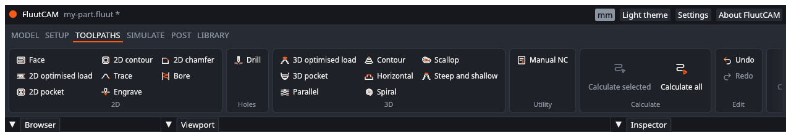
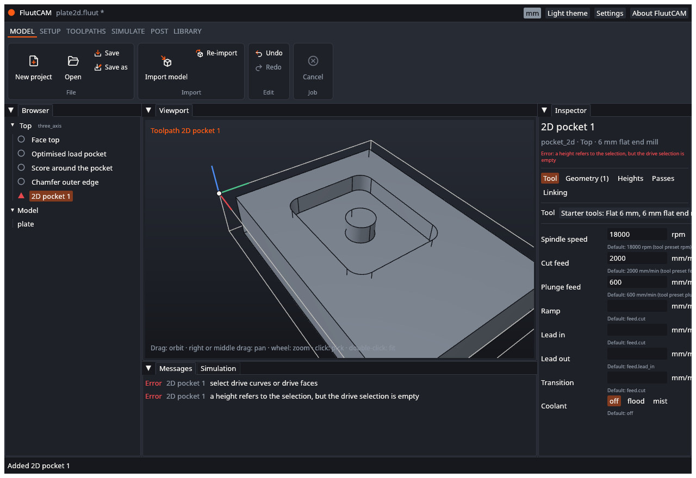
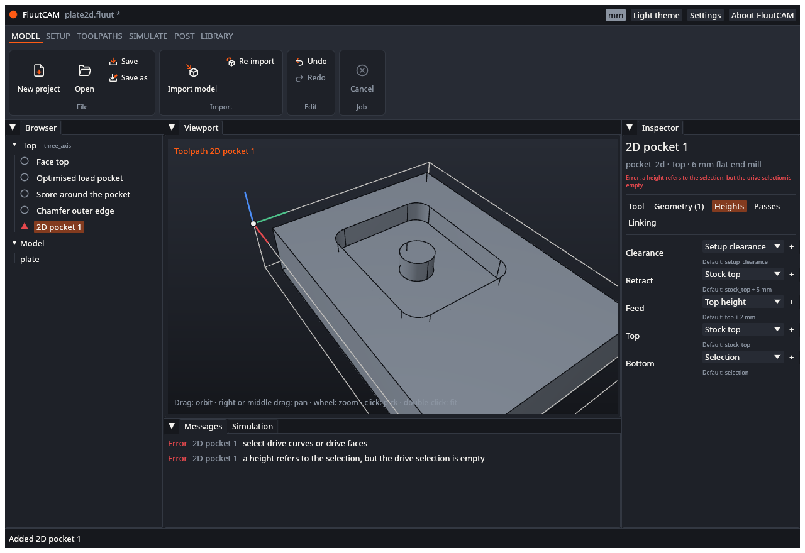
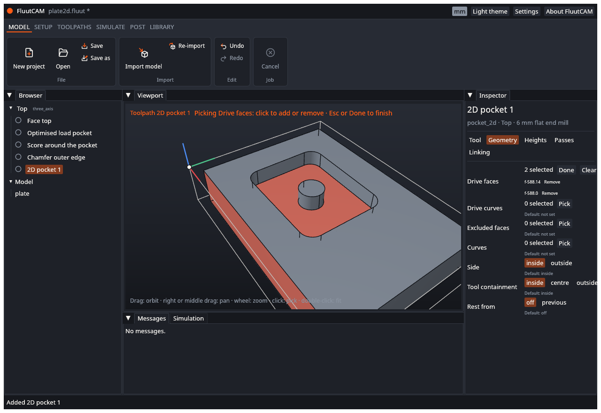

# Add a toolpath

A **toolpath** is one cutting job with one tool: a pocket, a contour, a finishing pass over a 3-D surface. A Setup holds a list of toolpaths, cut in the order they are listed.

## Add one

1. Select a Setup, or a toolpath in it, in the Browser. The new toolpath goes into the Setup you selected. If nothing is selected it goes into the first Setup. The toolpath buttons are greyed out until the project has a Setup. See [Add a Setup](Add-a-Setup).
2. Open the **Toolpaths** stage of the ribbon and click the type in its gallery.

The galleries show only the types that suit the selected Setup's kind: a rotary Setup shows the Rotary gallery and not the 2D, Holes and 3D ones; the other kinds show those and not Rotary. Manual NC is always there.

The new toolpath appears at the end of the Setup's list, named after its type ("Parallel 1"), selected, and not calculated. Adding it is one undo step.

## Choose the type

There are 22 types. [Toolpath types](Toolpath-Types) lists them with a page for each, with every setting. In short:

| Group | Types | Use for |
|---|---|---|
| 2-D | 2D contour, 2D pocket, Face, Trace, 2D chamfer, Bore, 2D optimised load, Engrave | Cut-outs, pockets, flat tops, grooves, chamfers, round holes, V-carving |
| Holes | Drill | Drilled holes, with drilling cycles |
| 3-D roughing | 3D optimised load, 3D pocket | Removing the bulk of the material above a 3-D shape |
| 3-D finishing | Parallel, Contour, Horizontal, Spiral, Scallop, Steep and shallow | Cutting a 3-D surface to its final shape |
| Rotary | Rotary rough, Rotary along X, Rotary around A, Rotary spiral | Parts on a rotary axis (rotary Setups only) |
| Utility | Manual NC | A stop, a comment or your own line in the program |

Two rules to know:

- **Rotary types run in rotary Setups only**, and all the other types run in 3-axis and indexed Setups. The ribbon shows only the types that suit the selected Setup. If a project file puts a type in the wrong kind of Setup, the calculation reports `param.type.setup_kind`.
- **3-D types need nothing picked.** With nothing selected they machine every face of the Setup's bodies. **2-D types need curves or faces picked**. Until you pick, a 2-D toolpath shows a red triangle and reports "select drive curves or drive faces". See "Pick on the model" below.

## What a new toolpath starts with

FluutCAM writes no settings for a new toolpath: every setting takes its default. The defaults come from the Setup (heights, material) and from the tool's cutting data for the Setup's material (feeds, speeds, stepover, step-down). The inspector shows each default under the setting.

The tool comes from the built-in **starter tools** (see [Tools](Tools)):

| Type | Starting tool |
|---|---|
| Face | 12 mm flat end mill |
| 2D chamfer, Engrave | 60 degree V bit |
| Drill | 5 mm drill |
| Parallel, Contour, Spiral, Scallop, Steep and shallow, Rotary along X, Rotary around A, Rotary spiral | 6 mm ball end mill |
| Manual NC | none |
| Everything else | 6 mm flat end mill |

## Choose another tool

Open the **Tool** tab. The **Tool** list shows every tool the project can use: the built-in starter tools and the tools of the project's own library files. Each line reads like "Starter tools: Flat 6 mm, 6 mm flat end mill" (library, shape and diameter, name). Pick one and the toolpath uses it. The change is one undo step.

The list does not hide a tool that does not suit the toolpath. If a tool does not suit it (a ball end mill in a drill toolpath, for instance), a message appears under the list and in the Messages tab. A tool that is not in any library still shows, as it is written in the file.

Changing the tool changes the cutting data the toolpath takes by default (feeds, spindle speed, stepover), and marks the toolpath out of date.

## Change a setting

Select the toolpath. The browser also lets you rename, duplicate, reorder, disable and delete it: see the [Interface tour](Interface-Tour). The inspector has five tabs: **Tool**, **Geometry**, **Heights**, **Passes** and **Linking**.

- Click a number box, type a value or an expression (`6/2`, `1/4in`, `tool.diameter*0.4`) and press Enter. A unit you type wins over the project unit: `0.25in` is a quarter inch even in a millimetre project.
- Choices are buttons or a list. Yes-or-no settings are check boxes.
- A setting you changed shows **Reset to default**. One you did not change shows its default in grey.
- Settings that do not apply to your other choices are hidden. For example the offset order only shows for the offset pattern.
- Each change is one undo step.

**Heights.** On the **Heights** tab each height has a list and a number box. The list picks what the height is measured from: Setup clearance, Stock top, Stock bottom, Model top, Model bottom, Work zero, Selection (the picked faces) and, for **Feed** only, Top height. The box is the **offset** from it, in the project unit. The offset may be negative: `-2` is 2 mm below. Under each height a grey line shows its default, for example "stock_top + 5 mm".

**Text, durations and points.** A text setting (a comment) is a text box. A duration is a number of seconds. A point is typed as `x y z` with spaces, and a list of points as `x y z; x y z`. Spaces separate the numbers because some countries write a decimal comma.

**Selections.** See the next section.

**Which changes make a toolpath out of date.** A change that alters the path (most settings on the Geometry, Heights, Passes and Linking tabs) marks the toolpath, and often the later toolpaths in the Setup, as out of date: its Browser icon becomes an amber ring with a dot. Feeds, spindle speed and coolant only change the G-code, so they do not. Click **Calculate all** to bring everything up to date.

## Pick on the model

Faces and curves are picked on the model, in **pick mode**.

1. Select the toolpath and open the **Geometry** tab.
2. Next to the selection you want (**Drive faces**, **Drive curves**, **Excluded faces**, **Curves** of the boundary), click **Pick**. The banner at the top of the viewport names it. The simulated stock hides so you can reach the faces.
3. Move the pointer over the model. The entity you can pick lights up. Click it to add it. Click it again to take it off. The inspector counts the selection and lists each item by its id (for example `f-588.14`).
4. Click **Done**, or press **Esc**, to leave. Selecting something else also leaves.

What a field accepts:

| Field | You can pick |
|---|---|
| Drive faces of **Drill** and **Bore** | Cylinders only: the walls of round holes and bosses. Other faces do not light up. |
| **Drive curves** and boundary **Curves** | Edges, wire curves (from DXF and SVG files) and flat faces |
| Every other face selection | Any face |

**Closed loops.** After you click an edge in a curve field, the inspector offers **Add closed loop (n edges)** when that edge is part of a closed loop. Click it to add the rest of the loop at once.

**Remove and Clear.** Each item has **Remove**. **Clear** empties the whole selection.

Each click is one undo step. Picks keep working after you [re-import](Import-a-Model) a changed model, because they are stored by the face and edge ids.

Not yet: picking a whole body, and picking by dragging a box.

## Problems

A toolpath that cannot be calculated shows a red triangle in the Browser. Select it: the message sits under the setting it is about, and the **Messages** tab lists it. [Diagnostics](Diagnostics) explains each message and what to do.

## Next

[Calculate and simulate](Calculate-and-Simulate)
