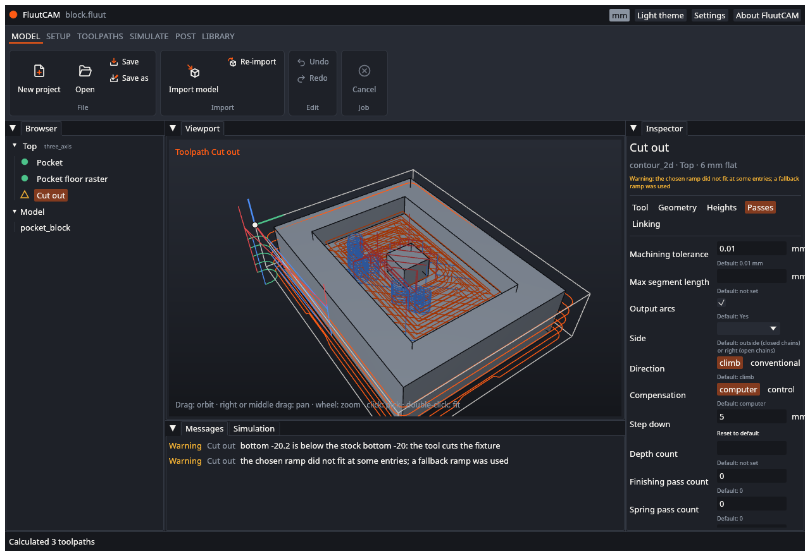
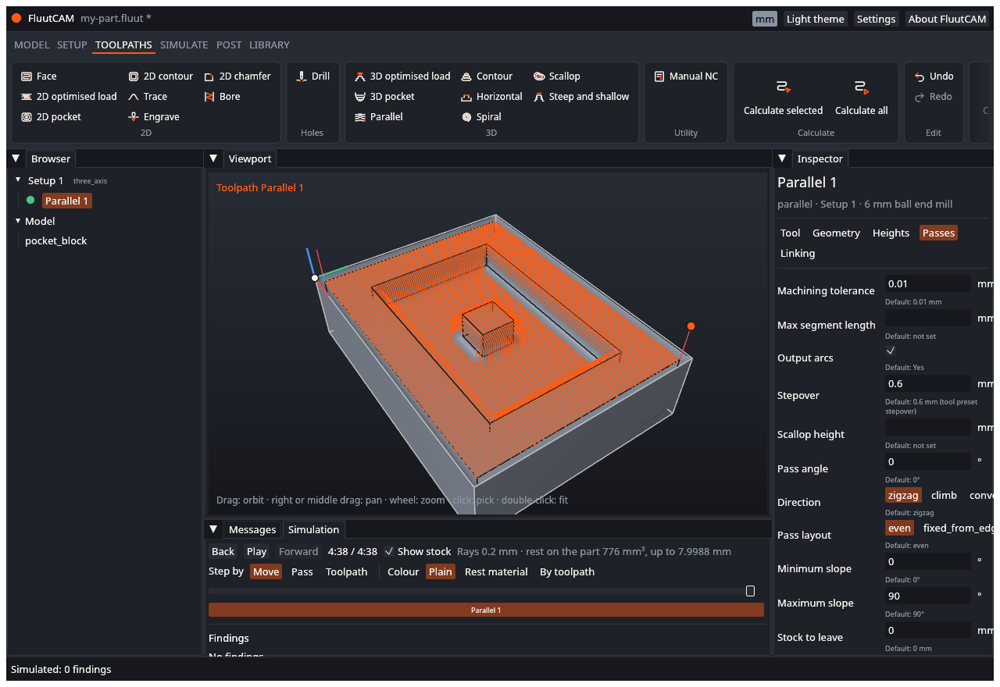

# Calculate and simulate

**Calculating** works out the tool paths from your settings. **Simulating** cuts a virtual piece of stock with those paths, so you can see the result and catch mistakes before you cut real material.

## Calculate

Click **Calculate all** in the ribbon (the **Toolpaths** stage). **Calculate selected** calculates only the selected toolpath. FluutCAM calculates every toolpath that is not up to date, in machining order, on a background thread, so the window stays usable.

While it runs:

- the status bar shows a progress bar and "Calculating Parallel 1 (1 of 3)";
- each toolpath's Browser icon shows a ring that fills;
- **Calculate all** and **Open** are greyed out, and **Cancel** is available.

When it ends the status bar says "Calculated 3 toolpaths". Each toolpath gets an icon:

| Icon | Meaning |
|---|---|
| Green filled circle | Calculated |
| Amber triangle outline | Calculated, with warnings: select it and read the messages |
| Red filled triangle | Could not be calculated: the toolpath is skipped, and the Messages tab says why |

The calculated paths are drawn over the model in the viewport. The selected toolpath is bright orange. Rapid moves, cutting moves, ramps and leads are drawn in different colours.

A toolpath that is up to date is not calculated again. Changing a setting that alters the path marks the toolpath out of date (see [Add a toolpath](Add-a-Toolpath)).

### Warnings and errors

A **warning** does not stop the calculation. The path is made, and you should check what the message says. An **error** stops that toolpath, and it has no path until you fix the cause. The messages are in the **Messages** tab, and next to the setting they are about in the inspector. A warning you can safely ignore, such as "bottom is below the stock bottom: the tool cuts the fixture" when you cut through to a spoilboard on purpose, stays until you change the setting.

[Diagnostics](Diagnostics) lists every message and what to do.

### Cancel

Click **Cancel** (in the ribbon or the status bar) to stop. FluutCAM finishes the toolpath it is working on and does not start the next. The status bar says "Cancelled". Toolpaths that finished keep their paths; the rest stay not calculated.

## Simulate

Select a Setup, or a toolpath in it, and click **Simulate**. FluutCAM simulates that Setup: it starts from the Setup's stock and cuts it with the Setup's calculated toolpaths in order, using the real tool shape. A toolpath that has not been calculated cannot be simulated; calculate first. The status bar says "Simulated: 0 findings", with the number of problems it found.

Then open the **Simulation** tab beside **Messages**.

| Control | What it does |
|---|---|
| **Play** / **Pause** | Plays the cut at a steady speed |
| Slider | Drag to any moment of the program; the coloured bar under it shows which toolpath runs when |
| **Back**, **Forward** | Step one move, one pass or one toolpath, as chosen by **Step by** |
| **Step by**: Move, Pass, Toolpath | How far Back and Forward go |
| **Show stock** | Show the simulated stock instead of the model's faces |
| **Colour**: Plain, Rest material, By toolpath | How the stock is coloured |

The line of text says the resolution of the simulation ("Rays 0.2 mm") and the **rest**: how much material is left on the part above its surface, in mm³, and the largest amount in mm.

With **Colour: Rest material** the stock shows how close each place is to the model, with a legend: above tolerance (material left to cut), within tolerance, gouge (cut into the part), no part below, and not cut. **By toolpath** gives each toolpath its own colour, so you can see what cut what.

### Findings

Under the controls the **Findings** list names problems the simulation found. Click one to look at it in the viewport. The kinds are:

| Finding | Meaning |
|---|---|
| Gouge | The tool cuts into the part by the stated depth |
| Rapid through stock | A fast, non-cutting move goes through material |
| Holder touches the stock | The tool holder reaches the material |
| Shank touches the stock | The part of the tool above the flutes reaches the material |
| Cuts above the flute length | The cut is deeper than the flutes |

"No findings" means none of these happened. It does not mean the program is safe: the simulation does not know about your clamps, your vise or your machine's limits.

### Limits

- **Rotary Setups cannot be simulated yet.** FluutCAM refuses with "rotary Setups are not simulated yet". 3-axis and indexed Setups can.
- The simulation is an approximation at the resolution it shows. Details smaller than that, such as very thin walls, can look different from the real cut.
- A simulation can take from a second to a minute for big programs. **Cancel** stops it.

## Next

[Post G-code](Post-G-code)
