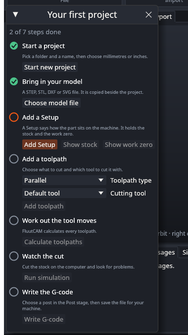

# Getting started

The first time FluutCAM starts, a small card called **Your first project** sits over the lower left of the window. It walks you through a first job, from an empty project to a G-code file. It is not a dialog: you can keep working in the window, and you can move the card by dragging its title.

## The seven steps

Each step has a ring on its left. The ring turns into a green tick when the project shows the step as done, so the card is always right about where you are, even if you did a step with the ribbon, or opened a project that is already part way. The ring of the step to do next is orange, and so is its button. A button is greyed out until its step can run.

| Step | Button | What it does |
|---|---|---|
| Start a project | **Start new project** | The same as **New project** in the Model stage: a file dialog asks for the folder and name, then a small window asks for the unit, **Millimetres** or **Inches**. |
| Bring in your model | **Choose model file** | The same as **Import model**: a file dialog for a STEP, STL, DXF or SVG file. |
| Add a Setup | **Add Setup** | Adds a 3-axis Setup, as **New 3-axis Setup** does. **Show stock** and **Show work zero** select the Setup and point the inspector at those two groups, so you can see and change them. |
| Add a toolpath | **Add toolpath** | Adds a toolpath to the Setup. Choose the **Toolpath type** and the **Cutting tool** first. **Default tool** keeps the tool FluutCAM picks for the type. The list of types follows the kind of the Setup. The type starts as Parallel, which needs nothing picked on the model; a 2-D type such as a pocket needs faces or curves picked after it is added. |
| Work out the tool moves | **Calculate toolpaths** | The same as **Calculate all**. |
| Watch the cut | **Run simulation** | The same as **Simulate** in the Simulate stage. Open the Simulation tab to play it. |
| Write the G-code | **Write G-code** | The same as **Post**: a save dialog for the file, using the post chosen in the Post stage (`fluut/linuxcnc` to start with). |

Every button runs the command of the ribbon, so each is one undo step where the ribbon's is, and each file is chosen in your system's file dialog. The card has no boxes for file paths.

When all seven are done the card says "All steps done. Your G-code is written." The last step is ticked when the G-code is written in this session; open another project and it starts again.

The card is a guide for a first job, not a replacement for the rest of these pages. [Your first project](Your-First-Project) explains each step in more detail, with the numbers to look at, and [Known limits](Known-Limits) lists what the window cannot do yet.

## Closing the card and bringing it back

Click the **x** in the card's title bar to close it. FluutCAM remembers that: the card stays closed the next time you start. Click **Getting started** in the title bar (beside Settings) to open it again. That is remembered too, so the card then shows at the next start, until you close it.

The choice is stored in the settings file; see [Settings and updates](Settings-and-Updates).

## Next

[Your first project](Your-First-Project)
