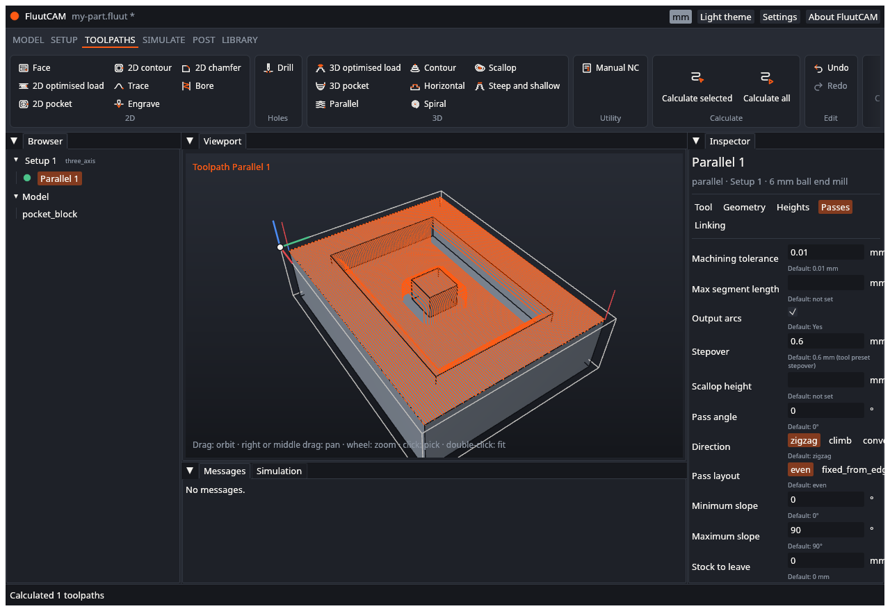

# FluutCAM

FluutCAM is open-source CAM software for CNC milling. You give it a 3-D model, tell it how the part sits on your machine and what tools you have, and it works out the tool paths and writes the G-code for your controller.

This wiki is the user guide. It is written for a hobbyist or small-shop machinist. You do not need to know how FluutCAM works inside.

> **Early software.** FluutCAM is at version 0.1. The window works end to end, from a STEP file to G-code, but it cannot do everything yet. Where something is planned and not built, these pages say "not yet". [Known limits](Known-Limits) lists what to expect.

## Start here

1. [Install](Install) FluutCAM.
2. Take the [Interface tour](Interface-Tour) to learn the window.
3. Follow the [Getting started card](Getting-Started) that FluutCAM shows on first start, or [Your first project](Your-First-Project): from a STEP file to G-code in ten steps.

## How to

- [Import a model](Import-a-Model)
- [Add a Setup](Add-a-Setup) (3-axis, rotary, indexed, or based on another)
- [Add a toolpath](Add-a-Toolpath)
- [Calculate and simulate](Calculate-and-Simulate)
- [Post G-code](Post-G-code)
- [Save, undo and recover](Save-Undo-Recover)

## Reference

- [Setups, stock and work zero](Setups-Stock-and-Zero)
- [Machines and posts](Machines-and-Posts)
- [Tools](Tools)
- [Toolpath types](Toolpath-Types): every type, with every setting
- [Diagnostics](Diagnostics): every message, and what to do about it
- [Command line](Command-Line) (`fluut`)
- [Scripting](Scripting)
- [Settings and updates](Settings-and-Updates)
- [Keyboard shortcuts](Keyboard-Shortcuts)
- [Troubleshooting](Troubleshooting)
- [Known limits](Known-Limits)

## Testing FluutCAM

[User acceptance tests](UAT) are step-by-step test scripts for each area, with a pass box for each test. Use them to check a build before you rely on it.

## Words used in these pages

- **CAM**: computer-aided manufacturing. Software that turns a model into machine instructions.
- **Setup**: one way of holding the part on the machine, with its stock and its zero point. A project has one or more Setups. See [Setups, stock and work zero](Setups-Stock-and-Zero).
- **Toolpath**: one cutting job with one tool, such as a pocket or a finishing pass. A Setup holds a list of toolpaths.
- **Stock**: the raw material you start from.
- **Work zero**: the point on the stock where the machine's coordinates are zero.
- **Post** (post processor): the part of FluutCAM that writes the toolpaths as G-code for one kind of controller.
- **G-code**: the text program a CNC controller reads.

Help improve these pages: they live in the main repository in `docs/wiki/`. See the note in the page footer.
