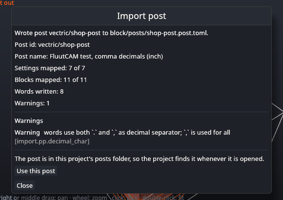

# Import posts

If your machine already runs G-code from Vectric software (VCarve, Aspire, Cut2D, Cut3D), you can turn its post processor, the `.pp` file, into a FluutCAM post with one command. This page says how, what carries over, and what to check before you cut.

You can import in the window or on the command line.

## Find the .pp file

Vectric keeps its post processors in a `PostP` folder: on Windows, typically `C:\ProgramData\Vectric\<product>\<version>\PostP`, with some posts in vendor subfolders. Your machine's supplier may also have given you a `.pp` file. Use the one you post with today.

Importing reads the file you give it and nothing else (and, if the file names a base post with `POST_BASE`, that base file in the same folder). It does not run anything from the file, and it does not use the network. Vectric's own post files belong to Vectric: FluutCAM does not ship them, you convert the ones you have.

## Import in the window

1. Open the **Library** tab of the ribbon and click **Import post…**. You do not need a project open.
2. Your system's file dialog opens, showing `.pp` files. Choose the Vectric post processor. (A `.cps` file, which is a program from Autodesk, is answered with the error `import.format.unsupported` and nothing is written.)
3. A second file dialog asks where to save the new post, as a `.post.toml` file. It offers the file's name with `.post.toml`, and starts in your project's `posts/` folder when the project has one (otherwise in the project's folder). FluutCAM finds a project's posts only in that folder, as `.post.toml` files, so save it there. If you choose a file that already exists, the dialog asks you to confirm replacing it; without that confirmation an existing file is never touched, and the import never replaces its own `.pp` file.
4. The import runs in the background (an **Importing…** window shows while it works), then a window shows the result: the post id and name, the number of settings and blocks mapped, the words written, the number of base files merged, and every warning with its severity and its `import.` code. A refused file shows **Nothing was imported.** and the reasons.



**Using the new post.** With a project open, and the post saved in the project's `posts/` folder, the window offers **Use this post**. It makes FluutCAM read the project's posts again now, so the post is in the Post stage's list at once without opening the project again, and it chooses the post there. Click **Post** and the file dialog offers the file extension the post names. The choice is for this window only: it is not saved in the project, so choose the post again after a restart (or name it with `--post` on the command line). If you saved the post anywhere else, the window says that FluutCAM does not find it there and offers no button; save it in the `posts/` folder beside the project file. With no project open, the window says to open one first. If your project has no `posts/` folder yet, make one in the save dialog (the dialog's **New folder** button) before you save.

If the `.pp` file names a base post with `POST_BASE`, that file is read from the same folder, as on the command line. Cancel either dialog and nothing happens. The post id is `vectric/` and the file's name, as on the command line; use the command line if you want another id.

## Import on the command line

```
fluut posts import "My_Router_mm.pp" -o posts/router.post.toml
```

| Option | Meaning |
|---|---|
| `<file.pp>` | The Vectric post processor |
| `-o <file>` | The FluutCAM post file to write (required) |
| `--id <id>` | The post id, for example `shop/router`. Default: `vectric/` and the file's name, in lower case with `-` for spaces and other characters (`My_Router_mm.pp` gives `vectric/my-router-mm`). Lower-case letters, digits, `-`, `_` and `/` only |
| `--force` | Replace the output file if it exists. Without it, an existing file is never touched |

The command prints a warning for everything it changed or left out, and one line at the end, for example:

```
posts/router.post.toml: converted `My Router (mm)` as post vectric/my-router-mm (12 of 12 blocks mapped, 12 words, 3 warnings)
```

Exit status 0 when the file was written, 1 when the post was refused (nothing is written), 2 for a wrong command line.

## Use the new post

Put the file in the `posts/` folder beside your project file ([Machines and posts](Machines-and-Posts)) (the window's save dialog starts there), then choose it in the Post stage's list or post with its id:

```
fluut post my-part.fluut --post vectric/my-router-mm -o my-part.tap
```

The new post is a standalone post: it does not extend a built-in one. It is marked `origin = "imported"`. It is plain text, so you can open it, read it and change it like any post of your own.

## What carries over

| Vectric | FluutCAM |
|---|---|
| `POST_NAME`, `FILE_EXTENSION`, `UNITS` | The post's name, the output file's extension, millimetres or inches |
| `LINE_ENDING` | CR LF, LF or CR (CR LF when the file does not say) |
| `LINE_NUMBER_START`, `_INCREMENT`, `_MAXIMUM` and `[N]` in the lines | Line numbers where the post puts `[N]`, with its format |
| `SUBSTITUTE` | The same character replacements in tool, toolpath, Setup and machine names and the file notes, so a name with brackets cannot end a comment early |
| `VAR` lines | One word each, with its prefix, "always" or "only when changed", decimals, sign, zero padding and multiplier (see below) |
| `HEADER`, `FOOTER` | Start and end of the program. The header sees the first toolpath's tool, speed and names, as in Vectric |
| `TOOLCHANGE`, `NEW_SEGMENT` | Tool change and toolpath start, from the second toolpath on (the header sets up the first) |
| `RAPID_MOVE`, `FEED_MOVE`, `PLUNGE_MOVE`, `RETRACT_MOVE` and their `FIRST_` forms | The same moves. A `FIRST_` block is used for the first move of a kind and again whenever the feed changes |
| `INITIAL_RAPID_MOVE` | The program's first rapid move |
| `CW_ARC_MOVE`, `CCW_ARC_MOVE` and their `FIRST_` forms | Arcs in the XY plane, with incremental (`[I] [J]`) or absolute (`[IA] [JA]`) centres or a radius (`[Radius]`, arcs of at most 90°). Arcs in other planes are written as line moves |
| `CW_HELICAL_ARC_MOVE` and the other helical blocks | Helices in the XY plane |
| `DWELL_MOVE`, `FEED_RATE_CHANGE`, `SPINDLE_ON` | Dwell, feed change, spindle on |
| `ROTARY_WRAP_X`, `ROTARY_WRAP_Y` | The rotary word (A or B, sign reversed for `-A`) written after the wrapped axis, with the feed as given (warning `import.pp.rotary_wrap`) |
| `MIN_ARC_RADIUS`, `MAX_ARC_RADIUS`, `MAXIMUM_ROTATION`, `MAXIMUM_LENGTH` | The same limits |
| `POST_BASE` | The base file (beside the `.pp`) is read first, and the post's own settings, words and blocks replace the base's |
| `[nn]` character codes | The character (`[34]` is `"`, `[91]` is `[`) |

Placeholders keep their names: `[X]`, `[Y]`, `[Z]`, `[F]`, `[S]`, `[T]`, `[TOOLNAME]`, `[TOOLPATH_NAME]`, `[DATE]`, `[TIME]`, `[SAFEZ]`, `[FP]`, `[FC]`, `[TDIA]` and the others in the [post processor specification](https://github.com/martinlong1978/fluutcam/blob/main/docs/spec/05-postprocessor-engine.md) (§5.4.2) work as in Vectric. Upper and lower case do not matter, as in Vectric. `[POST_NAME]` becomes the post's name.

**Number formats.** A `VAR` line's format is read like `1.3`: an optional `+` (always write the sign), the width, the decimal separator (`.` or `,`), the number of decimals. Decimals are always written, trailing zeros included, as Vectric does. A width that starts with `0` pads with zeros (`04.0` writes `N0010`). Other widths have no effect in practice, except a width wider than the number, which in Vectric pads with spaces: FluutCAM does not write those spaces and warns (`import.pp.var_format`).

**Home position.** `[XH] [YH] [ZH]` are X0, Y0 and the highest safe Z of the program's toolpaths. In Vectric they are the home position you set in the job, so check the first and last moves if your post rapids to the home position.

## What does not carry over

- **Values FluutCAM does not have:** the file name (`[TP_FILENAME]` and similar), material size (`[XLENGTH]` and similar), lists of tools and toolpaths, toolpath notes, the wrap diameter, laser power and some others. They are removed from the lines (warning `import.pp.placeholder`), and a comment line made only of them is left out (`import.pp.line_dropped`). `[XMIN]` to `[ZMAX]` are the extents of the toolpaths, not of the material (`import.pp.placeholder_approx`).
- **Laser and waterjet blocks** (`JET_TOOL_ON` and the others) and any other block FluutCAM has no event for are left out (`import.pp.block_unsupported`).
- **Settings for Vectric itself:** `DIRECT_OUTPUT`, `PRINT_DIRECT`, `TAPE_SPLITTING` (set `output.max_file_size` by hand if your controller needs short files), `RAPID_PLUNGE_TO_STARTZ`, `LASER_SUPPORT` (`import.pp.setting_ignored`).
- **Spaces at the start or end of a line, and empty lines**: FluutCAM trims every line (`import.pp.whitespace`).
- **Unquoted lines** such as a bare `%` at the end of a file are left out (`import.pp.unknown_line`); Vectric writes only quoted lines.

## Refused posts

These posts are not converted, because the result would write wrong G-code. Nothing is written and the command exits with 1.

| Code | Why |
|---|---|
| `import.pp.units` | No `UNITS`, or units that are neither MM nor INCHES: guessing could scale every move |
| `import.pp.inverse_time` | `INVERSE_TIME_MODE`: the post writes G93 feeds from its own blocks, and FluutCAM switches G93 itself |
| `import.pp.spindle_range` | `SPINDLE_SPEED_RANGE`: the machine expects speed steps, and FluutCAM writes the speed |
| `import.pp.rotary_wrap` (error) | A wrap setting that names no rotary axis letter |
| `import.pp.script` | A script section: FluutCAM runs no code from a post |
| `import.pp.post_base` | The `POST_BASE` file is missing, names a path, or the bases form a loop |
| `import.pp.block_missing` (error) | No usable `FEED_MOVE` |
| `import.file.invalid` | Not a text post processor |
| `import.limit.size`, `import.limit.lines`, `import.limit.vars` | Over 1 MiB, more than 50 000 lines, a block over 2 000 lines, or more than 1 000 `VAR` lines |

## Check your post

FluutCAM converts the format as documented, but it has not yet been compared with G-code that Vectric software wrote from the same post. Before you cut:

1. Post a small job with the new post.
2. Compare the program with one your Vectric software wrote for that machine: the start and end of the program, the tool change, the number formats, the arcs.
3. Run it in the air first, with the spindle clear of the work.

Differences you will see, which are expected: FluutCAM's own comment lines at the top (the provenance block, written in the post's comment style), and after a tool change or other non-motion block FluutCAM writes every axis again.

## Messages

Warnings (the post is written):

| Code | Meaning |
|---|---|
| `import.file.encoding` | The file is not UTF-8; read as Latin-1 |
| `import.pp.unknown_line` | Lines that are no setting, `VAR`, block or quoted line, quoted lines outside a block, or text after a closing quote |
| `import.pp.setting_ignored` | A Vectric setting with no meaning in FluutCAM |
| `import.pp.setting_unknown` | Settings FluutCAM does not know |
| `import.pp.setting_duplicate` | A setting given twice; the later value is used |
| `import.pp.bad_value` | A setting value that is not usable |
| `import.pp.line_ending` | A line ending other than CR LF, LF or CR; CR LF is used |
| `import.pp.var_format` | A `VAR` format, output mode or multiplier not understood, or a space-padded width |
| `import.pp.var_duplicate` | Two `VAR` lines for the same placeholder; the later is used |
| `import.pp.var_missing` | `[N]` is used without a `VAR`; written as `N` and a whole number |
| `import.pp.decimal_char` | Words use both `.` and `,`; the more common one is used |
| `import.pp.placeholder` | Placeholders FluutCAM has no value for, removed |
| `import.pp.placeholder_approx` | Placeholders with a slightly different meaning |
| `import.pp.line_dropped` | Lines left out because they were made only of such placeholders |
| `import.pp.control_char` | Control characters given as codes, left out |
| `import.pp.whitespace` | Lines trimmed, empty lines left out |
| `import.pp.block_unsupported` | Blocks with no FluutCAM event, left out |
| `import.pp.block_fallback` | A block stands in for a missing one (for example rapid moves written with the feed lines) |
| `import.pp.block_duplicate` | A block defined twice; the later is used |
| `import.pp.block_missing` | No `HEADER` or `FOOTER` |
| `import.pp.arcs_linearized` | The arc blocks write no centre FluutCAM supplies; arcs are written as line moves |
| `import.pp.rotary_wrap` | Wrapped output: what it means for your machine |
| `import.pp.comment_syntax` | The post writes no comments and does not look like G-code; check FluutCAM's `( … )` provenance lines suit the controller |

Errors are in the table above, plus `import.file.unreadable`, `import.format.unsupported` (not a `.pp` file), `import.post.bad_id`, `import.output.exists`, `import.output.unwritable`, and `import.pp.internal` (the converted post would not load: please report it).
