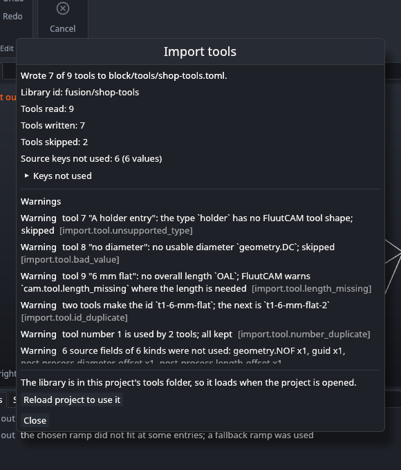

# Import tools

If you already have a tool library in Autodesk Fusion, you can turn it into a FluutCAM tool library with one command, instead of typing every tool again. This page says how, what carries over, and what does not.

You can import a **Fusion tool library** (`.json`). Vectric `.vtdb` tool databases are not supported yet (see [Known limits](Known-Limits)). You can import in the window or on the command line.

## Export from Fusion

In Fusion's tool library, export the library you want as a JSON file. Importing reads the file you give it and nothing else. It does not run anything from the file, and it does not use the network.

## Import in the window

1. Open the **Library** tab of the ribbon and click **Import tools…**. You do not need a project open.
2. Your system's file dialog opens. Choose the Fusion `.json` file. (A Vectric `.vtdb` file is answered with the error `import.format.unsupported`, and nothing is written.)
3. A second file dialog asks where to save the new library, as a `.toml` file. It offers the file's name with `.toml`, and starts in your project's `tools/` folder when a project is open. If you choose a file that already exists, the dialog asks you to confirm replacing it; without that confirmation an existing file is never touched.
4. The import runs in the background, then a window shows the result: the library id, the number of tools read, written and skipped, the number of source keys that were not used (open **Keys not used** for the list), and every warning with its code.



**Using the new library.** With a project open, the window offers **Use in this project**, wherever you saved the library.

- If the library is in the project's `tools/` folder, the project loads it whenever it opens; the button makes FluutCAM read the libraries again now, so its tools are in the Tool list at once. Nothing is added to the project file.
- If the library is anywhere else, the button adds a **reference** to the file to the project (a relative path where the library and the project share a folder) and loads the library at once. The project is marked as changed, and **Undo** takes the reference out again. The browser's **Tool libraries** list shows it, and you can remove it there. See [Tools](Tools) ("Use a library from another folder").
- With no project open, the window says to open one first.

The window never copies the library into the project: it stays where you saved it, so several projects can use it.

Cancel either dialog and nothing happens. The library id is `fusion/` and the Fusion file's name, as on the command line; use the command line if you want another id or name.

## Import on the command line

```
fluut tools import shop-tools.json -o shop.tools.toml
```

| Option | Meaning |
|---|---|
| `<file>` | The Fusion `.json` file |
| `-o <file>` | The FluutCAM library file to write (required) |
| `--id <id>` | The library id, for example `shop/fusion`. Default: `fusion/` and the file's name. Lower-case letters, digits, `-`, `_` and `/` only |
| `--name <text>` | The library's display name. Default: the file's name |
| `--force` | Replace the output file if it exists. Without it, an existing file is never touched |

The command prints a warning for everything it changed or left out, and one line at the end: `shop.tools.toml: 7 of 9 tools imported as library fusion/shop-tools (2 skipped)`.

To use the library, put the output file in your project's `tools/` folder, list it in the project's `tool_libraries` ([Tools](Tools)) or load it with `--tools shop.tools.toml` ([Command line](Command-Line)). A toolpath then names a tool as `<library id>#<tool id>`, for example `fusion/shop-tools#t1-6-mm-flat`. See [Tools](Tools).

The import always makes a **new** file. It does not change a library you already have. To combine them, make your own library `extends` the imported one ([Tools](Tools)).

## What carries over

| Fusion | FluutCAM |
|---|---|
| Tool type | Shape: flat, ball, bull nose, V, taper, drill (table below) |
| Description | Name, and the tool's id |
| Diameter, corner radius, flute length, overall length, shank diameter | The same settings, converted to millimetres (inch libraries are converted) |
| Taper angle, point angle, thread pitch, tip diameter | Half angle, point angle, pitch, tip diameter |
| Tool number | The tool number. Two tools with the same number are both kept, with a warning |
| Holder | One cylinder: the widest diameter and the total height of the holder's segments |
| Presets | One cutting-data preset per Fusion preset, with the **preset's name as the material**: spindle speed, cutting feed, plunge feed, stepover, step down |

The tool's id is made from its description, with its number in front: a tool numbered 1 called "6 mm flat" becomes `t1-6-mm-flat`. A repeated id gets `-2`, `-3`.

| Fusion type | Becomes |
|---|---|
| flat end mill | flat |
| ball end mill | ball |
| bull nose end mill, radius mill | bull (flat, with a warning, if the corner radius is missing) |
| chamfer mill | V (needs a taper angle) |
| counter sink | V (half of the point angle) |
| tapered mill | taper, with a warning to check its size |
| drill, center drill, spot drill | drill |
| tap right hand, tap left hand | drill with a pitch |
| face mill, slot mill | flat, with a warning |
| anything else (dovetail, lollipop, thread mill, reamer, counter bore, boring head, probes, holders on their own, laser, waterjet, turning tools) | **left out**, with a warning. A wrong shape would give a wrong toolpath, so these are not guessed |

## What does not carry over

- Flute count, body length, coolant, vendor and product information, offsets and every other field. One warning, `import.fields.dropped`, counts them and names the most common.
- Feed per tooth, surface speed, ramp, lead-in, lead-out and retract feeds. A preset without a cutting feed is imported without one, and the toolpath asks you for it.
- Expressions in the file are not evaluated.
- Whether a tool is centre cutting: every imported tool is treated as centre cutting.

**Match the preset names to your Setup's material.** A Setup picks cutting data by material name. If your Fusion presets are called "Aluminum" and "Wood", set the Setup's material to one of those names ([Setups, stock and zero](Setups-Stock-and-Zero)).

**A tool with no overall length** is imported without one and warned about (`import.tool.length_missing`). FluutCAM then warns again, `cam.tool.length_missing`, where it needs the length: a holder, or a rotary or indexed Setup's travel check. Add `overall_length` to the tool in the library file to fix it.

## Check your tools

The Fusion file format is not published as a specification. FluutCAM reads the fields it understands and checks every value, but check the result against your tools: open the library file (it is plain text, see [Tools](Tools)) and compare diameters, lengths and feeds with Fusion before you cut.

## Limits

An import stops with an error for a file over 32 MiB, a file with more than 10 000 tools, a file that is not JSON, or a file that is not a Fusion tool library. A value that is not a sensible number, or is out of range, is dropped with a warning; if it is the diameter, the tool is left out.

## Messages

| Code | Meaning |
|---|---|
| `import.file.unreadable` (error) | The file could not be read |
| `import.file.too_large` (error) | The file is over 32 MiB |
| `import.file.invalid` (error) | Not UTF-8, not JSON, or no list of tools in it |
| `import.file.version` | The file has no version number; read as a plain list of tools |
| `import.limit.tools` (error) | More than 10 000 tools |
| `import.library.bad_id` (error) | The `--id` is not allowed |
| `import.format.unsupported` (error) | The file type cannot be imported (`.vtdb` today) |
| `import.output.exists` (error) | The output file exists; add `--force` to replace it (in the window: the file dialog did not confirm replacing it) |
| `import.output.is_input` (error) | Window only: the library file is the Fusion file itself |
| `import.worker` (error) | Window only: the background import could not run |
| `import.output.unwritable` (error) | The output file could not be written |
| `import.tool.unsupported_type` | The tool type has no FluutCAM shape; the tool was left out |
| `import.tool.approximated` | Imported as a similar shape: check its size |
| `import.tool.bad_value` | A value was not usable and was dropped (the tool is left out if it is the diameter, the unit or the taper angle of a V tool) |
| `import.tool.skipped` | An entry that is not a tool |
| `import.tool.length_missing` | No overall length |
| `import.tool.holder_dropped` | The holder had unusable parts and was dropped |
| `import.tool.id_duplicate` | Two tools made the same id; the second got a suffix |
| `import.tool.number_duplicate` | Two or more tools have the same number |
| `import.preset.dropped` | A preset was dropped: a second one with the same name, more than 200, or not a preset |
| `import.fields.dropped` | Fields of the file that FluutCAM does not use, counted |

On the command line, errors exit with status 1 and write no file; warnings do not change the exit status. Messages name the tool, for example `tool 3 "6 mm flat": ...`.
