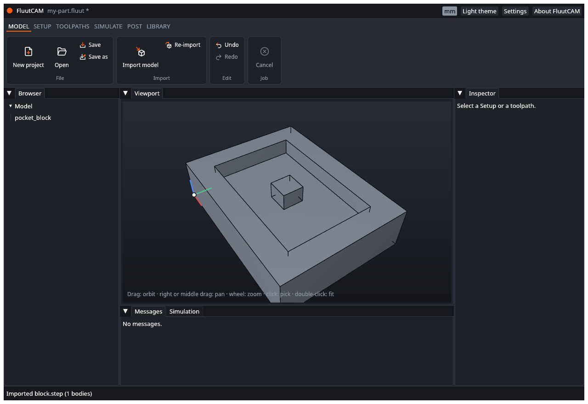
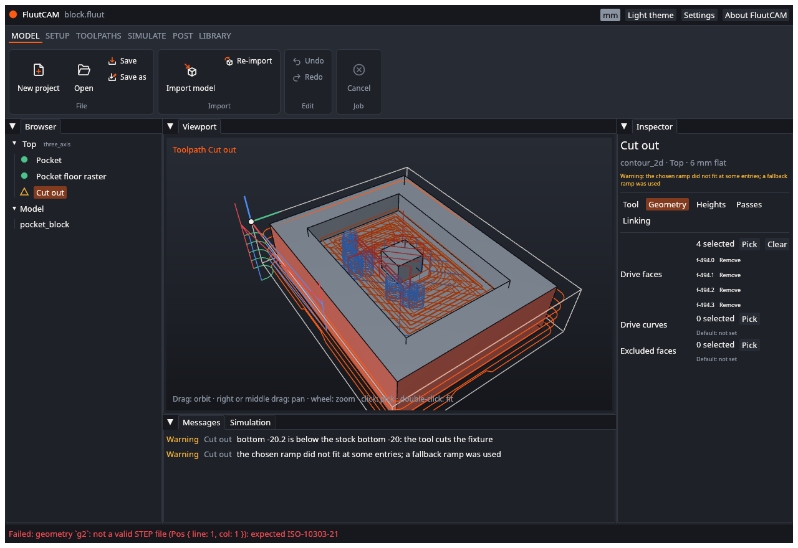

# Import a model

A project holds one or more model files: the parts you want to machine. This page says which files FluutCAM reads, how to import one, and what happens when it goes wrong.

## Which files

| File | Extension | What you get |
|---|---|---|
| STEP | `.step`, `.stp` | Solid bodies with exact faces. This is the format to use. 3-D toolpaths work on it. |
| DXF | `.dxf` | Flat curves (wire bodies), for 2-D work. |
| SVG | `.svg` | Flat curves, for 2-D work. |
| STL | `.stl` | The file is read, but it gives no bodies yet, so the import fails. See [Known limits](Known-Limits). |

2-D toolpaths need curves or faces picked. In the toolpath's Geometry tab, click **Pick** and click the entities on the model. The curves of a DXF or SVG import can be picked this way. See [Add a toolpath](Add-a-Toolpath).

## Import a file

1. Open a project, or start one with **New project** in the Model stage. **Import model** is greyed out until there is a project.
2. Click **Import model** in the **Model** stage of the ribbon (or press **Ctrl+I**).
3. Pick the file. The dialog offers STEP, STL, DXF and SVG files.

The status bar says "Imported block.step (1 bodies)". The bodies are listed under **Model** in the Browser, and the model is drawn in the viewport even before the project has a Setup.

The import is one undo step (the status bar says "Undid Add geometry" when you undo it).

## Where the file goes

A project folder is meant to be self-contained, so you can move or zip it as a whole.

- A file that is already inside the project folder stays where it is. The project refers to it by a path relative to the project file.
- A file from anywhere else is **copied** into the project folder, after FluutCAM has checked that it loads and has bodies. If the folder already has a different file with that name, the copy is named `name-2.step`, `name-3.step` and so on. If it has an identical file, FluutCAM uses that one.

Change the original and the copy does not change. When you open the project again, FluutCAM tells you if a model file has changed on disk since it was imported (`model.geometry.changed`). To read the files again, click **Re-import** in the Model stage. It re-imports every model file of the project (one undo step for each). **Your picks stay.** Faces and curves are stored by their ids, and FluutCAM maps them to the new model. A pick it cannot find again is dropped and counted in the status bar, and its toolpath reports `param.geometry.selection.missing` until you pick it again and the status bar says how many it read and how many selections it could not find again. There is no choice of a single file yet. The [scripting](Scripting) function `model.reimport` does the same for one file.

## Units

STEP files carry their unit. DXF, SVG and STL files do not. For those FluutCAM assumes the unit the project shows (mm or inch) and warns that it did (`model.import.unit_assumed`). If the part looks the wrong size, undo the import, start the project in the other unit, and import again. The window does not ask for the unit yet.

## When it goes wrong

A failed import changes nothing: the project and its folder stay as they were. The status bar turns red and says why.

| You see | Why | What to do |
|---|---|---|
| "not a valid STEP file" and a position in the file | The file is not STEP, or is damaged | Re-export it from your CAD program |
| "... gave no geometry" | The file loaded and had nothing a toolpath can use. An STL file does this today | Use a STEP file |
| "...: not a STEP, STL, DXF or SVG file" | The file extension is not one FluutCAM reads | Check the file |
| "cannot read ..." | The file is missing, locked or unreadable | Check the path and permissions |
| "body `...` of ... has the id of a body of `...`" | Two imported files give a body the same id. Two DXF files do this, because each calls its first body `b-1` | Not supported yet; use one project per file |
| "cannot copy into ..." | The project folder is not writable | Choose a project folder you can write to |

The [Diagnostics](Diagnostics) page lists every message.

## Next

[Add a Setup](Add-a-Setup)
