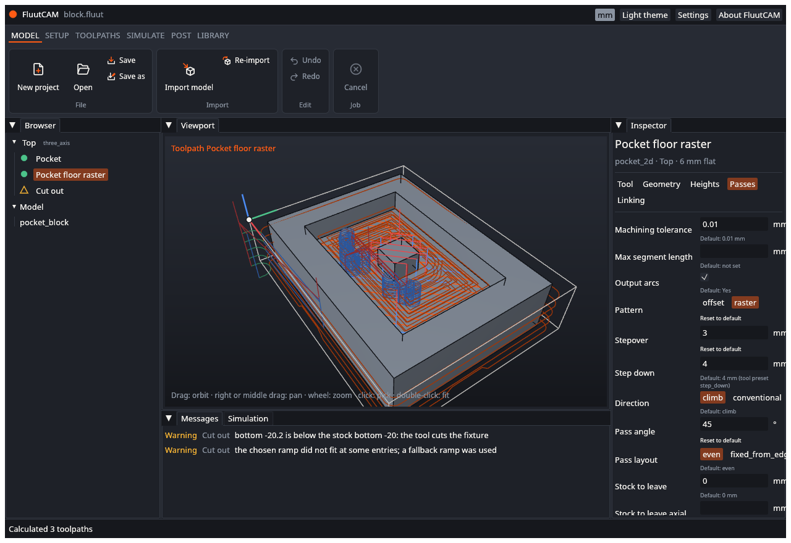
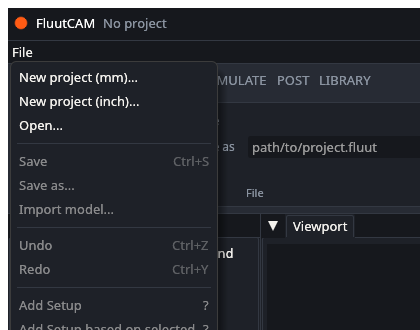
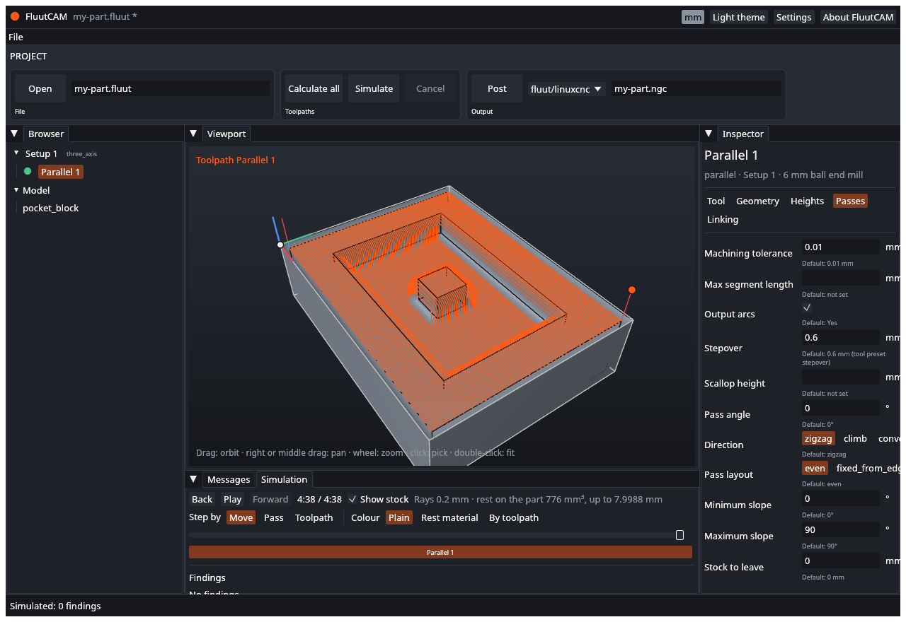

# Interface tour

This page names every part of the FluutCAM window, so the other pages can say "the Browser" or "the status bar" and you know where to look.

> **The ribbon is being rebuilt.** The row of buttons under the title (Open, Calculate all, Simulate, Post) is the first version of a ribbon. A new ribbon will replace it, and it will also take over the temporary **File** menu described below. The commands stay; where they sit will change. These pages are updated when it lands.

## From top to bottom

**Title bar.** The FluutCAM name, then the name of the open project. A `*` after the name means the project has changes you have not saved. On the right:

- a grey **mm** or **inch** badge: the unit the project shows. It is for display only. Inside the project file every length is in millimetres.
- **Light theme** or **Dark theme**: switches between the two.
- **Settings**: see [Settings and updates](Settings-and-Updates).
- **About FluutCAM**: the version and licence.

**File menu** (temporary). One menu, **File**. It holds everything about files and the project:

| Item | What it does |
|---|---|
| New project (mm)..., New project (inch)... | Start an empty project. You choose a file name. |
| Open... | Open a project file. |
| Save, Save as... | Save the project. |
| Import model... | Add a STEP, DXF, SVG or STL file to the project. |
| Undo, Redo | Undo or redo the last change. The menu names the change. |
| Add Setup, Add Setup based on selected | Add a Setup. |
| Add toolpath | Add a toolpath to the selected Setup. |

Items that do not apply are greyed out, for example Save when no project is open.

**Ribbon** (first version). Three groups of commands:

- **File**: **Open** and a text box with the project file's path. Type or paste a path and press Open. Unlike the File menu's Open, this does not ask about unsaved changes.
- **Toolpaths**: **Calculate all**, **Simulate** and **Cancel**.
- **Output**: **Post**, a list of posts, and a text box with the output file's name.

**Panels.** Below the ribbon the window has these panels. Drag the lines between them to resize.

| Panel | What it shows |
|---|---|
| **Browser** (left) | A tree of the project: each Setup with its toolpaths, then the **Model** with its bodies. Click a Setup or a toolpath to select it. |
| **Viewport** (middle) | The 3-D view of the selected Setup: the model, the stock outline, the work zero and the calculated toolpaths. |
| **Inspector** (right) | The details of the selection, and where you change toolpath settings. |
| **Messages** (below the viewport) | Warnings and errors from calculating, per toolpath. |
| **Simulation** (a tab beside Messages) | Playback of the cut. |

**Status bar.** The bottom line. It says what the program last did ("Calculated 3 toolpaths"), shows a progress bar and a **Cancel** button while a job runs, and turns red when a job fails. If you have asked for update checks, it also says when a newer version exists.

## Browser

The Browser lists each Setup, with its kind (for example `three_axis`) beside it, and under it the toolpaths in machining order. Each toolpath has a status icon. The shapes differ as well as the colours, so you can tell them apart without colour:

| Icon | Meaning |
|---|---|
| Hollow grey circle | Not calculated yet |
| Ring that fills | Calculating |
| Green filled circle | Calculated |
| Amber ring with a dot | Inputs changed since it was calculated: calculate again |
| Amber triangle outline | Calculated, with warnings |
| Red filled triangle | Cannot be calculated: see Messages |
| Grey circle with a slash | Disabled |

Hover over a toolpath to see its type, tool and status.

The **Model** at the bottom lists the bodies of the imported files. A project with no Setup shows its model in the viewport, so you can see an import straight away.

## Viewport

| Action | Result |
|---|---|
| Drag | Orbit around the model |
| Right or middle drag | Pan |
| Mouse wheel | Zoom |
| Click | Pick the face or the toolpath under the pointer, and select it |
| Double-click | Zoom to fit |

The small coloured arrows at one corner of the stock are the **work zero**: the red arrow is X, green is Y and blue is Z. Toolpaths are drawn over the model. The selected toolpath is bright orange, and its name shows in the top-left corner of the viewport.

If the computer has no usable graphics device, the viewport says so and stays off. Everything else still works.

## Inspector

Select a **Setup** and the inspector lists its kind, material, machine, work offset, stock, work zero and bodies. These are read-only in the window for now; see [Setups, stock and work zero](Setups-Stock-and-Zero).

Select a **toolpath** and the inspector shows its name, its type, its Setup and its tool, then five tabs:

| Tab | What is on it |
|---|---|
| **Tool** | Spindle speed, feeds and coolant |
| **Geometry** | Which faces or curves the toolpath works on |
| **Heights** | The clearance, retract, feed, top and bottom heights |
| **Passes** | How the tool covers the area: stepover, step-down, direction and so on |
| **Linking** | How the tool moves between passes: lead-ins, ramps, retracts |

Each setting shows its value. A setting you have not changed shows its default in small grey text underneath ("Default: 0.6 mm"). A setting you have changed has a **Reset to default** link.

To change a number, click its box and type. You can type an expression, such as `6/2`, `1/4in` or `tool.diameter*0.4`. Press Enter, or click elsewhere, to apply it. If the text is not a value, a red message says so and nothing changes. A choice (such as climb or conventional) is a row of buttons or a list. A yes-or-no setting is a check box.

Heights, face and curve selections and points are shown but cannot be edited in the window yet. Their value shows, and hovering says "Edit in the project file for now". See [Known limits](Known-Limits).

If a setting has a problem, the message appears right under it, in amber for a warning and red for an error.

## Messages and the Simulation tab

**Messages** lists the diagnostics of every toolpath in the project, and any warnings from opening the project: the kind (Warning or Error), the toolpath, and the text. Hover over a message to see its code. [Diagnostics](Diagnostics) explains each one.

**Simulation** is empty until you simulate a Setup. See [Calculate and simulate](Calculate-and-Simulate).

## Next

[Your first project](Your-First-Project)
