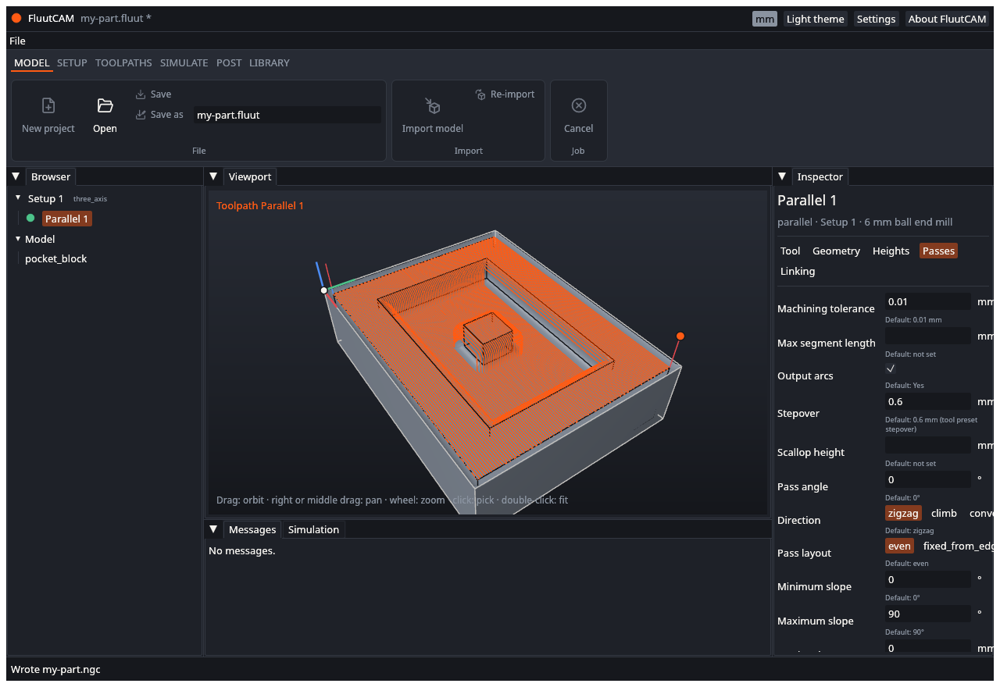

# Post G-code

**Posting** writes your toolpaths as a G-code program for one kind of controller. The part of FluutCAM that does this is called a **post processor**, or a **post**. Different controllers want different G-code, so you choose the post that matches yours. See [Machines and posts](Machines-and-Posts) for what the built-in posts do.

## Post from the window

1. Calculate first, or let **Post** do it: if a toolpath is out of date, FluutCAM calculates it before it posts.
2. In the **Post** stage of the ribbon, find the post list and output name (they may move as the ribbon is wired up). The list offers `fluut/linuxcnc`, `fluut/grbl` and `fluut/gcode`.
3. Check the output file name in the text box next to it. It starts as the project name with `.ngc`, in the project folder (`my-part.ngc`). Change it if you want another name or place.
4. Click **Post**.

The status bar says "Wrote my-part.ngc".



If a toolpath has an error, nothing is written and the status bar says "Cannot post the project" with the reason. Fix the error (see [Diagnostics](Diagnostics)) and post again. Warnings do not stop a post.

The program covers every enabled toolpath of every Setup, in order, as one file. A post can ask for more than one file; FluutCAM then names the extra files `name.2.ngc`, `name.3.ngc` and lists them all in the status bar.

## What the program looks like

Open the file in a text editor. A LinuxCNC program starts like this:

```
(FluutCAM 0.1.0)
(Project: Block)
(Post: fluut/linuxcnc)
(Layers: fluut/gcode@1.0, fluut/linuxcnc@1.0)
(Post hash: sha256:...)
G21
G17 G40 G49 G80 G90 G94
G64 P0.01
(Top)
G54
(6 mm flat)
T1 M6
G43 H1
S18000 M3
M8
(Pocket)
G0 X61.091 Y26.6 Z10
...
```

- The comment lines name the project, the post, and the post's layers. The hash identifies the post's exact text, so the same project and post always give the same program, on every computer.
- `G21` is millimetres. The built-in posts always write millimetres, even for a project that shows inches. The next lines set the plane, cancel compensations and use absolute moves.
- The Setup's name is a comment, then its work offset (`G54`).
- Then the tool: its name, a tool change, its length offset, the spindle speed and direction, and coolant if the toolpath asks for it.
- Each toolpath starts with a comment of its name, then its moves.
- The program ends with `M30`.

The same project and the same post always give the same G-code.

## Before you run it

FluutCAM is early software. Before you put a tool in material:

1. **Read the program.** Look at the header, the first moves and the first tool change.
2. **Check the units, the work offset and the tool numbers.** They must match your machine and your tool table.
3. **Run it in your controller's simulator, or in the air** with the tool well above the work.
4. **Check the feeds and speeds.** The starter tools carry cautious data for MDF only.
5. **Remember what FluutCAM does not know:** your clamps, your vise, your machine's limits and anything on the table. The [simulation](Calculate-and-Simulate) checks the tool and holder against the stock and part only.

## Tool changes and the post you choose

- **LinuxCNC** writes `T1 M6` and a tool length offset (`G43 H1`) at each tool change.
- **Grbl** has no tool changer, so it writes a stop that tells you which tool to fit: `M0 (Change to T1: 12 mm flat)`. Grbl does not have canned drilling cycles, so drilling is written out as separate moves, and FluutCAM warns about it. A toolpath that needs cutter compensation in the controller cannot be posted for Grbl.
- **Generic G-code** (`fluut/gcode`) is the plain RS-274 core the other two are built on.

## Rotary and indexed Setups

A program with a rotary axis needs a post that writes the A axis: **`fluut/linuxcnc-4x`**. The window's list does not offer it yet, so the window cannot write a good program for a rotary or indexed Setup. Use the command line:

```
fluut post my-part.fluut --post fluut/linuxcnc-4x -o my-part.ngc
```

See [Command line](Command-Line).

## Other things you cannot do from the window yet

- Choose a post that is not in the list (a post of your own, for example). The command line takes any post id.
- Post one Setup, or one toolpath, on its own. The window posts everything. The [scripting](Scripting) function `post` can post one Setup.

## Next

[Save, undo and recover](Save-Undo-Recover)
