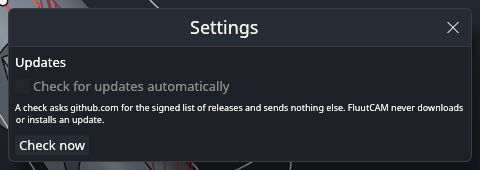

# Settings and updates

## Settings

Click **Settings** in the title bar. Today the Settings window holds one thing, the update check. Other options, such as default units, language and the layout of the panels, are **not yet** settings.

The title bar also has a **Light theme** / **Dark theme** button. The window starts dark each time; the choice is not saved.

## Updates

FluutCAM **never downloads or installs an update**. It can only tell you that a newer version exists, and then you download it yourself from the releases page.

### How the check works

- It is **off until you say yes.** The first time FluutCAM starts, it asks "Check for updates automatically?". **Yes** turns it on. **No**, or closing the question, leaves it off. You can change the answer in Settings at any time.
- When it is on, FluutCAM checks at most once a day, in the background, while it is running.
- A check is two requests to `github.com`: the signed list of releases, and its signature. FluutCAM sends nothing else: no project, no computer details, no version number. FluutCAM only trusts the list if its signature checks out against a key built into the program.
- **Check now** in Settings checks once, when you ask, whatever the automatic setting is.

### When there is a newer version

The status bar says "Version 0.2.0 is available". Open **Settings** and choose **Details** to see the release notes link and the download page. **Copy link** copies the page address. Open the page in your browser and download the file for your system yourself.

### When the check cannot run

- "This build has no update key, so it cannot check for updates." A build made without the project's signing key cannot verify the list, so it does not ask for it. At the time of writing the key has not been generated yet, so every build says this and the check is switched off.
- "The update check failed: ...". Usually there is no network. FluutCAM does not retry until the next day.

### On the command line

`fluut update-check` does the same check once, when you type it. See [Command line](Command-Line).

## Where your settings are kept

In a file `settings.toml` in FluutCAM's data folder:

| System | Folder |
|---|---|
| Windows | `%LOCALAPPDATA%\FluutCAM` |
| macOS | `~/Library/Application Support/FluutCAM` |
| Linux | `~/.local/share/fluutcam` (or `$XDG_DATA_HOME/fluutcam`) |

Setting the environment variable `FLUUT_DATA_DIR` uses that folder instead. The same folder holds the crash reports (in `crashes`). Delete the folder to remove all of it. A missing or damaged settings file gives the defaults.

## Next

[Keyboard shortcuts](Keyboard-Shortcuts)
