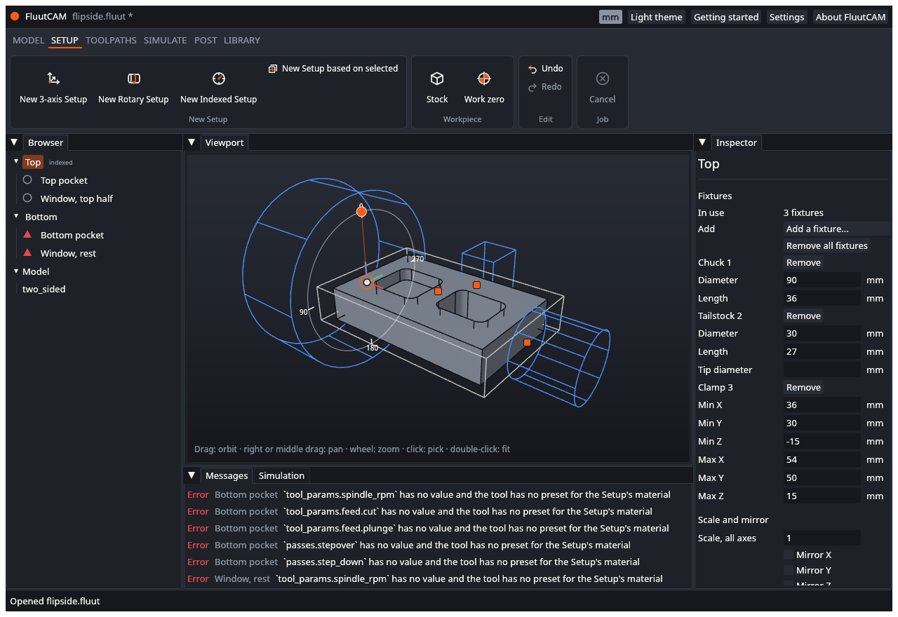

# Setups, stock and work zero

A **Setup** holds everything the toolpaths in it share: which bodies are machined, how the part is turned relative to the machine, the stock, the work zero, the machine and the material. This page explains each part. You change most of them in the window, in the inspector of the Setup (see [Add a Setup](Add-a-Setup)). The sections below also show how each one is written in the project file, which you only need if you prefer a text editor or want to script a change. If you edit the `.fluut` file in a text editor, close the project in FluutCAM first, or reopen it afterwards.

See [Add a Setup](Add-a-Setup) for adding one from the window.

## The project file

The file is TOML. A Setup is a `[[setup]]` table, and its toolpaths are `[[setup.toolpath]]` tables inside it. A 3-axis Setup looks like this (from the reference project `block`):

```toml
[[setup]]
id       = "s1"
name     = "Top"
kind     = "three_axis"
material = "MDF"
stock    = { kind = "block", margin = [5, 5, 0] }
zero     = { method = "stock_top_corner", corner = "front_left" }
```

All lengths in the file are millimetres, whatever unit the project shows. A key a Setup leaves out takes a default, or, for a Setup based on another, the parent's value.

## Edit in the window

Select a Setup in the Browser and use its inspector. The lists offer only choices that work for the Setup:

- **Stock.** A 3-axis Setup offers a block by margin, a block of a fixed size, and a body of the model. A rotary or indexed Setup offers a cylinder, or a body of the model. A Setup based on another also offers "From the previous Setup".
- **Kind.** Rotary and Indexed share their values. Changing to or from 3-axis also rewrites the orientation, the work zero, the stock and the clearance to the defaults of the new kind (one undo step).
- **Bodies.** A check box for each body, and **Pick** to choose on the model.
- **Scale and mirror.** **Scale, all axes** takes one factor for the model (for example `25.4` for a model drawn in inches). **Mirror X**, **Mirror Y** and **Mirror Z** flip the model across the model's own planes. Both are about the model's origin, and the Setup's stock, zero and handles follow.
- **Orientation.** The tool axis and X axis, or the rotary axis and the A = 0 direction. A list of model directions, or **Pick** a face or an edge.
- **Work zero.** A 3-axis Setup offers the four top corners, the centre of the top, the four bottom corners, and a point on the model. A rotary or indexed Setup offers the left end, the right end, or a position along the axis.
- **Inherited values.** A value that a based-on Setup takes from its parent shows "Inherited from" and the parent's name. Edit it to make it the Setup's own. **Reset to inherited** takes the parent's value back.

- **Fixtures.** A rotary or indexed Setup has a **Fixtures** group: add a chuck, a tailstock or a clamp, and edit or remove each one. See [Fixtures](#fixtures) below.
- **Handles.** Drag the work zero, the block margins or size, a cylinder's radius and length, and the index angle of an indexed Setup on the model. The work zero also snaps to the model's vertices and the centres of its arcs and circles. See [Add a Setup](Add-a-Setup).

Lengths follow the project unit. Each change is one undo step.

## Kinds

`kind` is `three_axis`, `rotary` or `indexed`. [Add a Setup](Add-a-Setup) explains when to use each.

## Machine and material

- `machine = "fluut/generic-3axis-router@1"` names the machine definition and its version. See [Machines and posts](Machines-and-Posts). The machine says what your machine can do: its travel limits, spindle range, rotary axis and tool changer.
- `material = "MDF"` picks the cutting data (feeds, speeds, stepover, step-down) of the tools: a tool's preset for that material. A toolpath whose tool has no preset for the material cannot find its feeds and reports "has no value and the tool has no preset for the Setup's material". See [Tools](Tools).
- `work_offset = "G54"` is the work coordinate system the program selects.

## Bodies

`geometry = { bodies = ["b-494"] }` limits the Setup to some of the model's bodies. Leave it out to machine every body of every imported file. In the window, use the **Bodies** group. A Setup can also scale and mirror the model: `scale = [1, 1, 1]`, `mirror = [false, false, false]` (factors per axis, and a flip per axis, about the model's origin). In the window, use **Scale and mirror**. The window sets one factor for every axis. A STEP solid, or a drawing with arcs and circles, only takes the same factor on every axis (a mirror is fine): with different factors the Setup shows "cannot be scaled by different factors per axis". A file with a factor per axis shows each one in the inspector. The default, all ones and no mirror, is not written.

## Orientation

Orientation says how the model sits relative to the machine's axes.

**3-axis.** `orientation = { tool_axis = "+Z", x_axis = "+X" }`. The tool axis is the direction the tool points down from; the X axis is the direction the machine's X runs along the model. The default is +Z and +X: the model as you imported it. Each can be a model axis (`"+X"`, `"-Y"`, `"+Z"` and so on) or a face (`{ face = "f-3" }`), which uses that face's direction. To cut the underside of a part, point the tool axis the other way.

**Rotary and indexed.** `orientation = { rotary_axis = "+X", a_zero_toward = "+Z" }`. The rotary axis is the line the part turns about; give a model axis or a round face (`{ face = "f-354.0" }`) whose axis it is. `a_zero_toward` is the direction in the model that points up (+Z of the work frame) when the rotary axis is at A = 0. The default is +Z.

In the window, use the **Orientation** group: choose a model direction from the list, or click **Pick** and click a flat face, a round face or an edge. The window stores the face or edge id for you. To write one by hand, click the face in the viewport: its id shows at the top left ("Face f-494.10").

## Stock

`stock` is the raw material:

| Stock | Written as | Use |
|---|---|---|
| Block | `{ kind = "block", margin = [2, 2, 1] }` | A box: the model's size plus a margin in X, on each side, in Y, on each side, and on top |
| Block of a given size | `{ kind = "block", size = [100, 80, 20] }` | A box of that size, centred on the model in X and Y, with its bottom at the model's bottom |
| Cylinder | `{ kind = "cylinder", radius = 26, length = 120 }` | Round stock around the rotary axis |
| Body | `{ kind = "body", body = "b-12" }` | A body of the model as the stock, such as a casting. The body is never machined |
| From previous | `{ kind = "from_previous" }` | The material left after the parent Setup's toolpaths. Needs `based_on` |

A 3-axis Setup defaults to a block, a rotary or indexed one to a cylinder, and a Setup with `based_on` to `from_previous`.

Not every kind works in every Setup yet. A 3-axis Setup calculates with a block or a body. A rotary Setup needs a cylinder. An indexed Setup takes a block or a cylinder. A `body` stock works in all three kinds, and the body is never machined. In a 3-axis Setup the stock is the box of the body in the Setup's frame. In an indexed Setup it is that box too, at A = 0. In a rotary Setup it is the **bounding cylinder** of the body about the rotary axis: as long as the body along the axis, and as wide as its farthest point from the axis. A body that is not round, such as a square bar or a casting, therefore gives round stock that holds it, with more material than the body has. See [Known limits](Known-Limits).

## Work zero

The work zero is the point where the machine's X, Y and Z are zero. You set the same point on the machine, with your probe or by touching off, so the program and the machine agree.

| For | Written as | Meaning |
|---|---|---|
| 3-axis | `{ method = "stock_top_corner", corner = "front_left" }` | The top corner of the stock. The corner is `front_left`, `front_right`, `back_left` or `back_right`, seen from above with front toward -Y |
| 3-axis | `{ method = "stock_bottom_corner", corner = "back_right" }` | The bottom corner |
| 3-axis | `{ method = "stock_top_centre" }` | The centre of the stock's top |
| 3-axis | `{ method = "point", at = [10, 20, 0] }` | A point in the model |
| Rotary, indexed | `{ x = "stock_left" }` | On the rotary axis, at the left end of the stock. `"stock_right"` or a number also work |

In the window, dragging the work zero handle also snaps to the model's vertices and to the centres of its arcs and circles (a 3-axis Setup writes `point` with that place; a rotary or indexed Setup writes the X along the axis, since its zero stays on the axis). Meshes (STL) have no such points: every triangle corner would be one.

Rotary and indexed zeros always lie on the rotary axis in Y and Z. Putting the zero there means every rotary and indexed Setup on the same fixture can share one work offset: indexing never moves the zero.

## Clearance

`clearance` is the safe height for the longest moves. For 3-axis Setups it is a plane above the stock: `clearance = { kind = "plane", offset = 10 }` (the default, 10 mm above the stock top). For rotary and indexed Setups it is a cylinder around the axis: `clearance = { kind = "cylinder", radius = 35 }`. The cylinder must be larger than the stock, or FluutCAM stops with "the clearance cylinder must lie outside the stock".

## Fixtures

A rotary or indexed Setup can list the **fixtures that turn with the part**, so that the tool rises high enough before the part turns. Add them in the **Fixtures** group of the inspector (a 3-axis Setup does not show the group), or write them in the project file or set `fixtures` from a script. The X positions are in the Setup's work frame, where X runs along the rotary axis from the work zero.



**In the window.** The group starts with **In use** (how many fixtures, and where the list comes from), the **Add** list (Chuck, Tailstock, Clamp) and **Remove all fixtures**. Below come the fixtures in order, each with a **Remove** button and its fields, in the project unit:

- Chuck: **Diameter** and **Length**.
- Tailstock: **Diameter**, **Length** and **Tip diameter** (leave it empty for a plain cylinder).
- Clamp: **Min X**, **Min Y**, **Min Z** and **Max X**, **Max Y**, **Max Z**, the two corners of the box at A = 0.

A new fixture starts with a size that fits the stock and does not touch it: a chuck three times the stock's radius wide and 40 % of its length long, a tailstock the stock's radius wide, and a clamp beside the stock on the +Y side. Change the numbers to match your fixture. An entry is checked as the project file is: sizes must be above 0, the tip diameter must not be negative, and each maximum of a clamp must be above its minimum; a refused entry shows the reason under the row and changes nothing. Each add, remove and edit is one undo step.

The list is inherited as a whole. In a Setup based on another that has no list of its own, **In use** says "Inherited from" and the parent's name and shows the parent's fixtures. Editing any of them, or clicking **Make a local copy**, gives the Setup its own copy; **Remove all fixtures** gives it an empty list, which overrides the parent's. **Reset to inherited** takes the parent's list back.

The viewport draws the fixtures of the selected Setup as blue wire frames in the Setup's frame, at its index angle: a drum for a chuck, a cylinder or cone for a tailstock, and a box for a clamp, which turns with the part. They are drawings for orientation, not solids; you cannot pick them.

**In the file.** Sizes are in millimetres.

```toml
fixtures = [
  { kind = "chuck", diameter = 120, length = 40 },
  { kind = "tailstock", diameter = 30, length = 25, tip_diameter = 8 },
  { kind = "clamp", min = [40, -35, -6], max = [55, 35, 6] },
]
```

- A **chuck** is a cylinder about the axis against the start face of the stock (the lowest X), reaching `length` outward.
- A **tailstock** is a cylinder, or a cone with `tip_diameter`, against the end face of the stock (the highest X). `diameter` is its width at the far end.
- A **clamp** is a box between two corners, given at A = 0. In an indexed Setup it turns with the index angle.

The tool rises to the largest distance from the axis of the stock, the part and any fixture it can reach, plus the clearance offset. The tool can reach a fixture when the fixture lies within the stock's length, widened at both ends by the tool's radius. A fixture further away, or smaller than the part, changes nothing. FluutCAM writes the list on one line when it saves the project. A Setup based on another takes the parent's list unless it has its own (an empty list, `fixtures = []`, means none). Fixtures are ignored, with a warning, in a 3-axis Setup. For an indexed Setup, **Simulate** reports a toolpath that meets a fixture (`sim.fixture`).

## Index angle

An indexed Setup turns the part to an angle and locks it: `index_angle = { mode = "absolute", value = 180 }`. A `relative` angle adds to the parent Setup's angle: `{ mode = "relative", value = 90 }`. At the start of the Setup the program turns the A axis, after lifting the tool clear of the stock.

In the window, type the angle in **Index angle**, or drag the **dial** on the model: a ring round the rotary axis at the start of the stock, with an orange pointer where the part's own +Z direction is. Drag the pointer round the ring and the angle follows your cursor, in steps of 5 degrees; hold Shift for steps of 1 degree, or Alt for no steps. Near 0, 90, 180 and 270 degrees the pointer always takes the exact angle. Nothing changes until you let go, and then the change is one undo step. For a relative angle the dial shows and sets the resulting angle, and writes it relative to the parent's. See [Add a Setup](Add-a-Setup).

## Based on another Setup

`based_on = "s1"` names an earlier Setup. Keys the new Setup leaves out come from the parent, and follow later changes to the parent. The parent must come first in the file. Toolpaths are never inherited. When a Setup has `stock = { kind = "from_previous" }`, it keeps the parent's machine, bodies, scale, rotary axis and work zero, and may change only its kind, index angle, region and clearance. Anything else is an error, because the carried-over stock would no longer line up with the part.

The reference project `flipside` is a worked example: two indexed Setups, 0 and 180 degrees, the second based on the first.

## Region

`region = { floor_z = -20 }` limits the Setup to a floor height. Most projects do not need it.

## Next

[Machines and posts](Machines-and-Posts)
