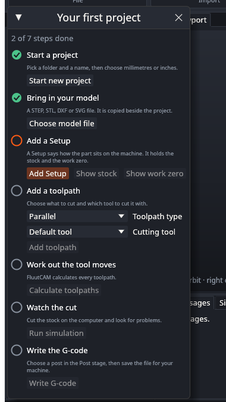

# UAT: Getting started card

Tests of the Getting started card: its steps, its buttons, and closing and reopening it. Part of the [user acceptance tests](UAT): read the setup there first. Test files: `block/block.step` (and the `block` project), copied to a work folder. The card is described in [Getting started](Getting-Started).

---

### UAT-GDE-01 The card shows at the first start

- **Preconditions:** FluutCAM has never been started on this account, or its data folder is empty (see [Settings and updates](Settings-and-Updates)). Start it with no project.
- **Steps:**
  1. Look at the window.
- **Expected:** A card called "Your first project" shows over the lower left of the window. It says "0 of 7 steps done" and lists seven steps: Start a project, Bring in your model, Add a Setup, Add a toolpath, Work out the tool moves, Watch the cut, Write the G-code. Each has an empty ring, and the ring of the first is orange. Only **Start new project** is available; the other buttons are greyed out. The ribbon and the rest of the window still work.

- [ ] Pass

### UAT-GDE-02 A first job with the card only

- **Preconditions:** UAT-GDE-01. An empty work folder.
- **Steps:**
  1. Click **Start new project**. In the dialog go to the work folder, type `my-part` and confirm. In the window that asks for the unit, click **Millimetres**.
  2. Click **Choose model file** and pick `block.step`.
  3. Click **Add Setup**.
  4. Click **Add toolpath**.
  5. Click **Calculate toolpaths** and wait for it to end.
  6. Click **Run simulation** and wait for it to end.
  7. Click **Write G-code**. In the dialog confirm `my-part.ngc` in the work folder.
- **Expected:** After each step its ring turns into a green tick, the line above the list counts up ("1 of 7 steps done" after step 1, and so on), and the ring of the next step turns orange. The status bar says what each step did: "Created my-part.fluut", "Imported block.step (1 bodies)", "Added Setup 1", "Added Parallel 1", "Calculated 1 toolpaths", then "Wrote my-part.ngc". After the last step the card says "All steps done. Your G-code is written." and `my-part.ngc` exists in the work folder with `G1` moves in it. The dialogs were your system's file dialogs; the card has no box for a path.
- [ ] Pass

### UAT-GDE-03 The card follows the ribbon

- **Preconditions:** A new project with no model, and the card showing (UAT-GDE-02 step 1).
- **Steps:**
  1. In the Model stage click **Import model** in the ribbon and pick `block.step`.
  2. In the Setup stage click **New 3-axis Setup**.
  3. In the Toolpaths stage click **Parallel**, then **Calculate all**.
- **Expected:** The card ticks Bring in your model, Add a Setup, Add a toolpath and Work out the tool moves as each is done, with no click in the card.
- [ ] Pass

### UAT-GDE-04 Closing the card and opening it again

- **Preconditions:** The card is showing.
- **Steps:**
  1. Click the **x** in the title bar of the card.
  2. Quit FluutCAM and start it again.
  3. Click **Getting started** in the title bar of the window (beside Settings).
  4. Click **Getting started** again.
  5. Quit and start FluutCAM again.
- **Expected:** After step 1 the card is gone. After step 2 it does not come back. After step 3 it shows again, with the ticks that the open project has earned. After step 4 it is gone again. After step 5 it is still gone, because closing it was the last thing you did. (If you stop after step 3 and restart, it shows.)
- [ ] Pass

### UAT-GDE-05 Choose the type and the tool

- **Preconditions:** A project with a Setup and the card showing, for example the `block` project (open it with **Open**). Click **Getting started** if the card is closed.
- **Steps:**
  1. In the card, open the **Toolpath type** list. It shows the 2-D, hole, 3-D and utility types, and no rotary type.
  2. Choose **2D pocket**.
  3. Open the **Cutting tool** list. The first entry is **Default tool**; the others are the starter tools, each with its shape and diameter.
  4. Choose a tool.
  5. Click **Add toolpath**.
- **Expected:** A new toolpath named "2D pocket" and a number appears in the Browser and is selected. On the **Tool** tab of the inspector it holds the tool you chose. With **Default tool** it holds the tool FluutCAM picks for the type.
- [ ] Pass

### UAT-GDE-06 Show stock and work zero

- **Preconditions:** A project with a model and the card showing, with a Setup added (UAT-GDE-02 step 3).
- **Steps:**
  1. Click **Show stock** in the card.
  2. Click **Show work zero** in the card.
- **Expected:** The Setup is selected. The inspector scrolls to the Stock group after step 1 and to the Work zero group after step 2, where you can change them. Both buttons are greyed out while there is no Setup.
- [ ] Pass

### UAT-GDE-07 Undo takes a tick back, and a change makes the work stale

- **Preconditions:** UAT-GDE-02 up to step 5.
- **Steps:**
  1. Click **Undo** in the Edit group of the ribbon once.
  2. Click **Redo** once, and calculate again (card).
  3. In the inspector change the **Stepover** on the Passes tab.
- **Expected:** After step 1 the toolpath is gone, the ticks of Add a toolpath and the steps after it are empty again, and **Calculate toolpaths**, **Run simulation** and **Write G-code** are greyed out. After step 2 the ticks are back. After step 3 the toolpath is out of date, so Work out the tool moves is not ticked, and the card's next step is orange again.
- [ ] Pass

### UAT-GDE-08 A cancelled dialog changes nothing

- **Preconditions:** A new project with the card showing (UAT-GDE-02 step 1).
- **Steps:**
  1. Click **Choose model file**, then **Cancel** in the file dialog.
  2. Click **Start new project**, then **Cancel** in the file dialog.
- **Expected:** Nothing changes: no model is added, the open project stays open, the ticks stay as they were, and there is no error.
- [ ] Pass

### UAT-GDE-09 An open project is already part way

- **Preconditions:** The card is showing, no project is open.
- **Steps:**
  1. Click **Open** in the ribbon and pick the `block` project.
- **Expected:** The first four steps are ticked (the project has a model, a Setup and toolpaths); Work out the tool moves is orange. Write the G-code is not ticked: it is ticked only when you write G-code in this session.
- [ ] Pass
