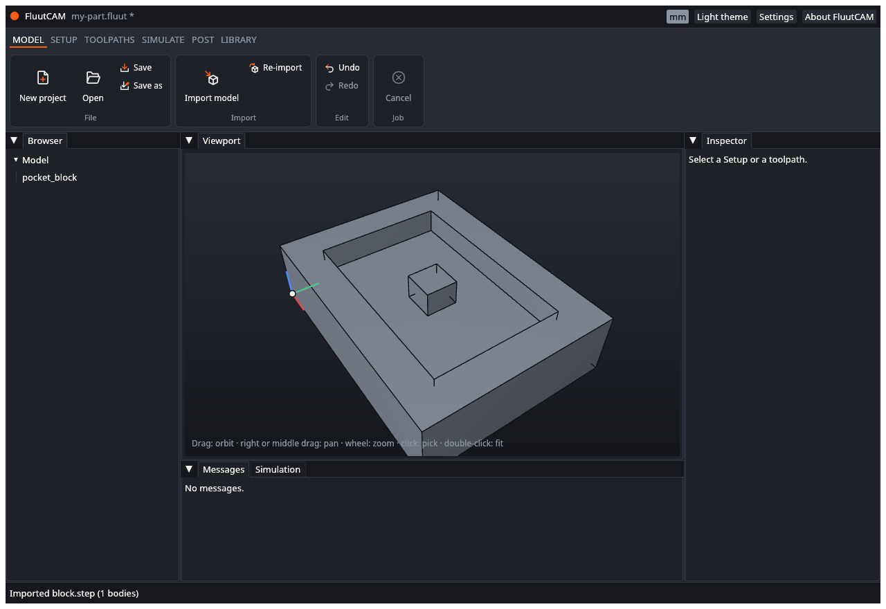
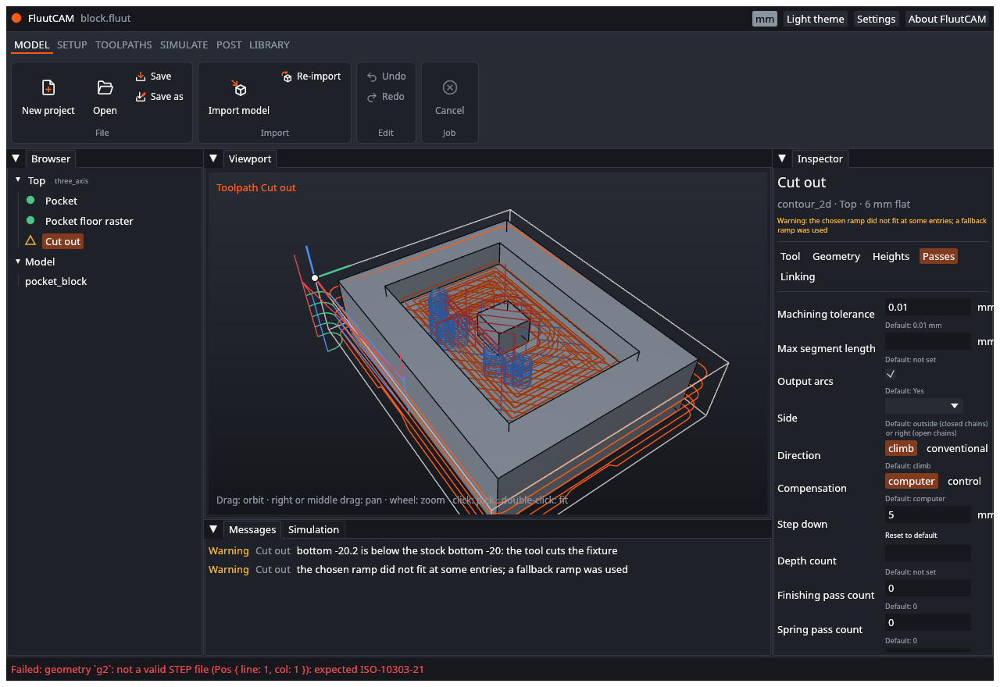

# UAT: Import

Tests of importing model files, the copy rules, units and bad files. Part of the [user acceptance tests](UAT). Test files: `crates/fluut-cli/tests/projects/block/block.step`, `plate/plate.dxf`, `vcarve/vcarve.dxf`, `fuzz/seeds/stl/tetra.stl`, and two files you make yourself (below). Each test starts from a new project, `my-part`, in the work folder, as in [UAT-PRJ-02](UAT-Project-Files), unless it says otherwise.

**Files to make:**

- `broken.step`: a text file containing `this is not a STEP file`.
- `notes.txt`: any text file.

---

### UAT-IMP-01 Import a STEP file

- **Preconditions:** A new, empty project.
- **Steps:**
  1. In the Model stage click **Import model** (or press Ctrl+I).
  2. Pick `block.step` in the dialog.
- **Expected:** The status bar says "Imported block.step (1 bodies)". The Browser lists the body `pocket_block` under **Model**. The viewport shows the block with its pocket. **Undo** is now available. The title shows `*`.

- [ ] Pass

### UAT-IMP-02 The file is copied into the project folder

- **Preconditions:** UAT-IMP-01 done, with `block.step` picked from outside the work folder.
- **Steps:**
  1. Look in the work folder.
  2. Save the project and open `my-part.fluut` in a text editor.
- **Expected:** The folder holds `block.step` (a copy). The project file has a `[[geometry]]` table with `path = "block.step"` (a path with no folder, relative to the project) and `kind = "step"`.
- [ ] Pass

### UAT-IMP-03 A file already in the project folder is not copied

- **Preconditions:** A new project in a folder that already contains `block.step`.
- **Steps:**
  1. Import that `block.step`.
  2. Look in the folder.
- **Expected:** The import works and no `block-2.step` appears. The path in the project is `block.step`.
- [ ] Pass

### UAT-IMP-04 Same name, different file

- **Preconditions:** A project folder that contains a different STEP file named `block.step` (for example a copy of `boss.step` renamed).
- **Steps:**
  1. Import `block/block.step` from the reference projects.
  2. Look in the folder.
- **Expected:** The import works. The folder holds the old `block.step` and a new `block-2.step`. The project refers to `block-2.step`.
- [ ] Pass

### UAT-IMP-05 Import the same file twice

- **Preconditions:** UAT-IMP-01 done (the project holds `block.step`).
- **Steps:**
  1. Import the same `block.step` again.
- **Expected:** The import is refused: the status bar turns red with "Failed:" and a message that a body of the file has the id of a body of the source already in the project (`model.import.body_ids`). Nothing changes: no second copy of the file, no new model, no new undo step.
- [ ] Pass

### UAT-IMP-06 A file that is not STEP

- **Preconditions:** A new project; `broken.step` made as above.
- **Steps:**
  1. Import `broken.step`.
- **Expected:** The status bar turns red: "Failed:" and a message that says the geometry is not a valid STEP file, with a position. The Browser still lists no model. No `broken.step` is left in the project folder. **Undo** is unchanged (nothing was added).

- [ ] Pass

### UAT-IMP-07 The dialog offers model files

- **Preconditions:** A new project; `notes.txt` in the work folder.
- **Steps:**
  1. Click **Import model**. Look at the file type list of the dialog. If your system lets you show all files and pick `notes.txt`, do that.
- **Expected:** The dialog's filter is "Models (STEP, STL, DXF, SVG)". If `notes.txt` is picked anyway, the import fails with "Failed:" and a message that it is not a STEP, STL, DXF or SVG file, and nothing changes.
- [ ] Pass

### UAT-IMP-08 An STL file

- **Preconditions:** A new project; `fuzz/seeds/stl/tetra.stl`.
- **Steps:**
  1. Import `tetra.stl`.
- **Expected:** The import fails: "Failed:" and a message that the file gave no geometry. No model appears and the project folder has no copy of the file. (This is a known limit: see [Known limits](Known-Limits). If the import succeeds, record it: a feature has changed and this test needs updating.)
- [ ] Pass

### UAT-IMP-09 A DXF file

- **Preconditions:** A new project in millimetres; `plate/plate.dxf`.
- **Steps:**
  1. Import `plate.dxf`.
- **Expected:** The import works. FluutCAM warns that the file carries no reliable unit and that it assumed millimetres, the project unit (`model.import.unit_assumed`), in the Messages tab or the status bar. The viewport shows the plate's outline as flat curves. A body is listed under **Model**.
- [ ] Pass

### UAT-IMP-10 The unit follows the project

- **Preconditions:** A new project in inches.
- **Steps:**
  1. Import `plate.dxf`.
  2. Compare the size of the outline in the viewport with UAT-IMP-09.
- **Expected:** FluutCAM warns that it assumed inches. The outline is 25.4 times larger than in UAT-IMP-09, because the same numbers are read as inches.
- [ ] Pass

### UAT-IMP-11 Two DXF files with the same body ids

- **Preconditions:** A new project; `plate.dxf` already imported.
- **Steps:**
  1. Import `vcarve/vcarve.dxf` as well.
- **Expected:** The second import is refused: "Failed:" and a message that a body has the id of a body of the first file (`model.import.body_ids`). The first file stays; the project is unchanged by the failed import. (A known limit.)
- [ ] Pass

### UAT-IMP-12 Undo an import

- **Preconditions:** UAT-IMP-01 done.
- **Steps:**
  1. Click **Undo** (Ctrl+Z).
- **Expected:** The status bar says "Undid Add geometry". The model disappears from the Browser and the viewport. **Redo** is available and brings the model back.
- [ ] Pass

### UAT-IMP-13 Import needs a project

- **Preconditions:** FluutCAM started with no project.
- **Steps:**
  1. Look at **Import model** in the Model stage. Press Ctrl+I.
- **Expected:** **Import model** is greyed out, and Ctrl+I opens no dialog.
- [ ] Pass

### UAT-IMP-14 Cancel the import dialog

- **Preconditions:** A project is open.
- **Steps:**
  1. Click **Import model** and cancel the dialog.
- **Expected:** Nothing changes: no new model, no new undo step, the title still shows no `*` if there were no changes.
- [ ] Pass

### UAT-IMP-15 A project with a model and no Setup is drawn

- **Preconditions:** UAT-IMP-01 done; no Setup added.
- **Steps:**
  1. Drag in the viewport to orbit. Scroll to zoom. Double-click to fit.
- **Expected:** The model turns, zooms and fits. The Browser shows only the Model. The inspector says "Select a Setup or a toolpath."
- [ ] Pass

### UAT-IMP-16 Re-import

- **Preconditions:** `block` open (a copy of the project, with `block.step` in its folder).
- **Steps:**
  1. Click **Re-import** in the Model stage.
- **Expected:** The status bar says "Re-imported 1 models, 0 selections not found" (or the matching counts). The model looks the same. With no model in the project, **Re-import** is greyed out.
- [ ] Pass
