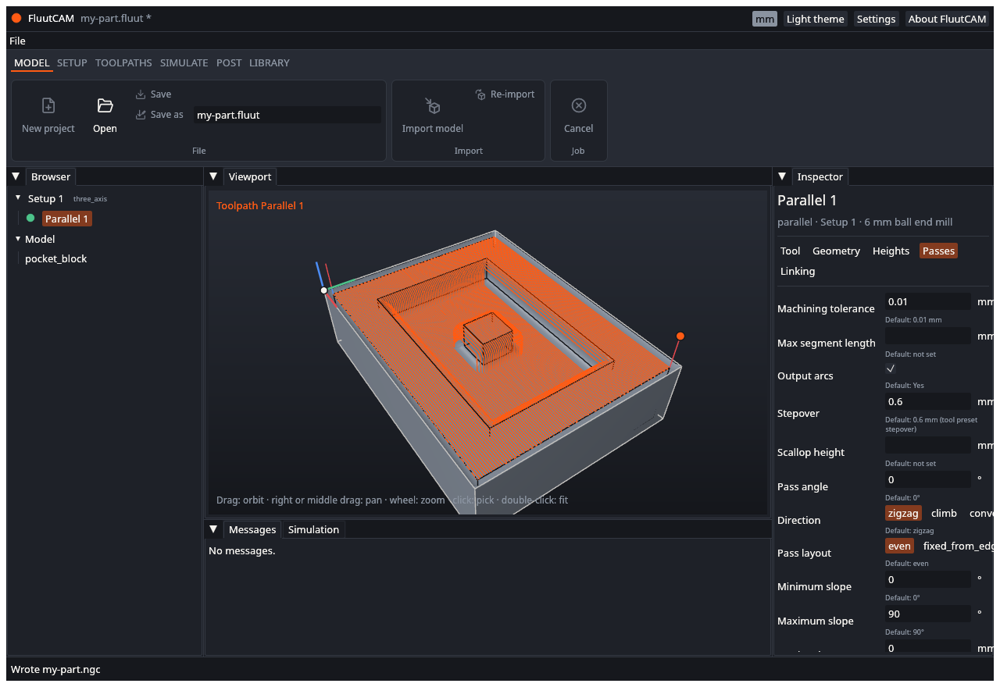

# UAT: Post

Tests of writing G-code from the window. Part of the [user acceptance tests](UAT). Test files: the `block`, `boss`, `holes` and `shaft` projects, and the expected programs in `crates/fluut-cli/tests/golden/`. Work on copies. The comparison tests (UAT-PST-09 and UAT-PST-10) use the command line.

---

### UAT-PST-01 Post with LinuxCNC

- **Preconditions:** `block` open and calculated. The Output list shows `fluut/linuxcnc`.
- **Steps:**
  1. Check the output file box: it holds `block.ngc` in the project folder.
  2. Click **Post**.
- **Expected:** The status bar says "Wrote block.ngc". The file exists and starts with `(FluutCAM` and `(Project:`. It has `G21`, the Setup name `(Top)`, `G54`, a `T1 M6` tool change and `G43 H1`, and ends with `M30`.

- [ ] Pass

### UAT-PST-02 Post with Grbl

- **Preconditions:** `holes` open and calculated.
- **Steps:**
  1. Choose `fluut/grbl` in the Output list. Set the output name to `holes.gcode`.
  2. Click **Post**.
- **Expected:** The file is written. Tool changes read `M0 (Change to T1: ...)` (no `M6`). Drilling is written as separate moves (no `G81` or `G83`). The Messages tab may warn that drilling was expanded; record whether it did.
- [ ] Pass

### UAT-PST-03 Post with generic G-code

- **Preconditions:** `block` open and calculated.
- **Steps:**
  1. Choose `fluut/gcode` and click **Post**.
- **Expected:** The file is written, with `G21` and `M30`. It is plain RS-274 without the LinuxCNC tool length offset (`G43`).
- [ ] Pass

### UAT-PST-04 Change the output name

- **Preconditions:** `block` open.
- **Steps:**
  1. Replace the output file box text with `first-cut.ngc`.
  2. Click **Post**.
- **Expected:** The status bar says "Wrote first-cut.ngc" and the file is in the project folder under that name.
- [ ] Pass

### UAT-PST-05 Post calculates what is out of date

- **Preconditions:** `block` open, not calculated.
- **Steps:**
  1. Click **Post** without calculating.
- **Expected:** FluutCAM calculates the toolpaths, then writes the file. The status bar shows the calculation, then "Wrote block.ngc".
- [ ] Pass

### UAT-PST-06 A toolpath with an error blocks the post

- **Preconditions:** A project with a toolpath that fails: add a **2D pocket** in the window (see UAT-TP-12).
- **Steps:**
  1. Click **Post**.
- **Expected:** The status bar turns red: "Cannot post the project" with the reason. No file is written (or the earlier file is not changed). The Messages tab lists the error.
- [ ] Pass

### UAT-PST-07 Warnings do not block the post

- **Preconditions:** `block` open and calculated. Its toolpath "Cut out" has a warning.
- **Steps:**
  1. Click **Post**.
- **Expected:** The file is written. The warnings stay in the Messages tab.
- [ ] Pass

### UAT-PST-08 Post a project that has no Setup

- **Preconditions:** A new project with a model and no Setup.
- **Steps:**
  1. Open the ribbon and look at **Post**. Click it if it is enabled.
- **Expected:** Either **Post** is greyed out, or a program with only a header and `M30` is written, or a clear message appears. The program does not crash. Record which happened.
- [ ] Pass

### UAT-PST-09 The output matches the reference program

- **Preconditions:** A copy of `block`. A shell in its folder, with `fluut` on the path.
- **Steps:**
  1. Run `fluut post block.fluut --post fluut/linuxcnc -o block.ngc --date 2026-11-01 --time 12:00:00`.
  2. Compare `block.ngc` with `crates/fluut-cli/tests/golden/block-linuxcnc.ngc`, for example with `diff`.
- **Expected:** The files are identical, byte for byte, except that the header names the version of your build. If the version line differs, only that line differs.
- [ ] Pass

### UAT-PST-10 Every reference program matches

- **Preconditions:** Copies of the reference projects.
- **Steps:**
  1. For each file in `crates/fluut-cli/tests/golden/`, run the matching `fluut post` command with `--date 2026-11-01 --time 12:00:00`. The post is in the file name: `linuxcnc`, `grbl` or `linuxcnc-4x` (the id `fluut/` plus that name).
  2. Compare.
- **Expected:** All thirteen outputs match their golden file, apart from the version line.
- [ ] Pass

### UAT-PST-11 A rotary part needs the 4-axis post

- **Preconditions:** A copy of `shaft`.
- **Steps:**
  1. Run `fluut post shaft.fluut --post fluut/linuxcnc-4x -o shaft.ngc`.
  2. Look for A moves in the file.
- **Expected:** The file is written and has `A` words. Using `fluut/linuxcnc` for the same project gives a program without the rotary axis, or an error message, but never a crash. In the window the Output list has no 4-axis post (see [Known limits](Known-Limits)).
- [ ] Pass

### UAT-PST-12 Post the same project twice

- **Preconditions:** `block` open and calculated.
- **Steps:**
  1. Post to `a.ngc`, then to `b.ngc`.
  2. Compare the two files.
- **Expected:** The files are identical, apart from any date or time in the header. (The built-in posts write no date.)
- [ ] Pass

### UAT-PST-13 Read the program before you cut

- **Preconditions:** A written program from UAT-PST-01.
- **Steps:**
  1. Open the file in a text editor. Check the units, the work offset, the tool numbers, the feeds and the spindle speeds against the toolpath settings.
- **Expected:** They match. The tool numbers match the order of the tools. This test is a reminder, and is a habit to keep for every real job.
- [ ] Pass
