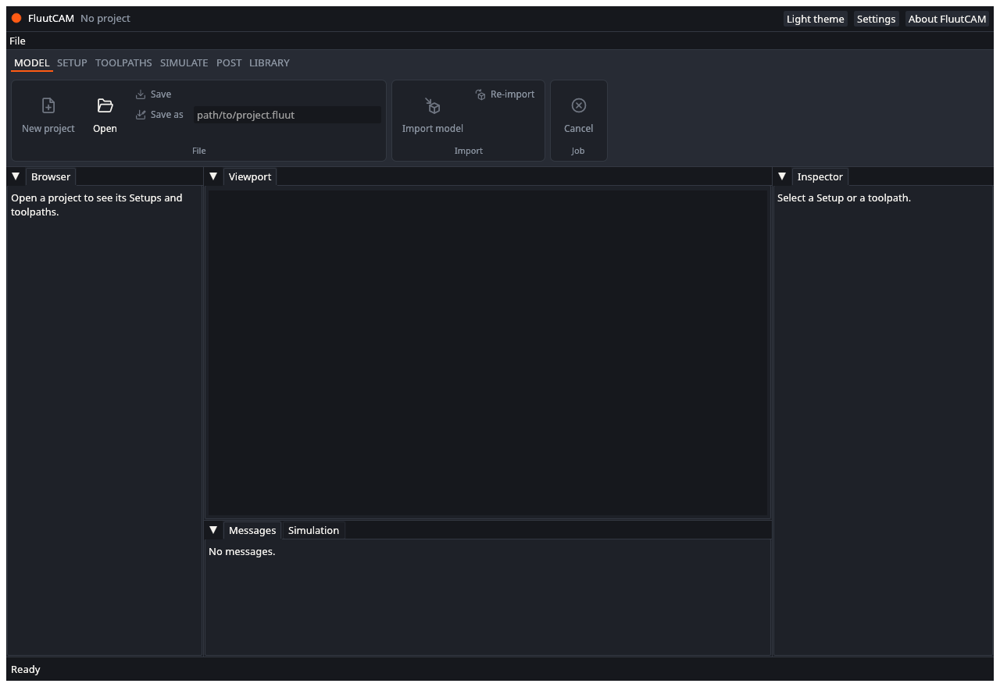

# UAT: Project files

Tests of starting, opening, saving and undoing. Part of the [user acceptance tests](UAT): read the setup there first. Test files: the `block` and `shaft` folders of the reference projects, copied to a work folder.

---

### UAT-PRJ-01 Nothing is open at the start

- **Preconditions:** FluutCAM is started with no project (not from a project file).
- **Steps:**
  1. Look at the window.
  2. Open the **File** menu.
- **Expected:** The title bar says "No project". The Browser says "Open a project to see its Setups and toolpaths." The status bar says "Ready". In the File menu, New project (mm), New project (inch) and Open are available, and Save, Save as, Import model, Undo, Redo, Add Setup and Add toolpath are greyed out.

- [ ] Pass

### UAT-PRJ-02 New project in millimetres

- **Preconditions:** UAT-PRJ-01. An empty work folder.
- **Steps:**
  1. Choose **File, New project (mm)...**.
  2. In the dialog, go to the work folder, type `my-part`, and confirm.
- **Expected:** The status bar says "Created my-part.fluut". The title bar shows `my-part.fluut` with no `*`. The unit badge says **mm**. The file `my-part.fluut` exists in the work folder. The Browser lists no Setups.
- [ ] Pass

### UAT-PRJ-03 New project in inches

- **Preconditions:** UAT-PRJ-02 done, so a project is open and saved.
- **Steps:**
  1. Choose **File, New project (inch)...**.
  2. Name it `my-part-inch` in the work folder and confirm.
- **Expected:** The window does not ask about unsaved changes (there are none). The title bar shows `my-part-inch.fluut`. The unit badge says **inch**.
- [ ] Pass

### UAT-PRJ-04 Cancel the New dialog

- **Preconditions:** A project is open.
- **Steps:**
  1. Choose **File, New project (mm)...**.
  2. Cancel the dialog.
- **Expected:** Nothing changes. The same project stays open and no file is created.
- [ ] Pass

### UAT-PRJ-05 Open a reference project from the File menu

- **Preconditions:** A copy of the `block` folder in the work folder.
- **Steps:**
  1. Choose **File, Open...**.
  2. Pick `block/block.fluut`.
- **Expected:** The status bar says "Opened block.fluut". The Browser shows the Setup "Top" (`three_axis`) with three toolpaths, "Pocket", "Pocket floor raster" and "Cut out", each with a hollow grey circle, and the Model "pocket_block". The viewport shows the block with a pocket and its stock outline. The inspector shows the Setup's values.
- [ ] Pass

### UAT-PRJ-06 Open by typing a path

- **Preconditions:** FluutCAM is running. A copy of `block` in the work folder.
- **Steps:**
  1. Click in the box next to the ribbon's **Open** button. Replace its text with the full path of `block/block.fluut`.
  2. Click **Open**.
- **Expected:** The project opens as in UAT-PRJ-05.
- [ ] Pass

### UAT-PRJ-07 Open a project that does not exist

- **Preconditions:** A project is open.
- **Steps:**
  1. In the ribbon's Open box, type a path to a file that does not exist, for example `nothing.fluut`.
  2. Click **Open**.
- **Expected:** The status bar turns red and says "Failed:" followed by a reason that includes "cannot read" and the file name. The project that was open stays open and unchanged.
- [ ] Pass

### UAT-PRJ-08 Open a damaged project file

- **Preconditions:** A text file `bad.fluut` in the work folder containing only the word `garbage`.
- **Steps:**
  1. Open `bad.fluut` with the Open box.
- **Expected:** The status bar turns red with "Failed:" and a message saying the file is not valid TOML and where. No project opens (or the previous project stays).
- [ ] Pass

### UAT-PRJ-09 Open a project whose model file is missing

- **Preconditions:** A copy of `block` in the work folder with `block.step` deleted.
- **Steps:**
  1. Open `block.fluut`.
- **Expected:** The window reports that the geometry cannot be read (`model.geometry.missing`, naming `block.step`), in the Messages tab or the status bar. The program does not crash. Putting `block.step` back and opening again works.
- [ ] Pass

### UAT-PRJ-10 Save and the unsaved mark

- **Preconditions:** `block` is open. No changes made.
- **Steps:**
  1. Select the toolpath "Pocket", and its **Passes** tab. Change **Step down** to `3` and press Enter.
  2. Look at the title bar.
  3. Choose **File, Save** (or press Ctrl+S).
  4. Look at the title bar and the work folder.
- **Expected:** After step 1 the title shows `block.fluut *`. After step 3 the status bar says "Saved block.fluut" and the `*` is gone. The work folder has `block.fluut` and `block.fluut.bak` (the version from before the save).
- [ ] Pass

### UAT-PRJ-11 The unsaved mark goes away on undo

- **Preconditions:** UAT-PRJ-10 done; the project is saved and clean.
- **Steps:**
  1. Change **Step down** of "Pocket" to `2`. The title shows `*`.
  2. Choose **File, Undo** (Ctrl+Z).
- **Expected:** The value goes back to `3` and the `*` goes away. **File, Redo** (Ctrl+Y) brings back `2` and the `*`.
- [ ] Pass

### UAT-PRJ-12 Save as to a new folder

- **Preconditions:** `block` open (after calculating or not).
- **Steps:**
  1. Choose **File, Save as...**. Pick a new, empty folder `copy` and the name `block-copy`.
  2. Look in the new folder.
  3. Open `block-copy.fluut` in a new FluutCAM window, or after File, Open.
- **Expected:** The new folder holds `block-copy.fluut`, the model file `block.step`, and the `tools` folder that the project uses. The new project opens with the same Setup and toolpaths. The title bar shows `block-copy.fluut`.
- [ ] Pass

### UAT-PRJ-13 Opening another project asks about unsaved changes

- **Preconditions:** `block` is open with an unsaved change (a `*` in the title).
- **Steps:**
  1. Choose **File, Open...** and pick another project, for example `boss/boss.fluut`.
  2. In the window that asks, choose **Keep editing**.
  3. Repeat step 1, and this time choose **Discard**.
- **Expected:** The window "Unsaved changes" says "The project has changes that are not saved. Discard them?". **Keep editing** closes it and leaves `block` open with its change. **Discard** opens `boss`.
- [ ] Pass

### UAT-PRJ-14 Undo and redo through several steps

- **Preconditions:** A new project, saved (UAT-PRJ-02).
- **Steps:**
  1. Import `block/block.step` (see [UAT-Import](UAT-Import)).
  2. Add a 3-axis Setup. Add a Parallel toolpath.
  3. Press Ctrl+Z three times.
  4. Press Ctrl+Y three times.
- **Expected:** Each Ctrl+Z removes the last step (first the toolpath, then the Setup, then the model; the File menu names each: "Undo Add toolpath" or similar). After three undos the project is as it was after creation and the title shows no `*`. Each Ctrl+Y puts a step back, in order. The viewport and the Browser follow each step.
- [ ] Pass

### UAT-PRJ-15 Typing does not undo the project

- **Preconditions:** A toolpath is selected and its settings show.
- **Steps:**
  1. Click in a number box and type a few characters, but do not press Enter.
  2. Press Ctrl+Z.
- **Expected:** The typing is undone in the box. The project's undo history is not touched (the File menu's Undo label stays the same).
- [ ] Pass

### UAT-PRJ-16 Open a rotary project

- **Preconditions:** A copy of the `shaft` folder in the work folder.
- **Steps:**
  1. Open `shaft/shaft.fluut`.
- **Expected:** The Setup "Turn" shows kind `rotary`, with five toolpaths. The viewport shows the shaft with a cylinder stock outline. The toolpaths show no error about their type (rotary types are valid in a rotary Setup).
- [ ] Pass
