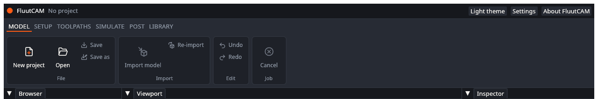

# UAT: Project files

Tests of starting, opening, saving and undoing. Part of the [user acceptance tests](UAT): read the setup there first. Test files: the `block` and `shaft` folders of the reference projects, copied to a work folder.

---

### UAT-PRJ-01 Nothing is open at the start

- **Preconditions:** FluutCAM is started with no project (not from a project file).
- **Steps:**
  1. Look at the window.
  2. Click each stage tab of the ribbon in turn (Model, Setup, Toolpaths, Simulate, Post, Library).
- **Expected:** The title bar says "No project". The Browser says "Open a project to see its Setups and toolpaths." The status bar says "Ready". In the Model stage, **New project** and **Open** are available, and Save, Save as, Import model, Re-import, Undo and Redo are greyed out. In the other stages every button is greyed out except the stage tabs. There is no File menu.

- [ ] Pass

### UAT-PRJ-02 New project in millimetres

- **Preconditions:** UAT-PRJ-01. An empty work folder.
- **Steps:**
  1. In the Model stage click **New project** (or press Ctrl+N).
  2. In the dialog, go to the work folder, type `my-part`, and confirm.
  3. In the window that asks "Which unit does this project use?", click **Millimetres**.
- **Expected:** The status bar says "Created my-part.fluut". The title bar shows `my-part.fluut` with no `*`. The unit badge says **mm**. The file `my-part.fluut` exists in the work folder. The Browser lists no Setups.
- [ ] Pass

### UAT-PRJ-03 A new project in inches

- **Preconditions:** A project in millimetres is open (UAT-PRJ-02).
- **Steps:**
  1. Click **New project**. Name it `my-part-inch` in the work folder and confirm.
  2. In the unit window, look at the order of the buttons. Click **Inches**.
- **Expected:** The unit window lists **Millimetres** first, because the open project is in millimetres. The window does not ask about unsaved changes (there are none). The title bar shows `my-part-inch.fluut`. The unit badge says **inch**. The file stores `units = "inch"`.

- [ ] Pass

### UAT-PRJ-04 Cancel the New dialog or the unit question

- **Preconditions:** A project is open.
- **Steps:**
  1. Click **New project**.
  2. Cancel the dialog.
  3. Click **New project** again, pick a name, and this time click **Cancel** in the unit window.
- **Expected:** Nothing changes either time. The same project stays open and no file is created.
- [ ] Pass

### UAT-PRJ-05 Open a reference project

- **Preconditions:** A copy of the `block` folder in the work folder.
- **Steps:**
  1. In the Model stage click **Open** (or press Ctrl+O).
  2. Pick `block/block.fluut` in the dialog.
- **Expected:** The status bar says "Opened block.fluut". The Browser shows the Setup "Top" (`three_axis`) with three toolpaths, "Pocket", "Pocket floor raster" and "Cut out", each with a hollow grey circle, and the Model "pocket_block". The viewport shows the block with a pocket and its stock outline. The inspector shows the Setup's values.
- [ ] Pass

### UAT-PRJ-06 Cancel the Open dialog

- **Preconditions:** `block` is open.
- **Steps:**
  1. Click **Open** and cancel the dialog.
- **Expected:** Nothing changes. The same project stays open.
- [ ] Pass

### UAT-PRJ-07 Open a project that was deleted

- **Preconditions:** `block.fluut` is open. Another project, `gone.fluut`, was in the work folder when you started and you deleted it while FluutCAM runs.
- **Steps:**
  1. Click **Open**. If the dialog still lets you pick `gone.fluut` (some systems cache the list), pick it. Otherwise record that the dialog does not offer it and skip the rest.
- **Expected:** The status bar turns red and says "Failed:" followed by a reason that includes "cannot read" and the file name. The project that was open stays open and unchanged.
- [ ] Pass

### UAT-PRJ-08 Open a damaged project file

- **Preconditions:** A text file `bad.fluut` in the work folder containing only the word `garbage`.
- **Steps:**
  1. Click **Open** and pick `bad.fluut`.
- **Expected:** The status bar turns red with "Failed:" and a message saying the file is not valid TOML and where. The project that was open (if any) stays open.
- [ ] Pass

### UAT-PRJ-09 Open a project whose model file is missing

- **Preconditions:** A copy of `block` in the work folder with `block.step` deleted.
- **Steps:**
  1. Open `block.fluut` with **Open**.
- **Expected:** The window reports that the geometry cannot be read (`model.geometry.missing`, naming `block.step`), in the Messages tab or the status bar. The program does not crash. Putting `block.step` back and opening again works.
- [ ] Pass

### UAT-PRJ-10 Save and the unsaved mark

- **Preconditions:** `block` is open. No changes made.
- **Steps:**
  1. Select the toolpath "Pocket", and its **Passes** tab. Change **Step down** to `3` and press Enter.
  2. Look at the title bar.
  3. Click **Save** in the Model stage (or press Ctrl+S).
  4. Look at the title bar and the work folder.
- **Expected:** After step 1 the title shows `block.fluut *`. After step 3 the status bar says "Saved block.fluut" and the `*` is gone. The work folder has `block.fluut` and `block.fluut.bak` (the version from before the save).
- [ ] Pass

### UAT-PRJ-11 The unsaved mark goes away on undo

- **Preconditions:** UAT-PRJ-10 done; the project is saved and clean.
- **Steps:**
  1. Change **Step down** of "Pocket" to `2`. The title shows `*`.
  2. Click **Undo** in the **Edit** group (or press Ctrl+Z).
- **Expected:** The value goes back to `3` and the `*` goes away. **Redo** (Ctrl+Y) brings back `2` and the `*`.
- [ ] Pass

### UAT-PRJ-12 Save as to a new folder

- **Preconditions:** `block` open (after calculating or not).
- **Steps:**
  1. Click **Save as** in the Model stage. Pick a new, empty folder `copy` and the name `block-copy`.
  2. Look in the new folder.
  3. Open `block-copy.fluut` in a new FluutCAM window, or with **Open**.
- **Expected:** The new folder holds `block-copy.fluut`, the model file `block.step`, and the `tools` folder that the project uses. The new project opens with the same Setup and toolpaths. The title bar shows `block-copy.fluut`.
- [ ] Pass

### UAT-PRJ-13 Opening another project asks about unsaved changes

- **Preconditions:** `block` is open with an unsaved change (a `*` in the title).
- **Steps:**
  1. Click **Open** and pick another project, for example `boss/boss.fluut`.
  2. In the window that asks, choose **Keep editing**.
  3. Repeat step 1, and this time choose **Discard**.
- **Expected:** The window "Unsaved changes" says "The project has changes that are not saved. Discard them?". **Keep editing** closes it and leaves `block` open with its change. **Discard** opens `boss`.
- [ ] Pass

### UAT-PRJ-14 Undo and redo through several steps

- **Preconditions:** A new project, saved (UAT-PRJ-02).
- **Steps:**
  1. Import `block/block.step` (see [UAT-Import](UAT-Import)).
  2. Add a 3-axis Setup. Add a Parallel toolpath.
  3. Press Ctrl+Z three times.
  4. Press Ctrl+Y three times.
- **Expected:** Each Ctrl+Z removes the last step (first the toolpath, then the Setup, then the model; the status bar names each: "Undid Add toolpath" or similar). After three undos the project is as it was after creation and the title shows no `*`. Each Ctrl+Y puts a step back, in order. The viewport and the Browser follow each step.
- [ ] Pass

### UAT-PRJ-15 Typing does not undo the project

- **Preconditions:** A toolpath is selected and its settings show.
- **Steps:**
  1. Click in a number box and type a few characters, but do not press Enter.
  2. Press Ctrl+Z.
- **Expected:** The typing is undone in the box. The project's undo history is not touched (the status bar does not say "Undid ..."; **Undo** stays as it was).
- [ ] Pass

### UAT-PRJ-16 Open a rotary project

- **Preconditions:** A copy of the `shaft` folder in the work folder.
- **Steps:**
  1. Open `shaft/shaft.fluut`.
- **Expected:** The Setup "Turn" shows kind `rotary`, with five toolpaths. The viewport shows the shaft with a cylinder stock outline. The toolpaths show no error about their type (rotary types are valid in a rotary Setup).
- [ ] Pass

### UAT-PRJ-17 Change the unit with the badge

- **Preconditions:** A project in millimetres is open, with a toolpath whose **Stepover** is set (for example 3).
- **Steps:**
  1. Click the **mm** badge in the title bar. Hover it first: it says "Project unit: click to change".
  2. Look at the **Stepover** box of the toolpath.
  3. Click **Undo**.
- **Expected:** After step 1 the badge says **inch**, the title bar shows `*`, and the Stepover box shows the same length in inches (3 mm is 0.1181 in). After step 3 the badge says **mm** again. The change was one undo step. The project file's lengths stay in millimetres either way.
- [ ] Pass

### UAT-PRJ-18 Every editing action is one undo step

- **Preconditions:** A project with a Setup and a toolpath, saved.
- **Steps:**
  1. Do each of these, one at a time, and press **Ctrl+Z** once after each: change the Setup's work zero, rename the toolpath with F2, change the toolpath's tool, change its Top height offset, pick a face, move the toolpath down, disable it, duplicate it, delete it.
- **Expected:** One press of Ctrl+Z undoes exactly the action just made, each time. The status bar names the change ("Undid ..."). When every action is undone, the `*` goes away.
- [ ] Pass
