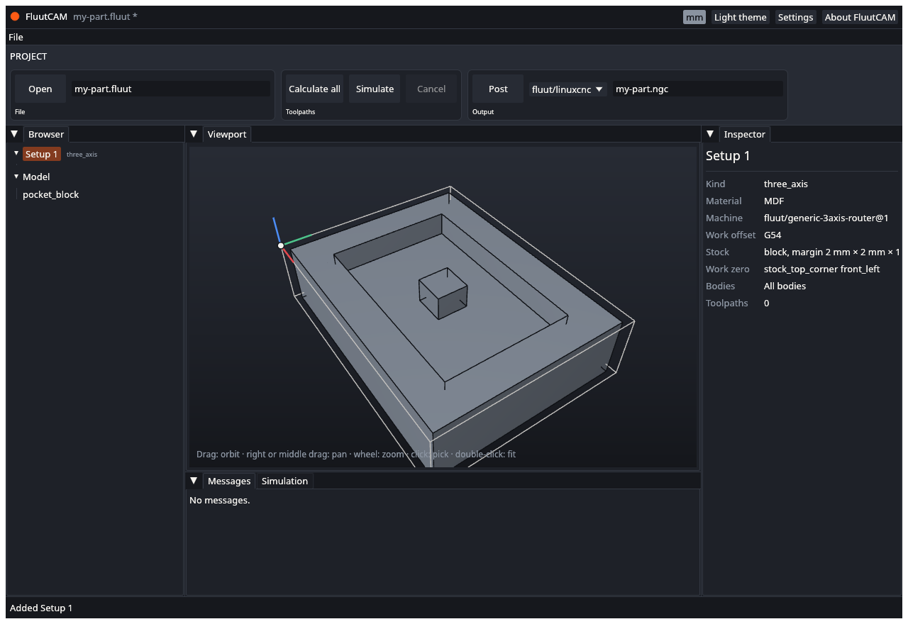
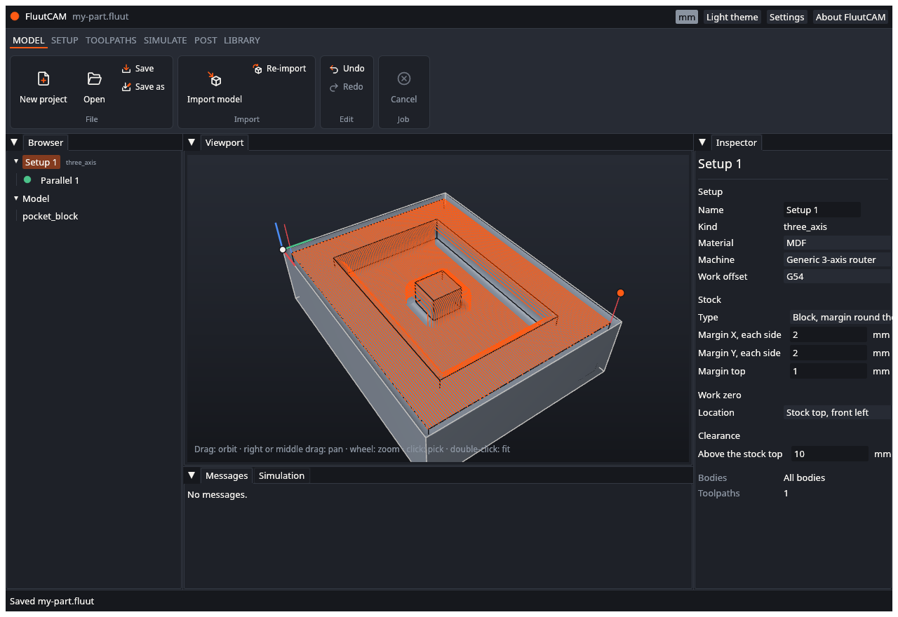
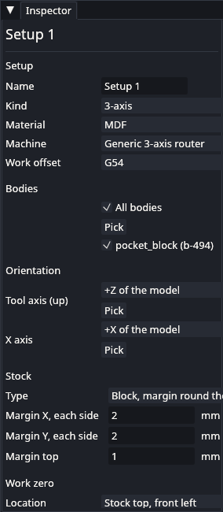
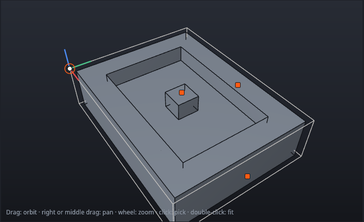

# UAT: Setups

Tests of adding and editing Setups and basing one on another. Part of the [user acceptance tests](UAT). Test files: `block/block.step`, `shaft/shaft.step`, and the `flipside` project. Each test starts from a new project (see [UAT-PRJ-02](UAT-Project-Files)) unless it says otherwise.

---

### UAT-SET-01 Add a 3-axis Setup

- **Preconditions:** A new project with `block.step` imported.
- **Steps:**
  1. Open the **Setup** stage and click **New 3-axis Setup**.
- **Expected:** The Browser lists "Setup 1" and selects it. The status bar says "Added Setup 1". The viewport shows a stock outline round the block and the work zero at the top front-left corner of the stock. The inspector shows kind `three_axis`, material MDF, machine `fluut/generic-3axis-router@1` and work offset G54. The stock is larger than the model by 2 mm each side in X and Y and 1 mm on top.

- [ ] Pass

### UAT-SET-02 Add a 3-axis Setup with no model

- **Preconditions:** A new project with no model.
- **Steps:**
  1. Open the **Setup** stage and click **New 3-axis Setup**.
- **Expected:** "Setup 1" is added (the status bar says "Added Setup 1") with kind `three_axis`, material MDF and the 3-axis machine. A 3-axis Setup needs no model. (Rotary and indexed Setups do: see UAT-SET-05.)
- [ ] Pass

### UAT-SET-03 Add a rotary Setup

- **Preconditions:** A new project with `shaft/shaft.step` imported.
- **Steps:**
  1. Open the **Setup** stage and click **New Rotary Setup**.
- **Expected:** "Setup 1" is added. The inspector shows kind `rotary`, machine `fluut/generic-4axis-router@1` and material MDF. The viewport shows a cylinder stock outline round the shaft: its radius is 1 mm larger than the shaft's and it is 2 mm longer. The work zero is on the axis at the left end.
- [ ] Pass

### UAT-SET-04 Add an indexed Setup

- **Preconditions:** A new project with `shaft/shaft.step` imported.
- **Steps:**
  1. Open the **Setup** stage and click **New Indexed Setup**.
- **Expected:** "Setup 1" is added with kind `indexed`, the 4-axis machine and a cylinder stock, as in UAT-SET-03.
- [ ] Pass

### UAT-SET-05 Rotary and indexed need a model

- **Preconditions:** A new project with no model.
- **Steps:**
  1. Open the **Setup** stage and click **New Rotary Setup**.
  2. Repeat with **New Indexed Setup**.
- **Expected:** Each time the status bar turns red: "Failed:" and a message that you must import a model before adding a rotary or indexed Setup. No Setup is added and **Undo** is unchanged.
- [ ] Pass

### UAT-SET-06 A second Setup gets the next number

- **Preconditions:** UAT-SET-01 done.
- **Steps:**
  1. Add another 3-axis Setup.
- **Expected:** "Setup 2" is added at the end of the list and selected. "Setup 1" is unchanged.
- [ ] Pass

### UAT-SET-07 Add a Setup based on another

- **Preconditions:** UAT-SET-01 done, with "Setup 1" selected.
- **Steps:**
  1. Click **New Setup based on selected** in the Setup stage.
- **Expected:** "Setup 2" is added with kind `three_axis` (the kind of the Setup it is based on). The inspector shows it takes the machine, material and bodies of "Setup 1", and that its stock comes from the previous Setup. It has no toolpaths of its own.
- [ ] Pass

### UAT-SET-08 Based-on is not offered without a selection

- **Preconditions:** A project with a Setup, but nothing selected (or a toolpath of no Setup selected).
- **Steps:**
  1. Look at **New Setup based on selected** in the Setup stage.
- **Expected:** It is greyed out when there is no Setup. It works when a Setup is selected (and also when a toolpath of a Setup is, or when a face is picked in it).
- [ ] Pass

### UAT-SET-09 Based on a rotary Setup gives a rotary Setup

- **Preconditions:** A project with `shaft.step` and a rotary "Setup 1", selected.
- **Steps:**
  1. Click **New Setup based on selected**.
- **Expected:** "Setup 2" is added with kind `rotary`. There is no way to ask for a 3-axis Setup based on a rotary one: the button takes the kind of the selected Setup.
- [ ] Pass

### UAT-SET-10 Based on a 3-axis Setup gives a 3-axis Setup

- **Preconditions:** A project with a model and a 3-axis "Setup 1", selected.
- **Steps:**
  1. Click **New Setup based on selected**.
- **Expected:** The new Setup has kind `three_axis`. The window cannot make a rotary Setup based on a 3-axis one (the project file could, and it is refused: `setup.add.kind`).
- [ ] Pass

### UAT-SET-11 An indexed Setup based on an indexed one

- **Preconditions:** A project with `shaft.step` and an indexed "Setup 1" (from **New Indexed Setup**), selected.
- **Steps:**
  1. Click **New Setup based on selected**.
- **Expected:** "Setup 2" is added with kind `indexed`, and its stock comes from the previous Setup.
- [ ] Pass

### UAT-SET-12 Undo and redo adding a Setup

- **Preconditions:** UAT-SET-01 done.
- **Steps:**
  1. Press Ctrl+Z (or click **Undo**), then Ctrl+Y (or **Redo**).
- **Expected:** After Ctrl+Z the Setup disappears from the Browser and the viewport, and **Redo** is available. After Ctrl+Y it returns, with the same name.
- [ ] Pass

### UAT-SET-13 Open a project with indexed Setups

- **Preconditions:** A copy of the `flipside` folder.
- **Steps:**
  1. Open `flipside/flipside.fluut`.
  2. Select each Setup in turn.
- **Expected:** The Browser lists two indexed Setups. The inspector shows their kind and the index angles 0 and 180 degrees. The viewport shows the stock for each. No error appears in the Messages tab.
- [ ] Pass

### UAT-SET-14 Edit a Setup in the inspector

- **Preconditions:** UAT-SET-01 done, with a calculated toolpath in the Setup.
- **Steps:**
  1. Select "Setup 1". In the inspector change **Margin top** to `3`, press Enter.
  2. Set **Location** under **Work zero** to "Stock top, centre".
  3. Change **Work offset** to G55.
  4. Click **Undo** three times.
- **Expected:** Each change shows in the viewport (the stock outline grows, the zero moves to the centre) and the toolpath's icon turns amber (out of date) where the stock or zero matters. The title bar shows `*`. Each Undo takes back one change. If a value is refused, the status bar says "Not changed" and gives the reason.

- [ ] Pass

### UAT-SET-16 Stock and zero choices follow the Setup kind

- **Preconditions:** A project with a 3-axis Setup and a rotary Setup (`shaft`).
- **Steps:**
  1. Select the 3-axis Setup. Open the **Type** list under **Stock** and the **Location** list under **Work zero**.
  2. Do the same for the rotary Setup.
- **Expected:** The 3-axis Setup offers "Block, margin round the model" and "Block, fixed size", and the corners, the centre and "Point on the model". The rotary Setup offers "Cylinder" and the left end, the right end, or a position along the axis. Neither offers a choice that would fail.
- [ ] Pass

### UAT-SET-17 Inherited values and reset

- **Preconditions:** A project with "Setup 1" and a Setup based on it ("New Setup based on selected").
- **Steps:**
  1. Select the based-on Setup. Find a value with "Inherited from Setup 1" under it, for example **Material**.
  2. Change it. Look at the text under it.
  3. Click **Reset to inherited**.
- **Expected:** After step 2 the text under the value is gone and **Reset to inherited** is there. After step 3 the value is the parent's again and "Inherited from Setup 1" shows. Each step is one undo step.
- [ ] Pass

### UAT-SET-18 Name and sizes cannot be broken

- **Preconditions:** A project with a Setup.
- **Steps:**
  1. Clear the **Name** box and press Enter.
  2. In **Stock**, type `0` in a size box.
- **Expected:** A blank name shows "A Setup needs a name." and the name does not change. A zero size shows "Must be above 0." and is not applied.
- [ ] Pass

### UAT-SET-15 Cancel while a Setup is added

- **Preconditions:** A project with a model.
- **Steps:**
  1. Click **New 3-axis Setup**. Watch the status bar.
- **Expected:** Adding a Setup is instant, so there is nothing to cancel. The Setup appears and the status bar returns to ready. (This test confirms the window does not stay busy.)
- [ ] Pass

### UAT-SET-19 Change the kind within a class

- **Preconditions:** A project with `shaft.step` and a rotary "Setup 1", selected.
- **Steps:**
  1. Open the **Kind** list in the inspector and choose **Indexed**.
  2. Click **Undo**.
- **Expected:** The kind shows Indexed and the Browser shows `indexed` beside the Setup. The stock, work zero and orientation are unchanged. Undo takes the kind back to Rotary in one step.
- [ ] Pass

### UAT-SET-20 Change the kind across classes

- **Preconditions:** A project with `shaft.step` and a 3-axis "Setup 1" (the 3-axis machine is not a rotary machine: set **Machine** to `fluut/generic-4axis-router@1` first).
- **Steps:**
  1. Choose **Rotary** in the **Kind** list.
  2. Click **Undo** once.
- **Expected:** After step 1 the Setup is Rotary. The stock is now a cylinder, the work zero is on the axis at the left end of the stock, the Orientation group shows **Rotary axis** and **A = 0 toward**, and the clearance is a radius. After step 2 all of that returns to the 3-axis values: one undo step takes back the whole change.
- [ ] Pass

### UAT-SET-21 A rotary kind needs a rotary machine

- **Preconditions:** A project with `shaft.step` and a 3-axis "Setup 1" that uses `fluut/generic-3axis-router@1`.
- **Steps:**
  1. Choose **Rotary** in the **Kind** list.
- **Expected:** The status bar says "Not changed" and that the machine has no rotary axis. The kind stays 3-axis and **Undo** is unchanged.
- [ ] Pass

### UAT-SET-22 Toolpaths the new kind does not allow stay

- **Preconditions:** UAT-SET-20 done before the Undo, and the Setup holds a 3-D toolpath such as Parallel.
- **Steps:**
  1. Select the toolpath and look at the Messages tab.
- **Expected:** The toolpath is still in the Setup. It shows its error and is not calculated. It is not deleted.
- [ ] Pass

### UAT-SET-23 Choose the bodies with check boxes

- **Preconditions:** The `plate` project (two bodies), with a Setup selected.
- **Steps:**
  1. Find the **Bodies** group in the inspector. "All bodies" is checked.
  2. Clear **All bodies**, then clear one body.
  3. Try to clear the last checked body.
  4. Click **Undo** until "All bodies" is checked again.
- **Expected:** Each body has a check box with its name and id. After step 2 only the other body stays checked and the viewport follows. At step 3 the box stays checked and the status bar says "At least one body must stay". Each change is one undo step.
- [ ] Pass

### UAT-SET-24 Choose bodies by picking on the model

- **Preconditions:** The `plate` project, with a Setup selected.
- **Steps:**
  1. Click **Pick** in the **Bodies** group.
  2. Move the pointer over the model. Click a face of one body.
  3. Click a face of the other body, then the same face again.
  4. Press Esc.
- **Expected:** A banner says "Picking Bodies: click to add or remove". The viewport shows every body. The face under the pointer lights up (not the whole body). A click toggles the whole body, which is tinted when chosen and untinted when not. The check boxes follow. Esc leaves pick mode.

- [ ] Pass

### UAT-SET-25 Use a body as the stock

- **Preconditions:** The `plate` project, with a 3-axis Setup that machines only one body (UAT-SET-23).
- **Steps:**
  1. Open the **Type** list under **Stock** and choose **Body**.
  2. Look at the row below.
  3. Choose the other body in its list, or click **Pick** and click the other body.
  4. Click **Undo**.
- **Expected:** "Body" is in the list. The body row starts on a body the Setup does not machine. The stock outline in the viewport becomes the size of that body, and that body is not machined by the Setup. Undo takes back one change at a time.
- [ ] Pass

### UAT-SET-26 No body stock for a rotary Setup

- **Preconditions:** A project with `shaft.step` and a rotary Setup selected.
- **Steps:**
  1. Open the **Type** list under **Stock**.
- **Expected:** The list offers the cylinder, and no "Body".
- [ ] Pass

### UAT-SET-27 Set the tool axis and X axis from the list

- **Preconditions:** A project with `block.step` and a 3-axis Setup, selected.
- **Steps:**
  1. In **Orientation**, open the **Tool axis (up)** list and choose "-Z of the model".
  2. Choose "+Y of the model" for **X axis**.
  3. Click **Undo** twice.
- **Expected:** The lists offer the six directions "+X of the model" to "-Z of the model". The viewport rebuilds in the new frame: the stock and the work zero move. At step 2 the choice for the X axis is refused if it is the same line as the tool axis (the Setup shows a finding, or the status bar says "Not changed"). Each Undo takes back one change.
- [ ] Pass

### UAT-SET-28 Set the orientation by picking a face

- **Preconditions:** A project with `block.step` and a 3-axis Setup, selected.
- **Steps:**
  1. Click **Pick** next to **Tool axis (up)**.
  2. Click a flat side face of the block.
  3. Look at the list.
- **Expected:** One click fills the value and ends the pick. The list shows "Face f-..." with the face id, and the viewport shows the part turned so the tool points along that face's direction. Clicking a curved edge for an axis that needs a straight line is refused: the Setup shows the reason as a finding.
- [ ] Pass

### UAT-SET-29 Set the rotary axis and A = 0 direction

- **Preconditions:** A project with `shaft.step` and a rotary Setup, selected.
- **Steps:**
  1. In **Orientation**, choose "+Y of the model" for **Rotary axis**.
  2. Click **Undo**.
  3. Click **Pick** next to **Rotary axis** and click the round surface of the shaft.
  4. Choose "+Z of the model" for **A = 0 toward**.
- **Expected:** The group shows **Rotary axis** and **A = 0 toward**. The viewport follows each choice. A round face gives its axis. **A = 0 toward** starts as "Default (+Z)". Each change is one undo step. If the A = 0 direction is along the rotary axis, the Setup shows a finding.
- [ ] Pass

### UAT-SET-30 Drag the work zero

- **Preconditions:** A project with `block.step` and a 3-axis Setup (stock by margin), selected, and no pick mode.
- **Steps:**
  1. Find the ring at the work zero in the viewport.
  2. Drag the ring toward the middle of the top of the stock. Watch the small circles.
  3. Let go on the circle at the top centre.
  4. Click **Undo**.
- **Expected:** While dragging, small circles mark the corners and the top centre, and the nearest one grows. After step 3 **Location** under **Work zero** shows "Stock top, centre" and the axes move there. Undo returns the zero in one step.

- [ ] Pass

### UAT-SET-31 A zero drag away from every point changes nothing

- **Preconditions:** As UAT-SET-30.
- **Steps:**
  1. Drag the ring far from the model and let go.
- **Expected:** The zero stays where it was. The title bar does not gain a `*`, and **Undo** is unchanged.
- [ ] Pass

### UAT-SET-32 Drag a margin handle

- **Preconditions:** A project with `block.step` and a 3-axis Setup (stock by margin), selected.
- **Steps:**
  1. Drag the orange square on top of the stock up the screen.
  2. Let go. Look at **Margin top**.
  3. Repeat with the squares on the +X and +Y sides.
  4. Drag a square inward, past the model.
  5. Click **Undo**.
- **Expected:** While dragging, the square follows and the new value shows beside it. After letting go **Margin top** has the new value and the stock outline is taller. The +X and +Y squares change **Margin X** and **Margin Y**. A margin never goes below 0. Each drag is one undo step.
- [ ] Pass

### UAT-SET-33 Handles by stock type and pick mode

- **Preconditions:** A project with a 3-axis Setup, selected.
- **Steps:**
  1. Change **Type** under **Stock** to "Block, fixed size".
  2. Click **Pick** in the **Bodies** group.
- **Expected:** With a fixed-size block, the ring and three orange squares show (see UAT-SET-37). Pick mode hides every handle. Esc brings them back. For a rotary Setup the ring snaps to the two ends of the stock on the axis, and the stock has a radius and a length square (see UAT-SET-38). An indexed Setup also draws the index angle ring and its pointer (see UAT-SET-49).
- [ ] Pass

### UAT-SET-34 A chuck raises the turn

- **Preconditions:** A copy of `flipside` (two indexed Setups). Close the project in FluutCAM. In a text editor, add this line under the `zero` line of Setup `s1`: `fixtures = [{ kind = "chuck", diameter = 100, length = 20 }]`.
- **Steps:**
  1. Open the project. Select Setup `s1` and then `s2`.
  2. Calculate all, and post with the `fluut/linuxcnc-4x` post (or run `fluut post flipside.fluut --post shop/linuxcnc-4x -o flip.ngc` in a work folder that has the project's `posts` and `machines` folders).
  3. Find `G0 A180` in the program and read the line above it.
- **Expected:** The project opens without a warning. The line above `G0 A180` is `G0 Z60`: the chuck radius, 50, plus the 10 mm clearance offset. Without the `fixtures` line it is `G0 Z41.321`. Setup `s2` takes the same chuck, because it is based on `s1`.
- [ ] Pass

### UAT-SET-35 A small fixture changes nothing

- **Preconditions:** As UAT-SET-34, with `fixtures = [{ kind = "chuck", diameter = 40, length = 20 }]`.
- **Steps:**
  1. Calculate and post as in UAT-SET-34.
- **Expected:** The program is the same as for the project without fixtures: the line above `G0 A180` is `G0 Z41.321`.
- [ ] Pass

### UAT-SET-36 Fixtures in a 3-axis Setup, and a bad fixture

- **Preconditions:** A copy of `block`. Close the project in FluutCAM.
- **Steps:**
  1. Add `fixtures = [{ kind = "chuck", diameter = 50, length = 20 }]` to the Setup, and open the project.
  2. Close it. Change the fixture to `{ kind = "vice" }` and open the project again.
- **Expected:** Step 1: the Setup resolves with the warning `setup.fixtures.ignored` (fixtures turn with the rotary axis and a 3-axis Setup has none). Step 2: the project does not open; the message says that `kind` is not one of chuck, tailstock, clamp.
- [ ] Pass

### UAT-SET-37 Drag the handles of a block of a fixed size

- **Preconditions:** A project with `block.step` and a 3-axis Setup, selected. Change **Type** under **Stock** to "Block, fixed size". Note **Size X**, **Size Y** and **Size Z**.
- **Steps:**
  1. Drag the orange square on the +X side of the stock 3 mm outward and let go. Look at **Size X**.
  2. Drag the square on top up and let go. Look at **Size Z**.
  3. Click **Undo** twice.
- **Expected:** Three orange squares show on the +X side, the +Y side and the top. While you drag, the square follows and the new size shows beside it. After step 1 **Size X** is about 6 mm larger: the block is centred on the model in X and Y, so both sides move. After step 2 **Size Z** has grown by about the distance dragged. A size never goes to 0 or below. Each drag is one undo step.
- [ ] Pass

### UAT-SET-38 Drag the radius and length of cylinder stock

- **Preconditions:** A new project with `shaft/shaft.step`, and a Rotary Setup (UAT-SET-03), selected. Note **Radius** and **Length** under **Stock**.
- **Steps:**
  1. Drag the orange square on top of the cylinder up 5 mm and let go.
  2. Drag the orange square at the right end of the cylinder 4 mm to the right and let go.
  3. Click **Undo** twice.
- **Expected:** After step 1 **Radius** is about 5 mm larger and the stock outline is wider. After step 2 **Length** is about 8 mm larger: the cylinder is centred on the model, so both ends move. The value shows beside the square while you drag. Each drag is one undo step, and neither goes to 0 or below.
- [ ] Pass

### UAT-SET-39 Snap the work zero to a vertex or an arc centre

- **Preconditions:** A project with `holes/holes.step` and a 3-axis Setup, selected (the work zero at the top front-left corner).
- **Steps:**
  1. Drag the ring toward the Ø22 blind hole at the top of the part, until its centre is near the pointer. Watch the small circles.
  2. Let go when the circle at the centre of the hole grows.
  3. Click **Undo**.
- **Expected:** While dragging, circles also show at the vertices of the model and at the centres of its holes, near the pointer. After step 2 **Location** under **Work zero** shows "Point on the model" with X 62, Y 25 and Z 15 (in the project unit), and the axes move to the centre of the hole. Undo returns the zero to the corner in one step. A corner of the part that is also a corner of the stock keeps its stock name ("Stock top, front left" and so on).
- [ ] Pass

### UAT-SET-40 Snap the zero of a rotary Setup along the axis

- **Preconditions:** A new project with `shaft/shaft.step` and a Rotary Setup, selected.
- **Steps:**
  1. Drag the ring toward the step in the shaft where the Ø30 part meets the square part (30 mm from the end).
  2. Let go on the circle there.
  3. Click **Undo**.
- **Expected:** **Location** under **Work zero** shows "Rotary axis, at X" with X 30 and the axes move to that step; the zero stays on the axis. Undo returns the zero to the left end.
- [ ] Pass

### UAT-SET-41 Scale and mirror the model

- **Preconditions:** A project with `block.step` and a 3-axis Setup, selected.
- **Steps:**
  1. Under **Scale and mirror**, type `2` in **Scale, all axes** and press Enter.
  2. Tick **Mirror Y**.
  3. Type `0` in **Scale, all axes** and press Enter.
  4. Type `1` in **Scale, all axes**, press Enter, and clear **Mirror Y**.
  5. Click **Undo** four times.
- **Expected:** After step 1 the model and its stock are twice as large and the zero stays at the corner of the stock. After step 2 the model is flipped across Y. Step 3 is refused with "Must not be 0." under the row. After step 4 the model is as it was and the Setup is back to its default (a saved file has no `geometry` line for the Setup). Each change is one undo step.
- [ ] Pass

### UAT-SET-42 Different scale factors per axis

- **Preconditions:** A copy of `block`. Close the project in FluutCAM. In a text editor, add `geometry = { scale = [2, 1, 1] }` to the Setup, and open the project.
- **Steps:**
  1. Select the Setup and look at **Scale and mirror**.
- **Expected:** **Scale, all axes** is empty and **Scale X**, **Scale Y** and **Scale Z** show 2, 1 and 1. The Setup shows an error that the body cannot be scaled by different factors per axis and to use one factor for every axis. Typing `2` in **Scale, all axes** clears the error and the three rows go.
- [ ] Pass

### UAT-SET-43 A body as the stock of a rotary Setup

- **Preconditions:** A new project with `plate/plate.dxf` (bodies OUTLINE and POCKET) imported, and a New Rotary Setup, selected.
- **Steps:**
  1. In **Bodies**, clear POCKET.
  2. Change **Type** under **Stock** to "Body".
  3. Look at the stock outline in the viewport.
  4. Click **Pick** beside the body list and click a curve of the other body.
- **Expected:** After step 2 the row below shows the body POCKET (a body the Setup does not machine). The stock outline is a cylinder centred on the rotary axis, as long as the POCKET drawing along the axis and as wide as its farthest point from the axis (the bounding cylinder of the body). The Setup shows no error. After step 4 the stock body is the other one. Changing the kind of the Setup to Indexed gives a block the size of the body instead.
- [ ] Pass

### UAT-SET-44 Add, edit and remove fixtures in the inspector

- **Preconditions:** A copy of `flipside` (two indexed Setups) open, and Setup `s1` ("Top") selected. Scroll the inspector to **Fixtures** after **Clearance**. **In use** says "None".
- **Steps:**
  1. Open the **Add** list and choose Chuck. Look at the viewport.
  2. Type `75` in **Diameter** under "Chuck 1" and press Enter.
  3. Choose Tailstock, then Clamp, in **Add**.
  4. Type `0` in the chuck's **Length** and press Enter.
  5. Click **Remove** beside "Chuck 1".
  6. Click **Remove all fixtures**.
  7. Click **Undo** until the list is back to the start.
- **Expected:** After step 1 **In use** says "1 fixture", "Chuck 1" shows **Diameter** and **Length**, and a blue drum outline appears against the start of the stock (its low X end). After step 2 the drum is 75 mm wide. After step 3 "Tailstock 2" shows **Diameter**, **Length** and an empty **Tip diameter** (a cylinder at the end of the stock) and "Clamp 3" shows **Min X** to **Max Z** (a box beside the stock); **In use** says "3 fixtures". Step 4 is refused with "Must be above 0." under the row and nothing changes. After step 5 the list is Tailstock 1 and Clamp 2 (the numbers follow the order). After step 6 **In use** says "None". Each of steps 1, 2, 3 (twice), 5 and 6 is one undo step; step 7 takes them back one at a time and a saved file has no `fixtures` line at the end.
- [ ] Pass

### UAT-SET-45 Fixture entries are checked

- **Preconditions:** As UAT-SET-44, with a Tailstock and a Clamp added.
- **Steps:**
  1. Type `-2` in the tailstock's **Tip diameter** and press Enter. Then type `0` and press Enter. Then clear the field and press Enter.
  2. Type `0` in the tailstock's **Diameter** and press Enter.
  3. Type a number in the clamp's **Max Y** that is below its **Min Y**, and press Enter.
  4. Type `abc` in **Min X** and press Enter.
- **Expected:** Step 1: `-2` is refused with "Must not be negative."; `0` is taken (a cone that ends in a point); an empty field is a plain cylinder again. Step 2 is refused with "Must be above 0.". Step 3 is refused with "Each maximum must be above its minimum.". Step 4 is refused and names the text. A refused entry changes nothing, and adds no undo step.
- [ ] Pass

### UAT-SET-46 Inherited fixtures

- **Preconditions:** `flipside` open. Add a chuck and a tailstock to Setup `s1` ("Top"). Select Setup `s2` ("Bottom", based on `s1`).
- **Steps:**
  1. Look at **Fixtures** for `s2`.
  2. Type a new **Length** for the chuck and press Enter.
  3. Click **Reset to inherited** under **In use**.
  4. Click **Remove all fixtures**.
  5. Click **Reset to inherited** again, then **Make a local copy**.
  6. Select `s1` and look at **Fixtures**.
- **Expected:** Step 1: **In use** says "2 fixtures" with "Inherited from Top", the two fixtures are listed, and the viewport draws them. Step 2 gives `s2` its own list with the new length; "Inherited from" goes and **Reset to inherited** shows. Step 3 brings back the parent's list and "Inherited from Top". Step 4 makes `s2` have no fixtures (**In use** says "None", the viewport shows none) while `s1` keeps its two. After step 5 the list is `s2`'s own copy, equal to `s1`'s, and **Make a local copy** is gone. `s1` has no "Inherited from" line and no **Make a local copy**.
- [ ] Pass

### UAT-SET-47 No Fixtures group in a 3-axis Setup

- **Preconditions:** A copy of `block`. Close the project in FluutCAM. In a text editor add `fixtures = [{ kind = "chuck", diameter = 50, length = 20 }]` to the Setup, and open the project.
- **Steps:**
  1. Select the Setup and look through the inspector.
  2. Look at the viewport.
- **Expected:** The inspector has no **Fixtures** group and no **Add** list; the Setup shows the warning that fixtures turn with the rotary axis and a 3-axis Setup has none (`setup.fixtures.ignored`). The viewport draws no fixture. Changing **Kind** to Indexed or Rotary (with a machine that has a rotary axis) shows the group, and the chuck.
- [ ] Pass

### UAT-SET-48 Fixtures follow the index angle in the viewport

- **Preconditions:** `flipside` open, Setup `s1` selected, with a clamp added (UAT-SET-44).
- **Steps:**
  1. Note where the clamp box is, then set **Index angle** to `90`.
  2. Set it to `180`, then select `s2`.
- **Expected:** The clamp starts on the +Y side of the stock (at A = 0). At 90 degrees it has turned up to the +Z side, the way the part turned. At 180 degrees it is on the -Y side. `s2` (its angle is 180 degrees, based on `s1`) shows it on the -Y side as well. The chuck and tailstock do not move: they turn about their own axis.
- [ ] Pass

### UAT-SET-49 Drag the index angle dial

- **Preconditions:** `flipside` open, Setup `s1` (index angle 0) selected, the viewport showing the part from above at an angle. The ring round the rotary axis with its marks 0, 90, 180 and 270 is drawn at the start of the stock, and the orange pointer is at the 0 mark.
- **Steps:**
  1. Drag the pointer along the ring to the 90 mark and let go. Look at **Index angle**.
  2. Click **Undo**.
  3. Drag the pointer to about a quarter of the way between the 0 and 90 marks, watching the number beside the pointer. Let go.
  4. Click **Undo**. Drag the pointer past the 180 mark to about 200 degrees and let go.
  5. Click **Undo**. Drag the pointer a little way and back to where it started, and let go.
- **Expected:** While you drag, the pointer follows the cursor round the ring and the angle shows beside it; the part does not turn yet. After step 1 **Index angle** is 90, the part has turned (its +Z side now faces -Y) and the pointer is at the 90 mark. Step 2 returns it to 0 in one undo step. After step 3 the angle is 22.5 rounded to 20 or 25 degrees (a step of 5). After step 4 the angle is about 200, not a negative number. After step 5 nothing changes and there is no new undo step.
- [ ] Pass

### UAT-SET-50 The dial snaps, from any view

- **Preconditions:** As UAT-SET-49.
- **Steps:**
  1. Drag the pointer to near the 180 mark, a little short of it (within 2 degrees), holding Alt, and let go.
  2. Click **Undo**. Drag to about 47 degrees holding Shift, and let go.
  3. Click **Undo**. Orbit the view to look along the rotary axis, and drag the pointer to 270 degrees.
  4. Click **Undo**. Orbit the view so you look at the ring edge on (a line), and drag the pointer along the line.
- **Expected:** Step 1 gives exactly 180 although Alt turns the steps off (the pointer is near a quarter). Step 2 gives 47 (steps of 1 degree). Step 3 gives 270; the pointer follows the cursor as you look straight at the ring. In step 4 the pointer moves up and down the line with the cursor, on one side of the axis at a time, and does not jump to the other side when the cursor crosses the middle of the line; the angle it gives is always a multiple of 5. Each drag is one undo step.
- [ ] Pass

### UAT-SET-51 The dial for a relative angle and its absence elsewhere

- **Preconditions:** A copy of `flipside`. Close the project in FluutCAM. In a text editor change `s2`'s `index_angle` line to `index_angle = { mode = "relative", value = 90 }`, and open the project.
- **Steps:**
  1. Select `s2`. Note **Index angle** and where the pointer is.
  2. Drag the pointer to the 270 mark and let go.
  3. Save the project and look at the `index_angle` line of `s2` in a text editor.
  4. Select `s1` (index angle 0), then a Setup of a 3-axis project and one of a rotary project.
- **Expected:** Step 1: **Index angle** shows 90 and the pointer is at the 90 mark (the angle after adding the parent's 0). After step 2 the pointer is at 270, and the saved line is `index_angle = { mode = "relative", value = -90 }` (270 relative to the parent's 0, written in the range -180 to 180). In step 4 the 3-axis and the rotary Setups draw no ring and no pointer.
- [ ] Pass
