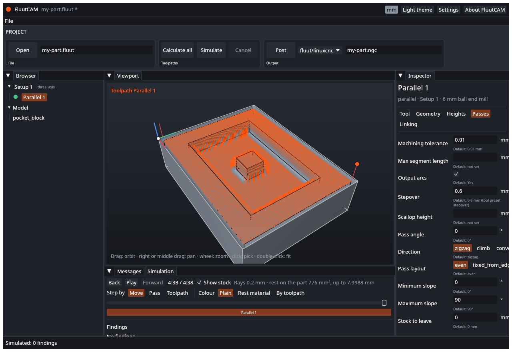

# UAT: Simulation

Tests of simulating a calculated Setup, the playback controls, the colours and the findings. Part of the [user acceptance tests](UAT). Test files: the `block`, `ridge`, `dome` and `shaft` projects. These tests need the 3-D viewport; if the viewport is off, run only UAT-SIM-08 and UAT-SIM-09.

---

### UAT-SIM-01 Simulate a calculated Setup

- **Preconditions:** `block` open and calculated (UAT-TP-17 or click **Calculate all**).
- **Steps:**
  1. Select the Setup "Top".
  2. In the **Simulate** stage click **Simulate**.
  3. Open the **Simulation** tab beside **Messages**.
- **Expected:** The status bar shows a progress bar while it runs, then "Simulated: N findings" (N may be 0). The Simulation tab shows the controls, a slider, and the text "Rays 0.2 mm" with the rest figures. The viewport shows the stock cut by the toolpaths.

- [ ] Pass

### UAT-SIM-02 Simulate before calculating

- **Preconditions:** `block` open, no toolpath calculated.
- **Steps:**
  1. Select "Top" and click **Simulate**.
- **Expected:** FluutCAM refuses with a message that the toolpaths must be calculated first. The status bar turns red and nothing is simulated. After **Calculate all** the same click works.
- [ ] Pass

### UAT-SIM-03 Play and pause

- **Preconditions:** UAT-SIM-01 done.
- **Steps:**
  1. Click **Play**.
  2. Wait two seconds, then click **Pause**.
- **Expected:** While playing, the slider moves and the stock in the viewport is cut away as the tool moves. The tool is drawn. After **Pause** the picture and the slider stop.
- [ ] Pass

### UAT-SIM-04 The slider

- **Preconditions:** UAT-SIM-01 done.
- **Steps:**
  1. Drag the slider to the middle, then to the end, then to the start.
- **Expected:** The stock shows the cut at each moment: untouched at the start, part cut in the middle, finished at the end. The coloured bar under the slider shows which toolpath runs at each point.
- [ ] Pass

### UAT-SIM-05 Step by move, pass and toolpath

- **Preconditions:** UAT-SIM-01 done, playback at the start.
- **Steps:**
  1. Set **Step by** to **Move**. Click **Forward** three times, then **Back** once.
  2. Set **Step by** to **Pass** and click **Forward**.
  3. Set **Step by** to **Toolpath** and click **Forward**.
- **Expected:** Each click moves the program one move, one pass or one toolpath. **Back** goes the other way. The slider follows.
- [ ] Pass

### UAT-SIM-06 Colour modes

- **Preconditions:** UAT-SIM-01 done, playback at the end.
- **Steps:**
  1. Set **Colour** to **Plain**, then **Rest material**, then **By toolpath**.
- **Expected:** Plain shows one colour. Rest material colours places by how close they are to the model, with a legend (above tolerance, within tolerance, gouge, no part below, not cut). By toolpath gives each toolpath its own colour.
- [ ] Pass

### UAT-SIM-07 Show stock off

- **Preconditions:** UAT-SIM-01 done.
- **Steps:**
  1. Untick **Show stock**.
- **Expected:** The simulated stock is hidden and the model's own faces show. Tick it again to bring the stock back.
- [ ] Pass

### UAT-SIM-08 A rotary Setup is refused

- **Preconditions:** `shaft/shaft.fluut` open and calculated.
- **Steps:**
  1. Select the Setup "Turn" and click **Simulate**.
- **Expected:** The status bar turns red with a message that rotary Setups are not simulated yet. Nothing is simulated and the program does not crash.
- [ ] Pass

### UAT-SIM-09 Cancel a simulation

- **Preconditions:** `dome` open and calculated.
- **Steps:**
  1. Select its Setup and click **Simulate**.
  2. Click **Cancel** at once.
- **Expected:** If the simulation was still running, the status bar says "Cancelled" and the Simulation tab holds no result (or the previous one). If it had already finished, record that and repeat with a bigger part.
- [ ] Pass

### UAT-SIM-10 Findings

- **Preconditions:** A project whose simulation reports findings. If you have none, edit a copy of `block`: in the project file lower the depth of a toolpath below the stock, so the tool meets the table, then calculate and simulate.
- **Steps:**
  1. Simulate the Setup.
  2. Open the **Findings** list in the Simulation tab. Click one finding.
- **Expected:** The list names each finding with its kind (for example Gouge or Rapid through stock) and a depth or place. Clicking one moves the view to it. The status bar number matches the list length. If the project has no findings, the list says "No findings."
- [ ] Pass

### UAT-SIM-11 Simulate a Setup that was changed

- **Preconditions:** UAT-SIM-01 done.
- **Steps:**
  1. Change a path-changing setting of a toolpath, and calculate again.
  2. Look at the Simulation tab.
- **Expected:** The simulation is dropped when the toolpaths of the Setup change: the Simulation tab says "Simulate the Setup to see its stock and findings." Before you calculate, the toolpath shows the out-of-date mark and **Simulate** is refused (calculate first). After calculating and clicking **Simulate** again the tab shows the new cut.
- [ ] Pass

### UAT-SIM-12 Two Setups

- **Preconditions:** `flipside` open and calculated.
- **Steps:**
  1. Select the first Setup and click **Simulate**. Note the result.
  2. Select the second Setup and click **Simulate**.
- **Expected:** Each simulation shows only that Setup's toolpaths. The second starts from the stock the first Setup left, since it is based on the first. The two results differ.
- [ ] Pass

### UAT-SIM-13 A toolpath that meets a fixture

- **Preconditions:** A copy of `flipside`, closed in FluutCAM. Add `fixtures = [{ kind = "clamp", min = [0, -30, -9], max = [90, 30, 9] }]` under the `zero` line of Setup `s1`. Open it and calculate all.
- **Steps:**
  1. Select Setup `s1` and click **Simulate**.
  2. Open the **Findings** list.
- **Expected:** The simulation reports errors `sim.fixture` ("the tool meets the clamp at ...") on the toolpaths of `s1`. With the clamp moved out of the way (`min = [300, -60, -5], max = [320, 60, 5]`) there are none.
- [ ] Pass

### UAT-SIM-14 A tool with a holder but no overall length

- **Preconditions:** A copy of `flipside` with `holder = { diameter = 20, length = 40 }` added to the tool `flat-6` in `tools/shop.toml`, and no `overall_length`. Calculate all.
- **Steps:**
  1. Look at the Messages tab, and then simulate Setup `s1`.
- **Expected:** One warning `cam.tool.length_missing` for the tool (not one per toolpath), saying that the holder cannot be placed without the overall length and is not checked. The simulation shows the same warning once. Add `overall_length = 60` and the warnings go.
- [ ] Pass

