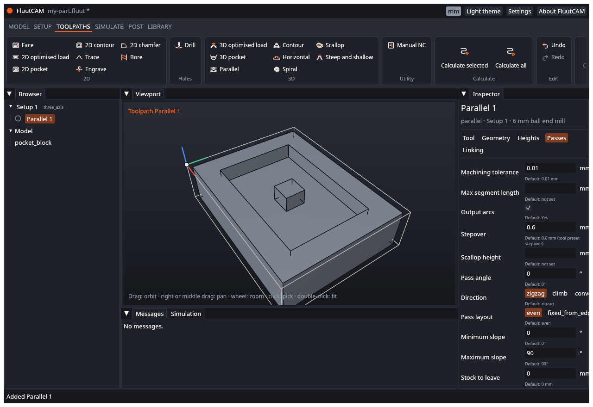
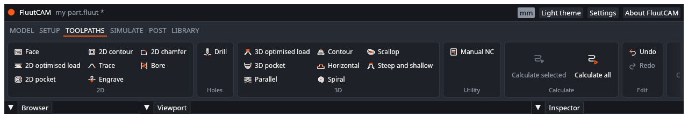
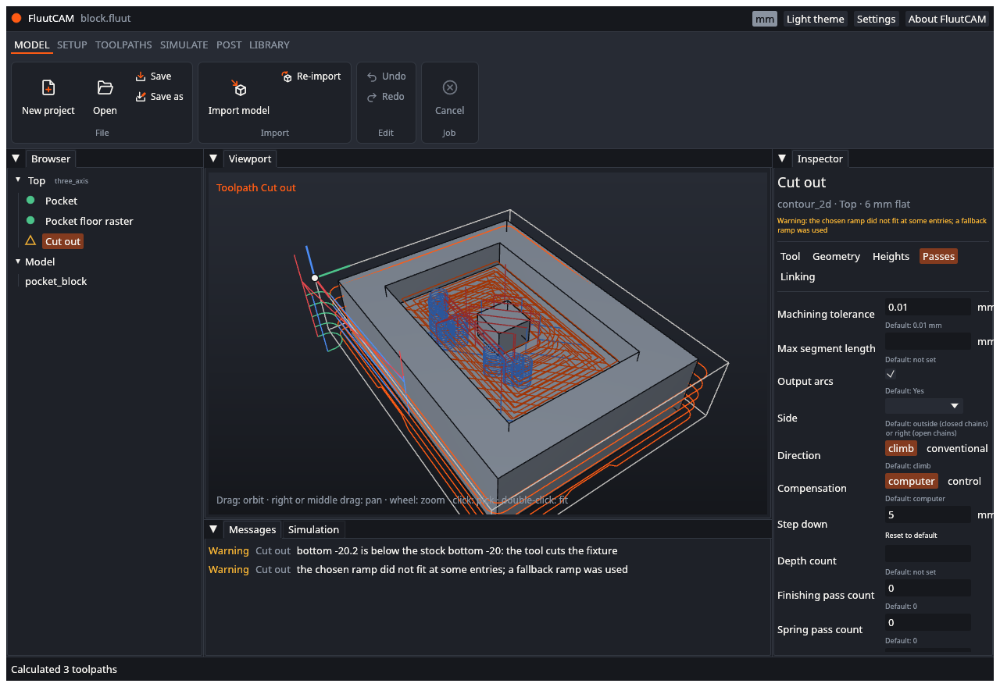

# UAT: Toolpaths

Tests of adding, editing and calculating toolpaths. Part of the [user acceptance tests](UAT). Test files: the `block`, `ridge`, `plate2d`, `shaft` and `holes` projects. Work on copies.

Remember: the window cannot yet pick curves or faces for a 2-D toolpath, so a 2-D toolpath you add in the window reports an error until its geometry is set in the project file. The reference projects already have their geometry set.

---

### UAT-TP-01 Add a 3-D toolpath

- **Preconditions:** A new project with `ridge/ridge.step` imported (copy the file from the `ridge` project) and a 3-axis Setup added.
- **Steps:**
  1. Open the **Toolpaths** stage and click **Parallel** in the 3D gallery.
- **Expected:** "Parallel 1" appears in the Browser under the Setup, selected, with a hollow grey circle (not calculated). The status bar says it was added. The inspector shows the five tabs Tool, Geometry, Heights, Passes and Linking, and the tool is the 6 mm ball end mill.

- [ ] Pass

### UAT-TP-02 The galleries list all 22 types

- **Preconditions:** A project with a 3-axis Setup selected, and another with a rotary Setup (`shaft`).
- **Steps:**
  1. Open the **Toolpaths** stage with the 3-axis Setup selected. Count the buttons.
  2. Select the rotary Setup and count again.
- **Expected:** For the 3-axis Setup: the 2D gallery (8 types), Holes (Drill), 3D (8 types) and Utility (Manual NC): 18 buttons. For the rotary Setup: the Rotary gallery (4 types) and Utility (Manual NC), and no 2D, Holes or 3D gallery. Together they cover the 22 types of [Toolpath types](Toolpath-Types). An indexed Setup shows the same galleries as a 3-axis one.

- [ ] Pass

### UAT-TP-03 Add toolpath needs a Setup

- **Preconditions:** A project with a model and no Setup.
- **Steps:**
  1. Open the **Toolpaths** stage and look at the toolpath buttons.
- **Expected:** They are greyed out. After a Setup is added they are available.
- [ ] Pass

### UAT-TP-04 The new toolpath goes into the selected Setup

- **Preconditions:** A project with two Setups; select "Setup 2".
- **Steps:**
  1. Click **Parallel** in the 3D gallery.
- **Expected:** The toolpath is listed under "Setup 2", at the end of its list. With nothing selected the toolpath goes into the first Setup.
- [ ] Pass

### UAT-TP-05 Calculate a toolpath

- **Preconditions:** UAT-TP-01 done.
- **Steps:**
  1. Click **Calculate all**.
  2. Watch the Browser and the status bar.
- **Expected:** During the job the status bar shows a progress bar and "Calculating Parallel 1 (1 of 1)", the toolpath's icon shows a filling ring, and **Calculate all** and **Open** are greyed out. At the end the status bar says "Calculated 1 toolpaths" (or the matching wording), the icon is a green filled circle, and the path is drawn over the model.

- [ ] Pass

### UAT-TP-06 Edit a setting and see it marked out of date

- **Preconditions:** UAT-TP-05 done.
- **Steps:**
  1. Select "Parallel 1". Open the **Passes** tab.
  2. Change **Stepover** to a different value and press Enter.
  3. Look at the Browser icon.
- **Expected:** The setting shows **Reset to default**. The toolpath icon becomes an amber ring with a dot (out of date). The title shows `*`. Clicking **Calculate all** makes it green again.
- [ ] Pass

### UAT-TP-07 A setting that only changes the G-code does not mark it out of date

- **Preconditions:** UAT-TP-05 done and the toolpath is green.
- **Steps:**
  1. On the **Tool** tab change the feed rate (cutting feed) and press Enter.
  2. Look at the icon.
- **Expected:** The icon stays green. The title shows `*`.
- [ ] Pass

### UAT-TP-08 Reset to default

- **Preconditions:** UAT-TP-06 done.
- **Steps:**
  1. Click **Reset to default** by the changed setting.
- **Expected:** The setting returns to its default (shown in grey) and the button goes away. The toolpath is out of date again until calculated.
- [ ] Pass

### UAT-TP-09 Type an expression

- **Preconditions:** A toolpath is selected.
- **Steps:**
  1. In a length setting, type `1/4in` and press Enter.
- **Expected:** The setting accepts it, and shows its value in the project unit (about 6.35 in a millimetre project).
- [ ] Pass

### UAT-TP-10 Type something invalid

- **Preconditions:** A toolpath is selected.
- **Steps:**
  1. In a number box type `abc` and press Enter.
- **Expected:** A red message appears under the box, and the value is not changed. No new undo step is made. The program does not crash.
- [ ] Pass

### UAT-TP-11 Undo a setting change

- **Preconditions:** UAT-TP-06 done.
- **Steps:**
  1. Press Ctrl+Z (or click **Undo**).
- **Expected:** The setting returns to its previous value, and the icon returns to its previous state.
- [ ] Pass

### UAT-TP-12 A 2-D toolpath added in the window reports a missing selection

- **Preconditions:** A project with a model and a 3-axis Setup.
- **Steps:**
  1. Click **2D pocket** in the 2D gallery.
  2. Click **Calculate all**.
- **Expected:** The toolpath gets a red filled triangle. Its message, in the Messages tab, is that you must select drive curves or drive faces. Nothing else is changed. (When picking is built this test changes; see [Known limits](Known-Limits).)

- [ ] Pass

### UAT-TP-13 A rotary type cannot be added to a 3-axis Setup

- **Preconditions:** A project with a model and a 3-axis Setup selected.
- **Steps:**
  1. Open the **Toolpaths** stage and look for the Rotary gallery.
- **Expected:** There is no Rotary gallery. (A project file that puts a rotary type in a 3-axis Setup is calculated with the error `param.type.setup_kind`, a red triangle and a message that the toolpath runs in rotary Setups only.)
- [ ] Pass

### UAT-TP-14 Heights in the wrong order

- **Preconditions:** A calculated 3-D toolpath in a project. You can only do this step by editing the file.
- **Steps:**
  1. Close FluutCAM. In the project file make the toolpath's retract height lower than its feed height.
  2. Open the project and click **Calculate all**.
- **Expected:** The toolpath gets a red triangle and a message that the heights must satisfy clearance, retract, feed, top and bottom in that order.
- [ ] Pass

### UAT-TP-15 A warning does not stop the toolpath

- **Preconditions:** A project from the `block` folder, calculated.
- **Steps:**
  1. Select "Cut out". Look at its icon and its messages.
- **Expected:** "Cut out" shows an amber triangle outline. The Messages tab lists two warnings for it, `param.heights.below_stock` (the bottom is below the stock bottom: the tool cuts the fixture) and `cam.linking.ramp_fallback` (a fallback ramp was used), and it still has a path.
- [ ] Pass

### UAT-TP-16 Cancel a calculation

- **Preconditions:** `rough3d/rough3d.fluut` open (3-D roughing takes a few seconds).
- **Steps:**
  1. Click **Calculate all**.
  2. Click **Cancel** while it runs.
- **Expected:** The status bar says "Cancelled" after the current toolpath ends. Toolpaths that finished are green and keep their paths. The ones that did not start are not calculated. Calculate all again finishes the rest.
- [ ] Pass

### UAT-TP-17 Calculate all the reference parts

- **Preconditions:** Copies of the reference projects.
- **Steps:**
  1. Open `block`, `ridge`, `rough3d`, `dome`, `holes`, `plate`, `plate2d`, `vcarve` and `boss` in turn. For each one click **Calculate all**.
- **Expected:** Every toolpath ends green or amber. None ends red. The status bar never shows "Failed:". No toolpath is empty, except where a note in the project says so.
- [ ] Pass

### UAT-TP-18 A toolpath is calculated once

- **Preconditions:** `block` open and calculated.
- **Steps:**
  1. Click **Calculate all** again without changing anything.
- **Expected:** The job ends at once: nothing needs calculating (the status bar says "Calculated 0 toolpaths" or similar). The paths do not change.
- [ ] Pass

### UAT-TP-19 Results are not kept after closing

- **Preconditions:** `block` calculated and saved.
- **Steps:**
  1. Open `block.fluut` again (click **Open**; discard changes if asked).
- **Expected:** The toolpaths show as not calculated (hollow grey circles). Calculating again gives the same result. (Saving results is planned: see [Known limits](Known-Limits).)
- [ ] Pass

### UAT-TP-20 The number box explains what it accepts

- **Preconditions:** A toolpath is selected.
- **Steps:**
  1. Hover over a number box.
- **Expected:** A tooltip says: type a value or an expression, for example 6/2, 1/4in or tool.diameter*0.4. (A tooltip that explains each setting is not in the window yet; the meaning of every setting is in [Toolpath types](Toolpath-Types).)
- [ ] Pass
