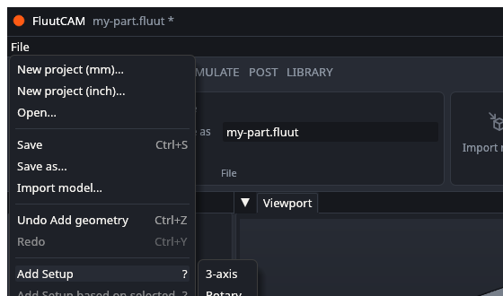
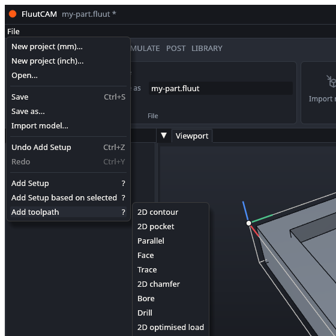

# Your first project

This walk takes a STEP file to G-code. It uses the window as it is today, with the temporary **File** menu. The ribbon is being wired up and will take over from that menu; the steps stay the same, only the buttons move. See the [Interface tour](Interface-Tour) if a word is new.

**You need:**

- FluutCAM, [installed](Install).
- A STEP file of one solid part. Any small part will do. The pictures use `block.step`, a block with a pocket, which is in the FluutCAM repository at `crates/fluut-cli/tests/projects/block/block.step`. Your numbers will differ if you use another part.
- A folder for the project. FluutCAM saves the project file in it, copies the model beside it, and writes the G-code there.

The whole walk is ten steps and takes a few minutes.

## 1. Start a new project

Choose **File, New project (mm)...** (or **New project (inch)...** if you think in inches). A file dialog opens. Pick your folder and type a name, for example `my-part`. FluutCAM adds `.fluut` and saves the empty project at once.

The status bar says "Created my-part.fluut". The title bar shows the name.

## 2. Import the STEP file

Choose **File, Import model...** and pick your STEP file. FluutCAM copies the file into the project folder (if it is not there already) and reads it.

The status bar says "Imported block.step (1 bodies)". The part appears in the viewport, and its body is listed under **Model** in the Browser. Drag in the viewport to turn it around.

If the import fails, the status bar says why and the project is unchanged. See [Import a model](Import-a-Model).

## 3. Add a 3-axis Setup

A Setup says how the part sits on the machine. Choose **File, Add Setup, 3-axis**.

A Setup called "Setup 1" appears in the Browser and is selected. The inspector shows what FluutCAM chose for it: the material (MDF), the machine, a block of stock a little bigger than the part, and the work zero at the top front-left corner of the stock. The coloured arrows in the viewport mark the work zero.

You cannot change these in the window yet. [Setups, stock and work zero](Setups-Stock-and-Zero) explains them and how to change them in the project file.

## 4. Add a 3-D toolpath

Choose **File, Add toolpath** and pick **Parallel**. It runs straight passes over the whole surface, and a 3-D type needs no curves picked. (2-D types, such as pockets, need curves or faces picked, which the window cannot do yet; see [Known limits](Known-Limits).)

"Parallel 1" appears under Setup 1 with a hollow circle: not calculated yet. It is selected, so the inspector shows its settings, and it uses the 6 mm ball end mill from the built-in starter tools. Look through the five tabs. Every setting already has a default.

To change a number, click its box, type, and press Enter. For example, set **Stepover** on the **Passes** tab to `1`. [Add a toolpath](Add-a-Toolpath) says more.

## 5. Calculate

Click **Calculate all**. The status bar shows a progress bar and the toolpath's name. When it ends the status says "Calculated 1 toolpaths", the circle in the Browser turns green, and the path appears on the model in orange.

If the circle turns into a triangle, open the **Messages** tab. [Diagnostics](Diagnostics) says what each message means.

## 6. Simulate

Click **Simulate**. FluutCAM cuts the stock on the computer, move by move. When it ends, click the **Simulation** tab beside Messages. Press **Play** to watch, drag the slider, or step with **Back** and **Forward**. The stock in the viewport shows what is left. Findings, such as a cut that goes into the part too deep, are listed in the tab.

See [Calculate and simulate](Calculate-and-Simulate).

## 7. Choose a post and an output file

In the ribbon's **Post** stage, find the list of posts and the file name. The list starts at **fluut/linuxcnc**. Pick the one that matches your controller: `fluut/linuxcnc` for LinuxCNC, `fluut/grbl` for Grbl, or `fluut/gcode` for plain G-code. The file name starts as `my-part.ngc` in the project folder; change it if you like.

## 8. Post the G-code

Click **Post**. If a toolpath is out of date, FluutCAM calculates it first. When it ends the status bar says "Wrote my-part.ngc".

Open the file in a text editor and read it. The first lines are comments with the project name and the post used. Then come the setup lines, the tool change and the moves. [Post G-code](Post-G-code) explains what to check before you run it on a machine.

## 9. Save

Choose **File, Save**. The `*` after the name goes away.

Your project is now the `.fluut` file, the model beside it, and anything else FluutCAM put in the folder. Open it again with **File, Open...**.

## 10. Check before you cut

FluutCAM is early software. Before you put a tool in material:

- Read the G-code, or run it in your controller's simulator or in the air.
- Check that the work zero, the stock and the tool are the ones you meant. The starter tools carry cautious cutting data for MDF only; set your own feeds and speeds for your tool and material.
- Remember that **Simulate** checks the tool and its holder against the stock and the part. It does not know about your clamps, your vise or your machine's limits.

## What next

- [Import a model](Import-a-Model), [Add a Setup](Add-a-Setup) and [Add a toolpath](Add-a-Toolpath) in more detail.
- [Save, undo and recover](Save-Undo-Recover): undo any step with **Ctrl+Z**.
- [Toolpath types](Toolpath-Types): everything FluutCAM can cut.
- [Command line](Command-Line): calculate and post without the window.
