# Your first project

This walk takes a STEP file to G-code. Every step is a button in the ribbon: click a stage tab (Model, Setup, Toolpaths, Simulate, Post), then the button. See the [Interface tour](Interface-Tour) if a word is new.

**You need:**

- FluutCAM, [installed](Install).
- A STEP file of one solid part. Any small part will do. The pictures use `block.step`, a block with a pocket, which is in the FluutCAM repository at `crates/fluut-cli/tests/projects/block/block.step`. Your numbers will differ if you use another part.
- A folder for the project. FluutCAM saves the project file in it, copies the model beside it, and writes the G-code there.

The whole walk is ten steps and takes a few minutes. Everything happens in the window: you never edit the project file by hand. A second, short example at the end shows a 2-D toolpath (a pocket on a picked face).

## 1. Start a new project

In the **Model** stage click **New project** (or press Ctrl+N). A file dialog opens. Pick your folder and type a name, for example `my-part`. Then a small window asks which unit the project uses. Click **Millimetres** or **Inches**. (**Cancel** stops: no project is made.) FluutCAM adds `.fluut` and saves the empty project at once.

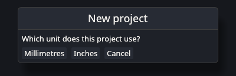

The unit only changes what the window shows and what you type. The project file always stores millimetres. You can change the unit later by clicking the unit badge in the title bar.

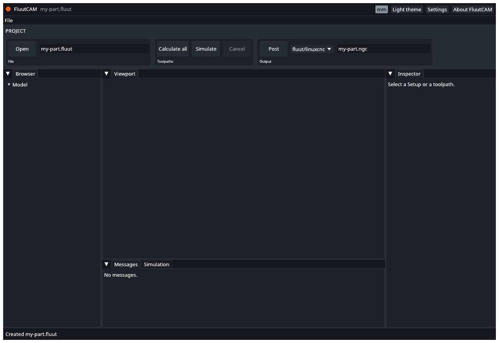

The status bar says "Created my-part.fluut". The title bar shows the name.

## 2. Import the STEP file

Click **Import model** in the Model stage (or press Ctrl+I) and pick your STEP file. FluutCAM copies the file into the project folder (if it is not there already) and reads it.

The status bar says "Imported block.step (1 bodies)". The part appears in the viewport, and its body is listed under **Model** in the Browser. Drag in the viewport to turn it around.

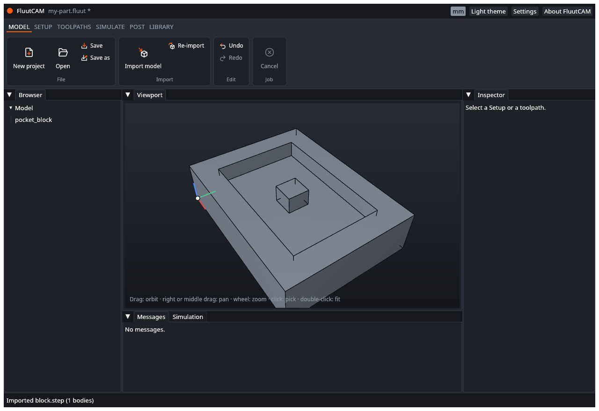

If the import fails, the status bar says why and the project is unchanged. See [Import a model](Import-a-Model).

## 3. Add a 3-axis Setup

A Setup says how the part sits on the machine. Open the **Setup** stage and click **New 3-axis Setup**.

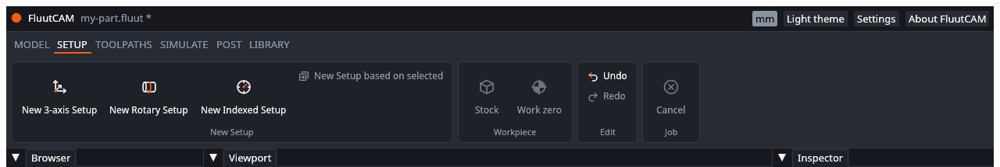

A Setup called "Setup 1" appears in the Browser and is selected. The inspector shows what FluutCAM chose for it: the material (MDF), the machine, a block of stock a little bigger than the part, and the work zero at the top front-left corner of the stock. The coloured arrows in the viewport mark the work zero.

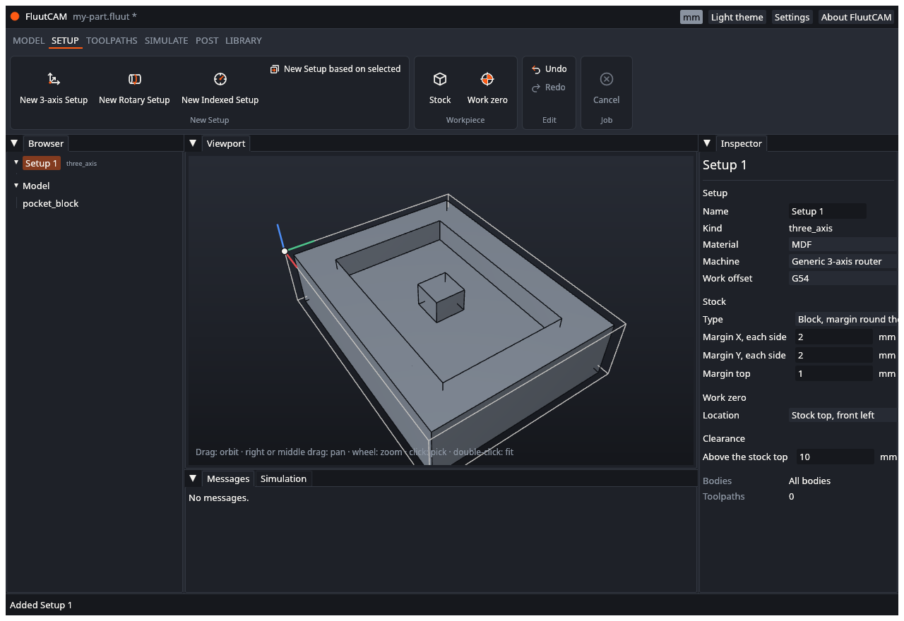

You can change every one of them. With the Setup selected, the inspector shows boxes and lists for the name, the material, the machine, the work offset, the stock, the work zero and the clearance. For example, choose **Stock top, centre** under **Work zero**. Each change is one undo step. [Add a Setup](Add-a-Setup) and [Setups, stock and work zero](Setups-Stock-and-Zero) explain each value.

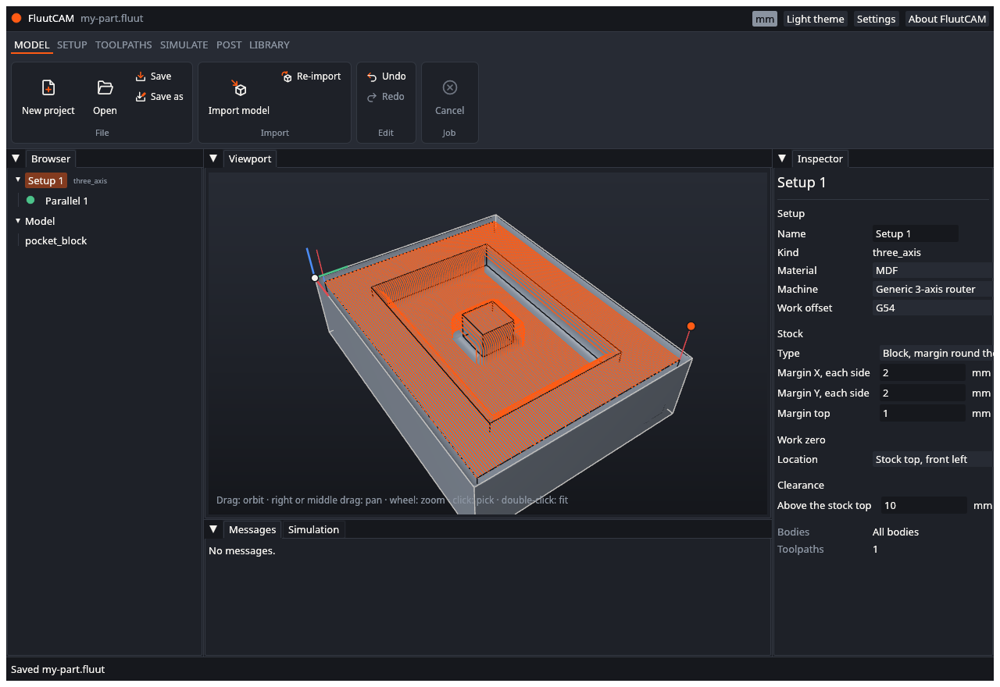

## 4. Add a 3-D toolpath

Open the **Toolpaths** stage and click **Parallel** in the 3D gallery. It runs straight passes over the whole surface, and a 3-D type needs nothing picked. (2-D types, such as pockets, need faces or curves picked on the model. The 2-D example at the end of this page shows how.)

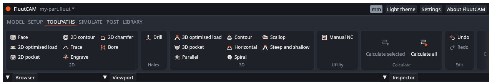

"Parallel 1" appears under Setup 1 with a hollow circle: not calculated yet. It is selected, so the inspector shows its settings, and it uses the 6 mm ball end mill from the built-in starter tools. Look through the five tabs. Every setting already has a default. To use another tool, open the **Tool** tab and choose one from the **Tool** list. The **Heights** tab sets each height as a reference (such as "Stock top") plus an offset.

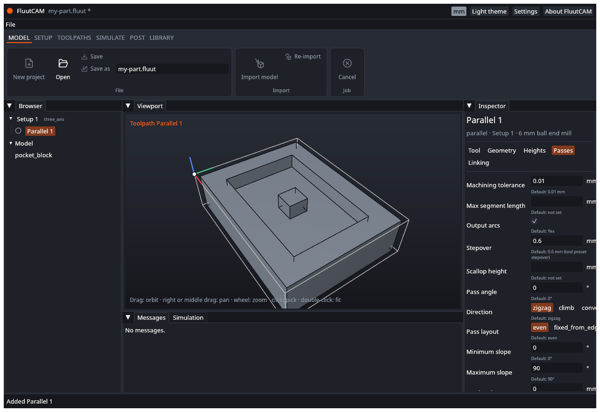

To change a number, click its box, type, and press Enter. For example, set **Stepover** on the **Passes** tab to `1`. [Add a toolpath](Add-a-Toolpath) says more.

## 5. Calculate

In the **Toolpaths** stage click **Calculate all**. The status bar shows a progress bar and the toolpath's name. When it ends the status says "Calculated 1 toolpaths", the circle in the Browser turns green, and the path appears on the model in orange.

If the circle turns into a triangle, open the **Messages** tab. [Diagnostics](Diagnostics) says what each message means.

## 6. Simulate

In the **Simulate** stage click **Simulate**. FluutCAM cuts the stock on the computer, move by move. When it ends, click the **Simulation** tab beside Messages. Press **Play** to watch, drag the slider, or step with **Back** and **Forward** (the ribbon's Simulate stage has play and step buttons too). The stock in the viewport shows what is left. Findings, such as a cut that goes into the part too deep, are listed in the tab.

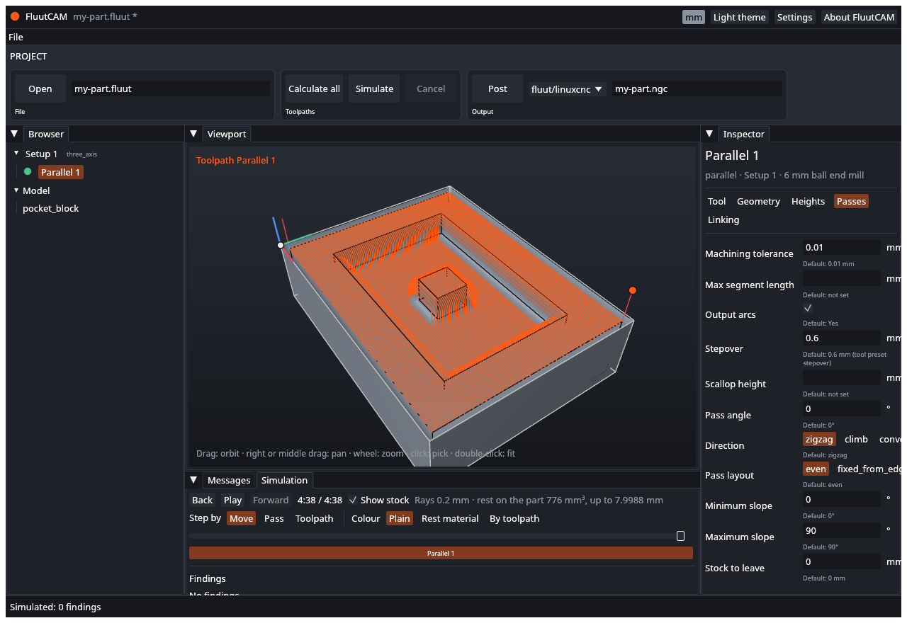

See [Calculate and simulate](Calculate-and-Simulate).

## 7. Choose a post

Open the **Post** stage. The list starts at **fluut/linuxcnc**. Pick the one that matches your controller: `fluut/linuxcnc` for LinuxCNC, `fluut/grbl` for Grbl, or `fluut/gcode` for plain G-code. (`fluut/linuxcnc-4x` is for rotary parts.)

## 8. Post the G-code

Click **Post**. A save dialog opens with the name `my-part.ngc` in the project folder; confirm it or change it. If a toolpath is out of date, FluutCAM calculates it first. When it ends the status bar says "Wrote my-part.ngc".

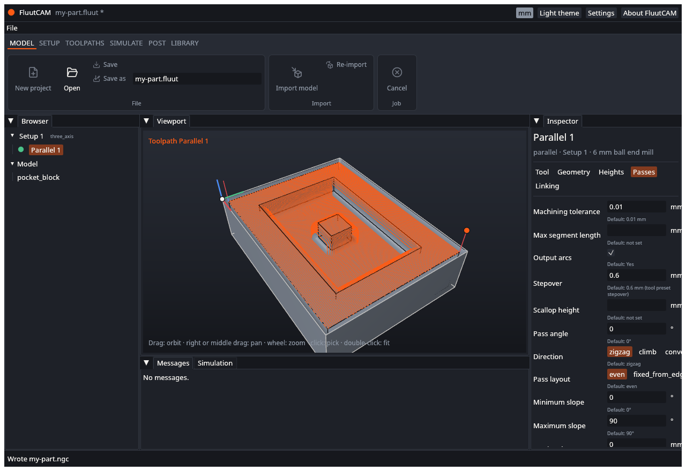

Open the file in a text editor and read it. The first lines are comments with the project name and the post used. Then come the setup lines, the tool change and the moves. [Post G-code](Post-G-code) explains what to check before you run it on a machine.

## 9. Save

In the **Model** stage click **Save** (or press Ctrl+S). The `*` after the name goes away.

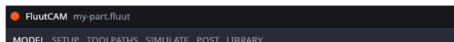

Your project is now the `.fluut` file, the model beside it, and anything else FluutCAM put in the folder. Open it again with **Open** in the Model stage.

## 10. Check before you cut

FluutCAM is early software. Before you put a tool in material:

- Read the G-code, or run it in your controller's simulator or in the air.
- Check that the work zero, the stock and the tool are the ones you meant. The starter tools carry cautious cutting data for MDF only; set your own feeds and speeds for your tool and material.
- Remember that **Simulate** checks the tool and its holder against the stock and the part. It does not know about your clamps, your vise or your machine's limits.

## A 2-D example: a pocket on a picked face

A 2-D toolpath works on faces or curves that you pick on the model. This example cuts a pocket. It needs a STEP file of a plate with a pocket in it. The reference project `plate2d` has one: `crates/fluut-cli/tests/projects/plate2d/plate2d.step`.

1. Do steps 1 to 3 above with that file: new project, **Import model**, **New 3-axis Setup**.
2. In the **Toolpaths** stage click **2D pocket** in the 2D gallery. The toolpath shows a red triangle at first. It has nothing to cut yet, and the Messages tab says "select drive curves or drive faces".
3. In the inspector open the **Geometry** tab. Next to **Drive faces** click **Pick**.
4. A banner at the top of the viewport says "Picking Drive faces". The simulated stock hides, so you can reach the faces. Move the pointer over the model: the face under it lights up. Click the floor of the pocket. It turns orange and the list says "1 selected". Click it again to take it off.
5. Click **Done** (or press Esc) to leave pick mode.

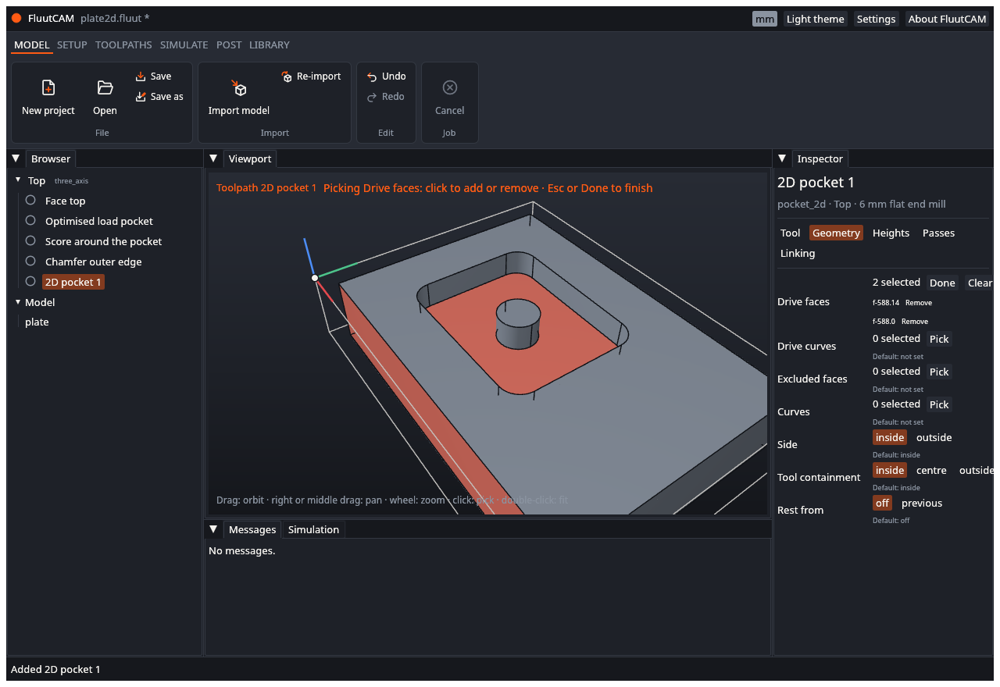

6. Look at the **Heights** tab. **Top** and **Bottom** default to "Selection": the top and bottom of the picked faces.
7. Click **Calculate all**. Then carry on from step 6 above: simulate, choose a post, post, save.

Every pick is one undo step, so Ctrl+Z takes back the last click. [Add a toolpath](Add-a-Toolpath) says what each kind of field can pick.

## What next

- [Import a model](Import-a-Model), [Add a Setup](Add-a-Setup) and [Add a toolpath](Add-a-Toolpath) in more detail.
- [Save, undo and recover](Save-Undo-Recover): undo any step with **Ctrl+Z**.
- [Toolpath types](Toolpath-Types): everything FluutCAM can cut.
- [Command line](Command-Line): calculate and post without the window.
